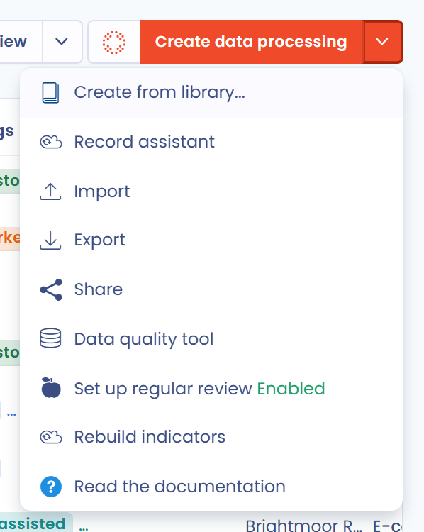
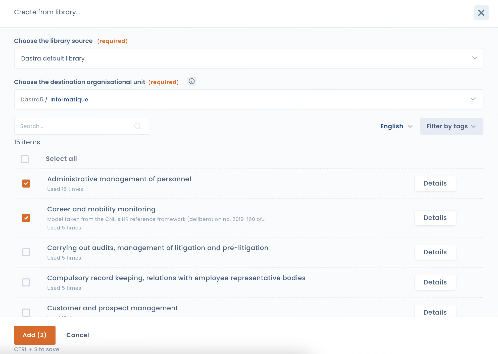

# Eine Verarbeitungsvorlage verwenden

Mit Dastra können Sie Ihr Verarbeitungsverzeichnis anhand von Vorlagen aufbauen, die unsere Fachleute entwickelt haben.

Verarbeitungsvorlagen sparen Zeit, wenn Sie gängige Verarbeitungstätigkeiten erfassen.

## Eine Verarbeitungstätigkeit aus einer Vorlage anlegen

Klicken Sie auf **Erstellen Sie eine Datenverarbeitung**

<figure><figcaption>
Die Schaltfläche Erstellen Sie eine Datenverarbeitung
</figcaption></figure>

und wählen Sie **Basierend auf einer Vorlage**.

<figure><figcaption>
Die Option Basierend auf einer Vorlage
</figcaption></figure>

Anschließend können Sie über die Suchleiste nach Verarbeitungsvorlagen suchen.

<figure><figcaption>
In der Vorlagenbibliothek suchen
</figcaption></figure>

Mehrere Filter helfen Ihnen, die passende Vorlage zu finden:

* Mit **Datenquelle der Bibliothek** wählen Sie die Bibliothek aus, die Sie durchsuchen: **Von Dastra erstellte Vorlagen** oder die Bibliothek Ihres Partners, falls Ihre Organisation eine hat.
* Die Sprachauswahl zeigt die Vorlagen der Standardbibliothek von Dastra in anderen Sprachen an.
* Mit **Tags** filtern Sie die Vorlagen nach Branche.
* **Status** und **Sortieren nach** (**Die neueste Version**, **Beliebteste**, **Alphabetische Reihenfolge**) verfeinern und ordnen die Ergebnisse.

Die Ergebnisse können Sie als Liste oder als Karten anzeigen.

Um **den Inhalt einer Vorlage** vor der Verwendung anzusehen, klicken Sie bei der Vorlage auf die Schaltfläche **Übersicht**.

<figure><figcaption>
Eine Vorlage vor der Verwendung ansehen
</figcaption></figure>

Klicken Sie auf die gewünschte Vorlage, prüfen Sie den **Name der Datenverarbeitung**, wählen Sie die **Organisationseinheit** und klicken Sie auf **Erstellen Sie eine Datenverarbeitung**. Sie gelangen zur neuen Verarbeitungstätigkeit, die Sie an Ihre Organisation anpassen können.

## Eine Verarbeitungsvorlage vorschlagen

Wenn Ihre Suche keine Vorlage aus der Standardbibliothek von Dastra ergibt, können Sie mit **Fordern Sie eine Vorlage an** eine Vorlage bei unserem Team vorschlagen: Geben Sie den **Name des gewünschten Modells** ein, ergänzen Sie bei Bedarf **Weitere Informationen** und klicken Sie auf **Senden**. Mit **Bitte probieren Sie es mit KI aus.** können Sie die Verarbeitungstätigkeit auch mit unserem KI-Assistenten erzeugen.

<figure><figcaption>
Eine neue Vorlage vorschlagen
</figcaption></figure>

## Mehrere Verarbeitungstätigkeiten gleichzeitig aus Vorlagen anlegen

Sie können mehrere Verarbeitungsvorlagen auswählen und sie über die Bibliothek in einem Schritt importieren.

Öffnen Sie das Menü der Schaltfläche **Erstellen Sie eine Datenverarbeitung** (der Pfeil rechts daneben) und wählen Sie **Erstellen Sie auf der Grundlage von Vorlagen**.

<figure><figcaption>
Der Eintrag Erstellen Sie auf der Grundlage von Vorlagen
</figcaption></figure>

Wählen Sie im sich öffnenden Bereich die **Datenquelle der Bibliothek** und die Organisationseinheit (**Bitte wählen Sie die gewünschte Organisationseinheit aus.**), aktivieren Sie dann eine oder mehrere Vorlagen und klicken Sie auf **Hinzufügen**.

<figure><figcaption>
Mehrere Vorlagen in der Bibliothek auswählen
</figcaption></figure>

Mit der Schaltfläche **Details** sehen Sie eine Vorschau einer Vorlage.

Ihre Verarbeitungstätigkeiten werden anschließend im Hintergrund angelegt.
