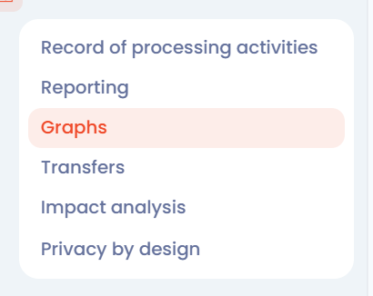

# Datenkartierung des Verzeichnisses anzeigen

## Einführung

In Dastra können Daten auf mehrere Arten angezeigt werden. Eine davon ist die **Datenkartierung** des Verarbeitungsverzeichnisses.

Mit dieser Ansicht erkunden, analysieren und verstehen Sie die Verknüpfungen zwischen den Elementen Ihres Verzeichnisses: Verarbeitungstätigkeiten, Organisationseinheiten, Stakeholder, Assets, Datenkategorien, Sicherheitsmaßnahmen, Übermittlungen usw.

## Die Datenkartierung des Verzeichnisses anzeigen

Um die Datenkartierung Ihres Verzeichnisses anzuzeigen, klicken Sie im linken Menü auf **Verarbeitungsverzeichnis** und dann auf **Data Mapping**.

<figure><figcaption>
Der Eintrag Data Mapping des Menüs Verarbeitungsverzeichnis
</figcaption></figure>

Anschließend können Sie die **Datenkartierung Ihres Verzeichnisses anzeigen**.

<figure><figcaption>
Beispiel einer Kartierung
</figcaption></figure>

Mit der Symbolleiste über der Karte können Sie:

* vergrößern und verkleinern,
* die Karte auf einige Verarbeitungstätigkeiten, auf eine Organisationseinheit oder mit Filtern einschränken,
* die anzuzeigenden **Typen** von Elementen wählen,
* im Menü **Aktionen** den Zoom zurücksetzen, in den Vollbildmodus wechseln, die Karte drucken und **Dunkler Hintergrund**, **Legende der Knoten** oder **Legende zu den Links** aktivieren.

Klicken Sie auf ein Element der Karte, um im rechten Bereich seine **Details zum Knoten** anzuzeigen, mit einer Schaltfläche **Bearbeiten**, um es zu öffnen.


Sobald die Karte angezeigt wird, fügen Sie ein Element mit einem Doppelklick zu den gefilterten Knoten hinzu und fokussieren die Karte darauf. Mit der Suchleiste im Bereich **Gefilterte Knoten** finden Sie ebenfalls ein Element und fügen es als Filter hinzu. Klicken Sie auf **Filter löschen**, um wieder die gesamte Karte anzuzeigen.


## Weiterführende Informationen


[Übermittlungskarte anzeigen](transfers-map.md)

