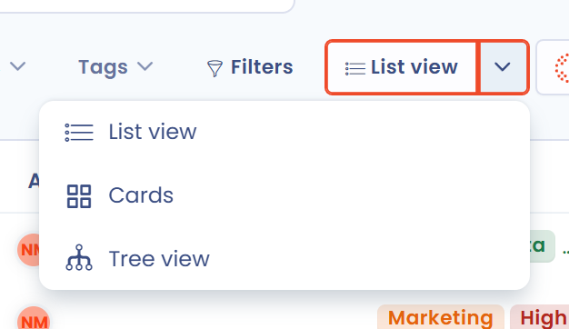

# Baumstruktur der Verarbeitungen anzeigen

## Einführung

In Dastra können Daten auf mehrere Arten angezeigt werden. Eine davon ist die **Baumstruktur der Verarbeitungstätigkeiten**, gegliedert nach Entitäten und Abteilungen.

Diese Ansicht zeigt insbesondere, welchen Entitäten und Abteilungen Ihre Verarbeitungstätigkeiten zugeordnet sind.

## Die Baumstruktur der Verarbeitungstätigkeiten anzeigen

Um die Baumstruktur der Verarbeitungstätigkeiten anzuzeigen, öffnen Sie das Modul **Verarbeitungstätigkeiten**, klicken auf den Pfeil rechts neben der Schaltfläche **Tabelle** und wählen dann **Baumstruktur**.

<figure><figcaption>
Pfeil rechts neben der Schaltfläche Tabelle und Dropdown-Menü
</figcaption></figure>

Anschließend können Sie die **Baumstruktur** Ihrer Verarbeitungstätigkeiten **anzeigen**.

<figure><figcaption>
Die Baumstruktur der Verarbeitungstätigkeiten in Dastra
</figcaption></figure>

Jede Entität und jede Abteilung wird mit der Zahl der ihr zugeordneten Verarbeitungstätigkeiten angezeigt. Sind Adresse und Vertreter ausgefüllt, erreichen Sie sie über das Hilfesymbol neben dem Namen. Klicken Sie auf den Pfeil am Zeilenanfang, um eine Organisationseinheit aufzuklappen und ihre Untereinheiten und Verarbeitungstätigkeiten mit **Schritt**, **Typ**, **Fortschritt** und **Tags** anzuzeigen.

Klicken Sie auf eine Verarbeitungstätigkeit, um ihre Details anzuzeigen. Ihr Aktionsmenü, das erscheint, wenn Sie mit dem Mauszeiger über die Zeile fahren, ermöglicht es, sie zu bearbeiten, zu kopieren, zu exportieren, zu teilen oder in den Papierkorb zu verschieben.


Mit den Filtern über der Baumstruktur passen Sie die Ansicht an Ihre Bedürfnisse an. Nutzer, die die Organisationseinheiten verwalten, können im Aktionsmenü einer Einheit außerdem diese bearbeiten oder eine untergeordnete Einheit hinzufügen und im Menü neben der Schaltfläche **Erstellen Sie eine Datenverarbeitung** **Eine Abteilung erstellen** verwenden.


## Weiterführende Informationen


[Organisationseinheiten erstellen und konfigurieren](../../../getting-started/setup/organizational-units.md)

