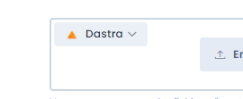

# OneDrive/SharePoint- und Google-Drive-Integrationen

## Vorteile eines eigenen Cloud-Speichers

Standardmäßig basiert das [Dokumentenmanagementsystem](../files/README.md) von Dastra auf Azure Blob Storage: Die Dateien werden verschlüsselt, auf Viren geprüft und redundant auf einem zweiten Server gespeichert. Weitere Einzelheiten finden Sie in der [Sicherheitsdokumentation](../../security/general.md).

In manchen Organisationen dupliziert dieser Speicher ein bestehendes Cloud-Dateisystem (SharePoint, OneDrive, Google Drive). Dastra ist nativ in diese Anbieter integriert, um diese Duplizierung zu vermeiden:

* **Microsoft OneDrive & SharePoint**: ein OneDrive oder eine **SharePoint-Dokumentbibliothek** Ihrer Microsoft-365-Organisation;
* **Google Drive**.

<figure><figcaption>
Dateien können in Dastra, in OneDrive & SharePoint oder in Google Drive gespeichert werden
</figcaption></figure>

## Verbindungsart: OAuth des Nutzers


Diese Integration verwendet eine **OAuth-Authentifizierung mit den Zugangsdaten eines Nutzerkontos**. Es handelt sich nicht um eine Verbindung auf Anwendungsebene über die Microsoft Graph API oder die Google API.

In der Praxis bedeutet das:

* Die Verbindung wird **im Namen des Nutzers** hergestellt, der die Integration konfiguriert
* Der Zugriff auf die Dateien hängt von den **Berechtigungen dieses Kontos** ab
* Wird das Konto deaktiviert oder werden seine Token widerrufen, funktioniert die Integration nicht mehr, bis sie neu verbunden wird
* Es wird empfohlen, für die Konfiguration dieser Integration ein **dediziertes (nicht persönliches) Dienstkonto** zu verwenden


## Die Integration einrichten

Öffnen Sie **Mandanteneinstellungen** > **Integrationen** und klicken Sie auf **Microsoft OneDrive & SharePoint** oder **Google Drive**.

Klicken Sie auf **Integration hinzufügen**. Sie werden zur Anmeldeseite des Anbieters weitergeleitet, wo Sie den Zugriff auf Ihren Speicher autorisieren müssen.

### Das Laufwerk wählen (nur OneDrive & SharePoint)

Nach der Authentifizierung listet Dastra die Laufwerke auf, die das verbundene Konto erreichen kann. Wählen Sie unter **Bitte wählen Sie das Stammverzeichnis aus.** das Laufwerk, das Dastra verwenden soll:

| Option | Beschreibung | Empfehlung |
| --- | --- | --- |
| **Name der Site / Name der Bibliothek** (zum Beispiel `Root site / Documents`) | Eine Dokumentbibliothek einer SharePoint-Site Ihrer Organisation | Für den Unternehmenseinsatz empfohlen: gemeinsamer Bereich, nicht an ein persönliches Konto gebunden |
| **Your personal drive** | Persönliches OneDrive des verbundenen Kontos | In der Produktion vermeiden: gewährt Zugriff auf alle Dateien des persönlichen Laufwerks |

Klicken Sie auf **Aktualisieren**, wenn eine Site oder Bibliothek, die Sie gerade erstellt haben, noch nicht angezeigt wird.


Wenn Sie ein persönliches Laufwerk verwenden, wird dringend empfohlen, ein dediziertes Dienstkonto zu verwenden, das keine persönlichen Dateien enthält. Sie können auch eine [dedizierte SharePoint-Site](https://learn.microsoft.com/de-de/sharepoint/create-site-collection) erstellen, um die Dateien von Dastra zu isolieren.


### Einen Stammordner wählen (nur OneDrive & SharePoint)

Standardmäßig verwendet Dastra das **Stammverzeichnis des Laufwerks**. Sie können es auf einen Ordner des Laufwerks beschränken:

1. Klicken Sie unter **Root folder** auf **Choose a folder**.
2. Navigieren Sie im Laufwerk und klicken Sie beim gewünschten Ordner auf **Bitte auswählen**. Mit **Use the root of the drive** kehren Sie zur Standardeinstellung zurück.
3. Speichern Sie die Konfiguration.

Dastra speichert seine Dateien dann in diesem Ordner, und die Navigation in Dastra ist darauf beschränkt: Nutzer können nicht darüber hinaus navigieren. So geben Sie am einfachsten einen einzelnen Ordner einer SharePoint-Bibliothek für Dastra frei, ohne den Rest der Bibliothek offenzulegen.

<figure><figcaption>
Das Laufwerk und den Stammordner wählen
</figcaption></figure>


Der Stammordner begrenzt, was Dastra anzeigt und wohin es schreibt. Er ändert nicht die Berechtigungen des verbundenen Kontos in Microsoft 365: Dieses Konto behält den Zugriff auf alles, was es bereits öffnen konnte. Um den Zugriff auch auf der Microsoft-Seite zu beschränken, verbinden Sie die Integration mit einem Dienstkonto, das nur Zugriff auf die gewählte Bibliothek oder den gewählten Ordner hat.


Wird der Stammordner in SharePoint oder OneDrive gelöscht oder verschoben, zeigt Dastra einen Fehler an und fordert Sie auf, in den Einstellungen der Integration einen anderen Ordner zu wählen.

## Cloud-Dateien an eine Dastra-Entität anhängen

Bei jeder Entität (Verarbeitungstätigkeit, Aufgabe, Stakeholder …) können Sie Dateien anhängen, die in Ihrer Cloud gespeichert sind:

1. Öffnen Sie das Dateipanel der Entität
2. Wählen Sie oben links im Panel die **Datenquelle**

3. Navigieren Sie über den Dateimanager in Ihrem Laufwerk
4. Klicken Sie auf **Bitte wählen Sie im Manager aus**, um die Datei anzuhängen

Sie können neue Dateien auch direkt aus Dastra in Ihr Laufwerk hochladen.

Ein Speicher, dessen Anwendungsfall in den Einstellungen der Integration deaktiviert ist, wird nicht mehr als Datenquelle angeboten.

## Einschränkungen

### OneDrive & SharePoint

* Die Verbindung verwendet OAuth des Nutzers, nicht die Microsoft Graph API. Wird das Konto, das die Integration eingerichtet hat, deaktiviert, wird die Verbindung unterbrochen.
* Dastra arbeitet nur im gewählten Laufwerk und, falls festgelegt, in dessen Stammordner.
* Für Unternehmensumgebungen sollten Sie eine SharePoint-Dokumentbibliothek einem persönlichen Laufwerk vorziehen.

### Google Drive

* Nur Dateien, die **aus Dastra heraus erstellt** wurden, können in Google Drive hinzugefügt oder geändert werden. Dastra hat keine Zugriffsrechte auf Dateien, die direkt in Drive erstellt wurden. Das ist eine Einschränkung des OAuth-Connectors.
* In Dastra erstellte Dateien können ohne Einschränkung mit anderen Mitarbeitenden geteilt werden.
