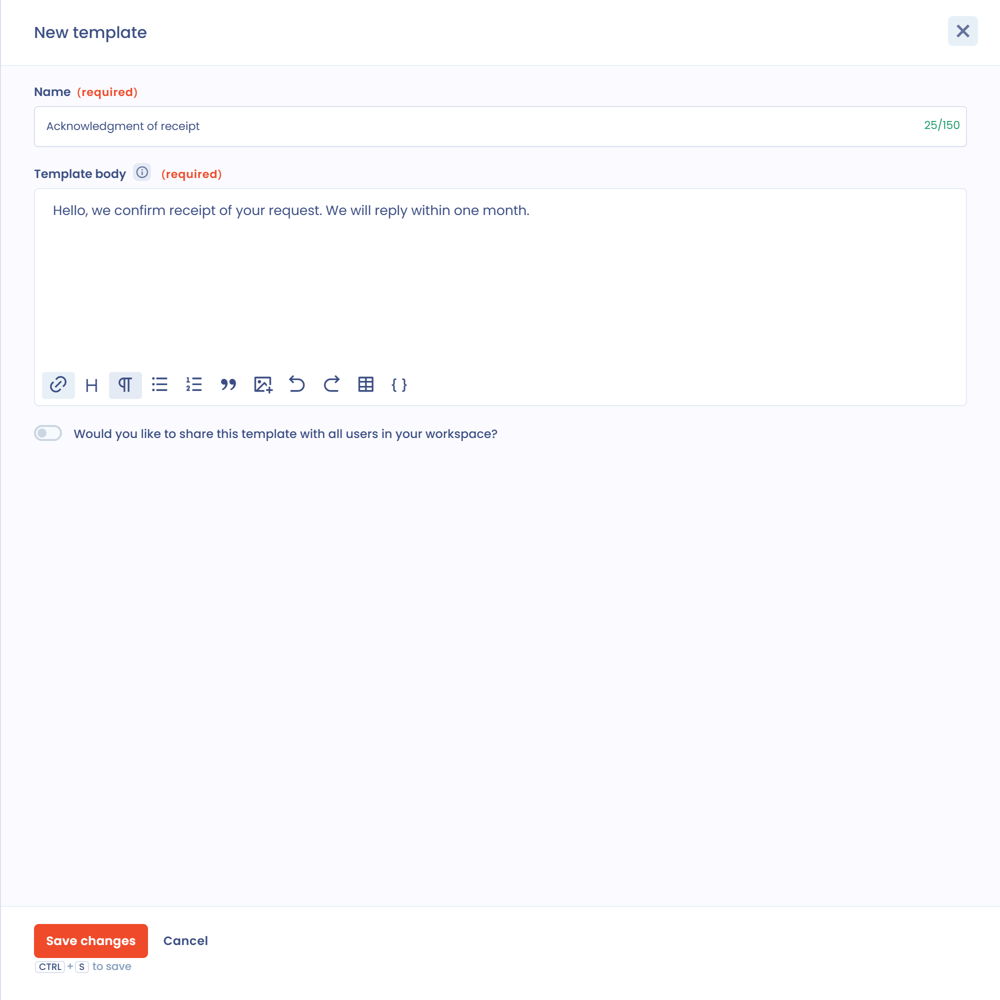
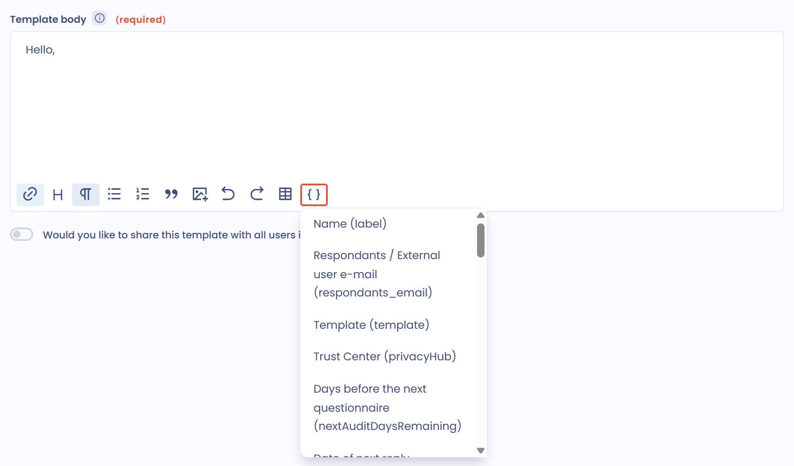

# Nachrichtenvorlagen

Nachrichtenvorlagen sparen Zeit: Sie schreiben sie einmal und verwenden sie in den Modulen von Dastra wieder. Um sie zu verwalten, öffnen Sie **Mandanteneinstellungen** > **Vorlagen**. Dieser Menüeintrag ist für Nutzer sichtbar, die die Schreibberechtigung für Nachrichtenvorlagen haben, entweder für alle Elemente oder für ihre eigenen Elemente.

## Arten von Nachrichtenvorlagen

Jede Art von Vorlage hat auf der Seite einen eigenen Tab. Welche Tabs Sie sehen, hängt von den Modulen ab, die Ihr Tarif enthält.

<figure><figcaption>
Die Liste der Nachrichtenvorlagen, Tab Nachricht zur Betroffenenanfrage
</figcaption></figure>

* **Nachricht zur Betroffenenanfrage**: um beim Austausch mit den Antragstellern Zeit zu sparen. Zum Beispiel eine Vorlage zur Bestätigung des Eingangs einer Anfrage.
* **Aufgabe**: um den Inhalt einer Aufgabenbeschreibung anzupassen, zum Beispiel wenn Sie regelmäßig jemanden bitten, Angaben zu einer Verarbeitungstätigkeit zu ergänzen.
* **Einladung zur Teilnahme an Fragebögen**: um die Einladungen zur Beantwortung eines Fragebogens anzupassen. Dieselbe Nachricht geht an alle Befragten. Sie können zum Beispiel Ihre Auftragsverarbeiter einladen, einen Fragebogen auszufüllen, der die Anwendung des Auftragsverarbeitungsvertrags prüft.
* **Einladungsnachricht zur Verarbeitung**: um einen Dastra-Nutzer einzuladen, eine Verarbeitungstätigkeit ab einem Schritt zu vervollständigen. Schreiben Sie die Vorlage einmal oder bereiten Sie je Empfängerart eine Vorlage vor (Jurist, IT-Leiter usw.).
* **Data breach**: um einen Dastra-Nutzer einzuladen, einen Datenschutzvorfall ab einem Schritt zu vervollständigen, auf die gleiche Weise.

## Eine Vorlage erstellen

Sie können eine Vorlage in den Mandanteneinstellungen oder an der Stelle erstellen, an der Sie die Nachricht schreiben.

In den Einstellungen:

1. Öffnen Sie **Mandanteneinstellungen** > **Vorlagen** und klicken Sie auf den Tab der Vorlagenart, die Sie benötigen.
2. Klicken Sie auf **Vorlage erstellen**.
3. Geben Sie den **Name** der Vorlage (höchstens 150 Zeichen) und den **Modelltext** (höchstens 9.000 Zeichen) ein.
4. Damit alle Nutzer des Mandanten die Vorlage verwenden können, schalten Sie **Möchten Sie diese Vorlage für alle Nutzer Ihres Mandanten freigeben?** ein.
5. Speichern Sie die Vorlage.

<figure><figcaption>
Eine Vorlage erstellen
</figcaption></figure>

## Geteilte und private Vorlagen

Die Liste zeigt für jede Vorlage, ob sie geteilt oder privat ist, zusammen mit der Anzahl ihrer Verwendungen. Eine geteilte Vorlage steht allen Nutzern des Mandanten zur Verfügung. Eine private Vorlage ist nur für ihren Ersteller sichtbar.

Um nur eine der beiden Gruppen anzuzeigen, verwenden Sie den Filter über der Liste (**Alle**, **Geteilt**, **Privat**). Zum Bearbeiten oder Löschen einer geteilten Vorlage ist die Schreibberechtigung für Nachrichtenvorlagen erforderlich; bei einer privaten Vorlage genügt die Berechtigung für eigene Elemente.

## Vorlagen importieren und exportieren

Der Pfeil der Schaltfläche **Vorlage erstellen** öffnet zwei Aktionen:

* **Importieren**: importiert Vorlagen aus einer Datei.
* **Exportieren**: exportiert die Vorlagen der angezeigten Art im Format CSV, XLSX, JSON oder Markdown.

## Benutzerdefinierte Variablen in Vorlagen

Dastra kann die Vorlage automatisch mit Variablen füllen. Sie können in den Text der Vorlage Informationen zu dem Objekt aufnehmen, mit dem sie verknüpft ist. In der Einladung zur Beantwortung eines Fragebogens können Sie zum Beispiel das Fälligkeitsdatum einfügen.

<figure><figcaption>
Die im Vorlageneditor verfügbaren Felder
</figcaption></figure>

Die Vorlagen verwenden die LiquidJS-Syntax. Den vollständigen Leitfaden finden Sie hier: [Tags](https://liquidjs.com/tags/overview.html) und [Filter](https://liquidjs.com/filters/overview.html).

Um Status zu übersetzen, verwenden Sie den benutzerdefinierten Filter `getTranslation` so: `{{ data | getTranslation: '' }}`. Zum Beispiel: `{{ data | getTranslation: 'dataSubjectRequestStates' }}`.

Die benutzerdefinierten Felder des Mandanten stehen als `customFields.<variable name>` zur Verfügung, wobei der Variablenname der Name ist, der im benutzerdefinierten Feld festgelegt wurde (**Name der Variablen (Slug)**).

## Details der Variablenfelder


Diese Liste ist ein Ausgangspunkt: Der technische Name in Klammern ist der, den Sie in der Vorlage verwenden, die Bezeichnungen können aber leicht von denen im Editor abweichen. Die für Ihren Mandanten verfügbaren Felder, einschließlich der benutzerdefinierten Felder, sind die, die der Vorlageneditor anbietet.


### Nachricht zur Betroffenenanfrage

* Titel der Anfrage (`title`)
* Geschlossen von (`closedByUser`)
* Organisationseinheit (`area`)
* Erstellt von (`creator`)
* Bearbeiter (`operator`)
* Sprache (`locale`)
* Archiviert (`archived`)
* Archiviert am (`archivedDate`)
* Betroffenenkategorie (`subjectCategory`)
* Komplexe Anfrage (`complex`)
* Abschlussdatum (`dateClosed`)
* Zusätzliche Informationen (intern) (`description`)
* Nachricht der Anfrage (`message`)
* E-Mail (`email`)
* Telefonnummer (`phoneNumber`)
* Vorname (`givenName`)
* Nachname (`familyName`)
* Aktualisiert am (`dateUpdate`)
* Referenz-ID (`refId`)
* Nutzer-ID (`userId`)
* Abschlussgrund (`closedReason`)
* Beschreibung des Abschlusses (`closedReasonDescription`)
* Ablaufdatum (`expiryTime`)
* Adresse (`address`)
* Postleitzahl (`zipCode`)
* Ort (`city`)
* Land (`countryCode`)
* Datum der Bestätigung der E-Mail-Adresse (`emailValidationDate`)
* E-Mail-Adresse bestätigt (`mailValidated`)
* Quell-URL (`referrerUrl`)
* Identität bestätigt (`identityValidated`)
* Datum der Identitätsprüfung (`dateIdentityValidated`)
* Anfrage-ID (`demandId`)
* Status (`state`)
* Datum (`dateCreation`)
* Workflow-Schritt (`workFlowStep`)
* Erfassungskanal (`channel`)
* Arten von Rechten (`purposes`)
* Nachrichten (`nbMessages`)
* Verbleibende Tage (`remainingDays`)
* Abschlussfrist (Tage) (`closingTime`)
* Tags (`tags`)

### Aufgabenbeschreibung

* Projekt (`project`)
* Sprint (`iteration`)
* Reihenfolge (`order`)
* Inhaber (`owner`)
* Organisationseinheit (`area`)
* Erstellt von (`creator`)
* Verbleibende Tage (`remainingDays`)
* Abschlussfrist (Tage) (`closingTime`)
* Anzahl der Unteraufgaben (`nbSubTasks`)
* Anzahl der abgeschlossenen Unteraufgaben (`nbSubTasksClosed`)
* Id (`id`)
* Interne Referenz (`ref`)
* Archiviert (`archived`)
* Name (`label`)
* Beschreibung (`descriptionHtml`)
* Verknüpft mit (`objectType`)
* Status (`state`)
* Fälligkeitsdatum (`deadline`)
* Startdatum (`startDate`)
* Geschlossen am (`dateClosed`)
* Aktiviert am (`dateActivated`)
* Erstellt am (`dateCreation`)
* Aktualisiert am (`dateUpdate`)
* Quelle (`source`)
* Tags (`tags`)
* Workflow-Schritt (`workFlowStep`)
* Priorität (`priority`)
* Zugewiesen an (`assignedToUser`)

### Einladungen zu Fragebögen

* Vorlage (`template`)
* Datum des nächsten Audits (`dateNextAudit`)
* Dauer des Audits (`auditDurationDays`)
* Anzahl der Korrekturen (`nbCorrections`)
* Anzahl der Validierungen (`nbValidations`)
* Tage bis zum nächsten Audit (`nextAuditDaysRemaining`)
* Id (`id`)
* Name (`label`)
* Alte Version (`isRevision`)
* Name der Version (`revisionDescription`)
* Archiviert (`archived`)
* Überfällig (`isOverdue`)
* Organisationseinheit (`area`)
* Aktualisiert am (`dateUpdate`)
* Archiviert am (`archivedDate`)
* Bewertung (`readiness`)
* Punkte (`score`)
* Abschlussquote (%) (`completionRate`)
* Anzahl der Antworten (`nbAnswers`)
* Anzahl der Fragen (`nbQuestions`)
* Inhaber (`owners`)
* Befragte (`respondants`)
* Aktionsplan erstellt am (`actionPlanDate`)
* Status (`state`)
* Startdatum (`startDate`)
* Abgeschlossen am (`responseDate`)
* Veröffentlichungsdatum (`publishedDate`)
* Erstellt am (`dateCreation`)
* Verknüpftes Objekt (`objectLabel`)
* Fälligkeitsdatum (`deadline`)

### Einladungen zur Vervollständigung von Verarbeitungstätigkeiten

* Organisationseinheit (`area`)
* Workflow-Schritt (`workflowStep.label`)
* ID (`id`)
* Quelle (`source`)
* Name (`label`)
* Status (`state`)
* Erstellt am (`dateCreation`)
* Archivierungsdatum (`dateArchived`)
* Archiviert (`archived`)
* Beschreibung der Version (`versionDescription`)
* Typ (`processingType`)
* Organisationseinheit (`areaId`)
* Assets (`assets`)
* Interne Referenz (`ref`)
* Status der Verarbeitung (`processingState`)
* Dokumentation (`descriptionHtml`)
* Tags (`tags`)
* Inhaber der Verarbeitungstätigkeit (`owner`)
* Stakeholder (`stakeHolders`)
* DSFA erforderlich (`isDPIARequired`)
* Datum der DSFA (`dpiaDate`)
* Von der DSFA befreit (`dpiaExemption`)
* Empfänger (`recipients`)
* Verantwortliche / Kunden (`dataControllers`)
* Datenkategorien (`dataRetentionRules`)
* Zwecke (`purposes`)
* Maßnahmen (`securityMeasures`)
* Kategorien betroffener Personen (`personCategories`)
* Fortschritt (%) (`progression`)
* Qualität (%) (`quality`)
* Sensibilität (%) (`sensitivity`)
* Erstellt von (`creatorUser`)
* Datum der Inbetriebnahme (`dateDeployment`)
* Veröffentlichungsdatum (`datePublication`)
* Zuletzt geändert (`dateUpdate`)
* Beschreibung (`description`)

### Einladungen zur Vervollständigung von Datenschutzvorfällen

* Name (`label`)
* ID (`id`)
* Speicherort der Daten (`location`)
* Verlust der Vertraulichkeit (`access`)
* Verlust der Integrität (`integrity`)
* Verlust der Verfügbarkeit (`availability`)
* Ursache (`reason`)
* Quelle (`source`)
* Beteiligte Auftragsverarbeiter (`processorInvolved`)
* Auftragsverarbeiter (`processors`)
* Sensible Daten (`sensitiveData`)
* Wahrscheinlichkeitsbewertung (`probabilityScore`)
* Auswirkungsgrad (`impactScore`)
* Bewertung (`score`)
* Risikostufe (`riskLevel`)
* Umfang der Datensätze (`dataVolume`)
* Datenträger (`dataSupport`)
* Kommunikation erfolgt? (`communicationDone`)
* Grund für fehlende Kommunikation (`noCommunicationReason`)
* Zeitraum (`period`)
* Startdatum (`startDate`)
* Enddatum (`endDate`)
* Datum der Feststellung (`constatationDate`)
* Frist für die Meldung an die Aufsichtsbehörde (`notificationDueTime`)
* Bearbeiter (`operator`)
* Workflow-Schritt (`workFlowStep`)
* Organisationseinheit (`area`)
* Erstellt am (`dateCreation`)
* Aktualisiert am (`dateUpdate`)
* Post-Mortem durchgeführt (`postMortemDone`)
* Tags (`tags`)
* Anmerkungen (`complementaryInformations`)
* Abschlussdatum (`dateClosed`)
* Archivierungsdatum (`dateArchived`)
* Erstellt von (`creator`)
