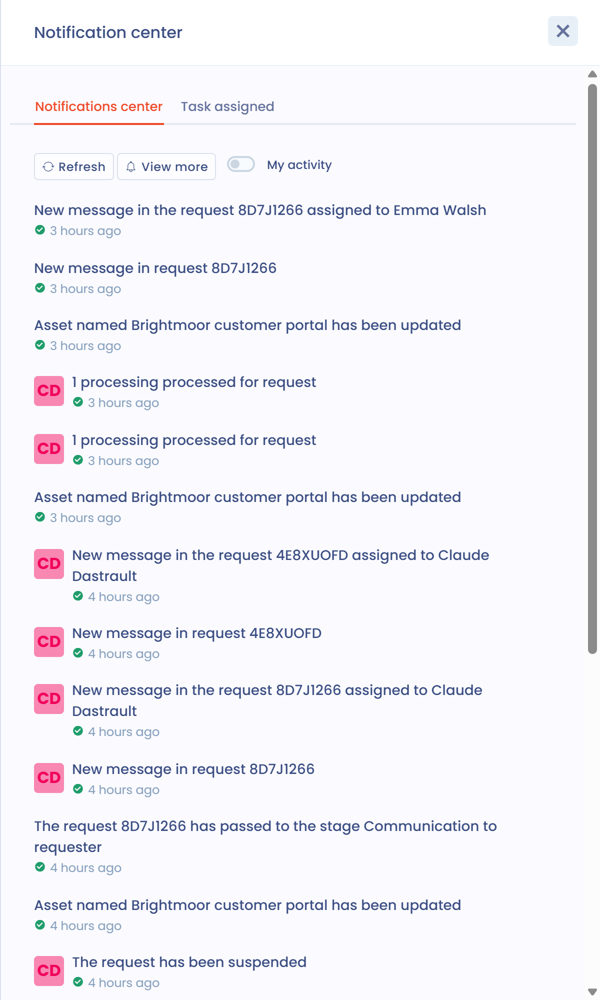

# Benachrichtigungen

## Überblick

Benachrichtigungen in Dastra informieren Sie über wichtige Aktivitäten bei Ihren Verarbeitungstätigkeiten, Fragebögen, Aufgaben und Betroffenenanfragen.

Es gibt **zwei Arten von Benachrichtigungen**:

1. **Das Benachrichtigungscenter**, direkt in die Anwendung integriert.
2. **E-Mail-Benachrichtigungen**, die jeder Nutzer nach seinen Präferenzen anpasst.

## Benachrichtigungscenter (in der Anwendung)

Das Benachrichtigungscenter fasst die Hinweise zusammen, die Sie über das Benachrichtigungssymbol oben rechts auf dem Bildschirm sehen. Es hat zwei Tabs: **Benachrichtigungen** und **Zugewiesene Aufgaben**.

* Es steht allen Nutzern des Mandanten zur Verfügung.
* Es lässt sich nicht anpassen: Es gilt für den gesamten Mandanten.
* Es enthält allgemeine Benachrichtigungen über die jüngste Aktivität: Erstellung, Änderung oder Löschung von Elementen.
* Die Schaltfläche **Aktualisieren** lädt die Liste neu, **Mehr anzeigen** öffnet die Verlaufsseite, und der Schalter **Meine Tätigkeit** beschränkt die Liste auf Ihre eigenen Aktionen.

<figure><figcaption>
Das Benachrichtigungscenter
</figcaption></figure>


Beispiel: „Die Verarbeitungstätigkeit Personalverwaltung wurde geändert“.


## E-Mail-Benachrichtigungen

Jeder Nutzer wählt in seinem Profil, welche Benachrichtigungen er per E-Mail erhält.

### So passen Sie Ihre Benachrichtigungen an

1. Klicken Sie oben rechts in Dastra auf Ihren **Avatar**.
2. Wählen Sie **Benachrichtigungscenter**.
3. Schalten Sie die Ereignisse nach Bedarf ein oder aus. Jede Änderung wird sofort gespeichert.

<figure><figcaption>
Der Eintrag „Benachrichtigungscenter“ im Avatar-Menü
</figcaption></figure>

Die Seite hat drei Blöcke: **Push-Benachrichtigungen** (Desktop-Benachrichtigungen, auch wenn Ihr Browser geschlossen ist), **Marketing** (Anmeldung zum Newsletter und kommerzielle Kommunikation) und **Benachrichtigungen zu Aktivitäten**, der die E-Mail-Ereignisse zusammenfasst. Der Schalter oben in diesem letzten Block schaltet alle Ereignisse auf einmal ein oder aus.


E-Mail-Benachrichtigungen sind ideal, um auf Aktionen aufmerksam zu werden, die eine schnelle Antwort erfordern (Fragebögen, Anfragen, Datenschutzvorfälle usw.).


### Voraussetzung: die Berechtigung Benachrichtigung in der Rolle

Die Anpassung der E-Mail-Benachrichtigungen funktioniert nur, wenn die Rolle des Nutzers sie erlaubt.

In der Konfiguration der Rolle (**Konfiguration der Organisation** > **Rollen und Berechtigungen**) hat jedes Modul ein Kontrollkästchen **Benachrichtigung**. Ist es nicht angekreuzt, erhalten Nutzer mit dieser Rolle für dieses Modul keine E-Mail-Benachrichtigung, unabhängig von ihren persönlichen Präferenzen. Ist es angekreuzt, erhalten sie etwa eine Stunde nach der letzten Aktivität eine gesammelte Benachrichtigung.


Die Rolle öffnet oder schließt das Recht, Benachrichtigungen zu erhalten. Der Nutzer kann seine Präferenzen dann verfeinern, jedoch nur im Rahmen dessen, was seine Rolle erlaubt.


### Benachrichtigungskategorien

E-Mail-Benachrichtigungen sind nach **Kategorien** gegliedert, eine pro Objektart. Jede Kategorie enthält mehrere Ereignisse, die Sie einzeln einschalten können.

| Kategorie                          | Angebotene Ereignisse                                                                                                                           |
| ---------------------------------- | ----------------------------------------------------------------------------------------------------------------------------------------------- |
| Verarbeitungstätigkeit             | Erstellung, Änderung, Statusänderung, Veröffentlichung, Archivierung, Löschung, Beziehungen, Einladung, Überprüfung                              |
| Anfrage                            | Erstellung, Änderung, Statusänderung, neue Nachricht, Zuweisung, Identitätsprüfung, Aussetzung, Anonymisierung                                  |
| Datenschutzvorfall                 | Erstellung, Änderung, Statusänderung, Archivierung, Einladung                                                                                   |
| Aufgabe                            | Erstellung, Änderung, Statusänderung, Erwähnung, Zuweisung, Archivierung, Löschung                                                              |
| Kommentar                          | Neue Nachricht, neue Erwähnung                                                                                                                  |
| Widget zur Einwilligung in Cookies | Erstellung eines Widgets                                                                                                                        |
| Einreichung des Fragebogens        | Antwort abgelehnt, validiert oder abgeschlossen, Einladung, Anmerkungen, Aktionsplan erstellt, Antwort wartet auf Validierung                    |
| Musterfragebogen                   | Erstellung, Änderung, Löschung                                                                                                                  |
| Trust Center                       | Erstellung, Aktualisierung                                                                                                                      |
| Analysenberichte                   | Abonnement des Monatsberichts                                                                                                                   |
| Allgemeine Beziehungen             | Erstellung, Löschung einer Beziehung                                                                                                            |
| Risikobewertung                    | Erstellung, Änderung, Statusänderung                                                                                                            |
| Kontrollpunkt                      | Erstellung, Änderung, Überprüfung                                                                                                               |
| Beitrag                            | Genehmigung, Ablehnung                                                                                                                          |
| Stakeholder                        | Import, Erstellung, Änderung, Statusänderung, Löschung, Überprüfung                                                                             |
| Datenkategorie                     | Import                                                                                                                                          |
| Asset                              | Import, Erstellung, Änderung, Statusänderung, Löschung, Überprüfung                                                                             |
| Betroffenenkategorie               | Import, Erstellung, Änderung, Statusänderung, Löschung                                                                                          |
| Datenfeld                          | Import, Erstellung, Änderung, Statusänderung, Löschung                                                                                          |
| Sicherheitsmaßnahme                | Import, Erstellung, Änderung, Statusänderung, Löschung                                                                                          |
| Team                               | Nutzer hinzugefügt oder entfernt, Erstellung, Änderung, Löschung                                                                                |
| Organisationseinheit               | Team hinzugefügt oder entfernt, Änderung, Löschung                                                                                              |
| Vertrag                            | Erstellung, Änderung, Statusänderung, Löschung, Überprüfung, elektronische Unterschrift, Zuweisung, Ablauf                                      |
| KI-System                          | Erstellung, Aktualisierung, Phasenwechsel, Löschung, Überprüfung, Einladung zur Vervollständigung                                               |
| Compliance-Projekt                 | Erstellung, Archivierung, Statusänderung                                                                                                        |
| Compliance-Audit                   | Erstellung, Archivierung, Abschluss                                                                                                             |
| Testkampagne                       | Erstellung, Abschluss                                                                                                                           |
| Individuelles Reporting            | Erstellung, Änderung, in den Papierkorb verschoben, Wiederherstellung, endgültige Löschung                                                      |

Bei Verarbeitungstätigkeiten können Sie zum Beispiel wählen, ob Sie über eine Änderung, einen Statuswechsel oder das Entfernen einer Beziehung benachrichtigt werden:

<figure><figcaption>
Die Ereignisse der Kategorie Verarbeitungstätigkeit
</figcaption></figure>

Bei Fragebögen können Sie wählen, eine E-Mail zu erhalten, wenn eine Antwort abgelehnt oder validiert wird, bei einer Einladung zur Antwort oder wenn eine Anmerkung hinzugefügt wird:

<figure><figcaption>
Die Ereignisse der Kategorie Einreichung des Fragebogens
</figcaption></figure>

## Automatische Benachrichtigungen

Einige Benachrichtigungen sind **systembedingt**: Sie werden automatisch gesendet, auch wenn Sie die entsprechende Kategorie ausgeschaltet haben.

Diese Benachrichtigungen gelten als wesentlich für die Zusammenarbeit:

* Einladung zu einem **Fragebogen**
* **Zuweisung** einer Aufgabe oder einer Anfrage
* **Direkte Erwähnung** in einem Kommentar (@Ihr-Name)
* Einladung zur Vervollständigung des **Verarbeitungsverzeichnisses**
* Sofortiger Versand einer **geplanten Einladung** (wenn die Option aktiviert ist)

## Bewährte Vorgehensweisen

* Schalten Sie E-Mails für Aktivitäten ein, die ein Handeln von Ihnen erfordern (Fragebögen, Anfragen, Datenschutzvorfälle).
* Prüfen Sie das Benachrichtigungscenter regelmäßig, um einen Überblick über den Mandanten zu behalten.
* Prüfen Sie den Ordner „Benachrichtigungen“ in Ihrem Postfach, wenn Sie glauben, einige Nachrichten nicht mehr zu erhalten.
* Für einen Datenschutzbeauftragten: Schalten Sie alle Kategorien ein.
* Für einen Beitragenden: Priorisieren Sie Aufgaben, Kommentare und Fragebögen.

## FAQ

### Ich erhalte meine Benachrichtigungen nicht mehr. Was soll ich tun?

Prüfen Sie Ihre Präferenzen im **Benachrichtigungscenter** in Ihrem Avatar-Menü. Stellen Sie außerdem sicher, dass E-Mails von Dastra nicht in Ihren Ordner „Werbung“ oder „Spam“ umgeleitet werden.


Standardmäßig erhalten Sie keine Benachrichtigungen über Aktionen, die Sie selbst ausführen.


### Kann ich eine monatliche Zusammenfassung erhalten?

Ja, Sie können eine monatliche Zusammenfassung der Aktivität Ihres Mandanten erhalten. Schalten Sie im **Benachrichtigungscenter** das Ereignis **Preferences : mensual report subscription** der Kategorie **Analysenberichte** ein.

## Siehe auch

* [Ihr Nutzerprofil konfigurieren](../../getting-started/setup/profile.md)
* [Rollen und Berechtigungen verwalten](roles.md)
* [Ihre Fragebögen überwachen](../questionnaires/README.md)
