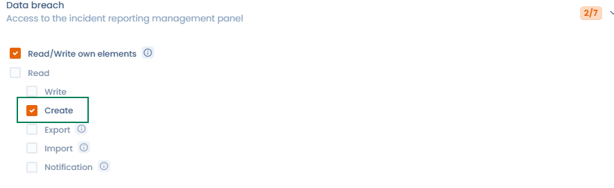

# Rollen und Berechtigungen

## Allgemeine Funktionsweise

Jeder Nutzer kann einer oder mehreren Rollen zugeordnet werden. Die Rollen sind ihrerseits mit einer Liste von Berechtigungen verknüpft (z. B.: im Verzeichnis schreiben, einen Fragebogen erstellen...). Es gibt zwei Möglichkeiten, die den Nutzern zugeordneten Rollen zu verwalten.

* Wenn Sie Inhaber sind, können Sie [diese Kontoverwaltungsoberfläche](https://app.dastra.eu/general-settings/users) verwenden
* Wenn Sie die Rolle eines Mandanten-Administrators haben, können Sie die Rollen und Berechtigungen der Nutzer Ihres Mandanten über [diese Oberfläche](https://app.dastra.eu/workspace/573/settings/users) verwalten.

Die Standardrollen (**Administrator**, **Beitragender**, **Leser**) werden unter [Rollen und Berechtigungen verwalten](../../getting-started/setup/roles.md) beschrieben. Diese Seite erklärt, wie Sie eigene Rollen erstellen.


Eine Rolle reicht nicht immer aus, um ein Element zu sehen: Auch der Zugriff auf **Organisationseinheiten** und die **Teams** des Nutzers zählen. Siehe [Warum sieht ein Nutzer eine Verarbeitung nicht?](../../getting-started/setup/visibility.md)


## Erstellen Sie Ihre eigenen Rollen

Die Seite **Rollen und Berechtigungen** ist den Inhabern der Organisation vorbehalten. Sie erscheint, wenn Ihr Tarif die erweiterte Personalisierung enthält.

Um Ihre eigenen Rollen mit zugehörigen Berechtigungen zu erstellen, gehen Sie auf [diese Seite](https://app.dastra.eu/general-settings/roles):

Sie können eine neue benutzerdefinierte Rolle erstellen, indem Sie auf die Schaltfläche **Eine Rolle hinzufügen** klicken.

<figure><figcaption>
Die Liste der Rollen
</figcaption></figure>

Es ist dann möglich, die den Berechtigungen zugeordneten Kontrollkästchen auszuwählen:

<figure><figcaption>
Erstellung einer Aufgabenverwaltungsrolle
</figcaption></figure>

 

* **Lesen/Schreiben eigener Elemente:** Ermöglicht Nutzern, nur die ihnen zugewiesenen Elemente im Modul zu sehen und zu bearbeiten.
* **Lesen:** Ermöglicht Nutzern, alle Elemente des Moduls zu sehen.
* **Schreiben:** Ermöglicht Nutzern, alle bestehenden Elemente des Moduls zu bearbeiten. In Modulen, die die Berechtigung **Erstellen** anbieten, gewährt **Schreiben** nicht das Recht, neue Elemente zu erstellen.
* **Erstellen:** Ermöglicht Nutzern, neue Elemente im Modul zu erstellen. Diese Berechtigung ist unabhängig von der Berechtigung **Schreiben**.
* **Export:** Ermöglicht Nutzern, alle Elemente des Moduls zu exportieren.
* **Import:** Ermöglicht Nutzern, alle Elemente in das Modul zu importieren.
* **Benachrichtigung:** Die Nutzer erhalten Benachrichtigungen für alle Elemente des Moduls.


Es ist nicht möglich, gleichzeitig „“ und die Berechtigungen für alle Elemente für dieselbe Rolle in einem Modul auszuwählen. Die Nutzer können entweder nur auf ihre eigenen Elemente oder auf alle Elemente zugreifen. Die Berechtigung **Erstellen** ist die Ausnahme: Sie lässt sich zusätzlich auswählen und erlaubt es, neue Elemente zu erstellen.


\
Sobald Ihre benutzerdefinierte Rolle erstellt ist, können Sie sie jedem Nutzer des Mandanten innerhalb Ihrer Organisation zuweisen.

### Berechtigung „Erstellen“

Die folgenden Module bieten eine Berechtigung **Erstellen**, die von der Berechtigung **Schreiben** getrennt ist:

* Aufgaben und Planung
* Verzeichnis und Datenverarbeitung
* Betroffenenanfragen
* Verletzung des Datenschutzes
* Datenkartierung und Referenzsysteme
* Vertragsmanagement
* Verwaltung von KI-Systemen

In diesen Modulen lässt sich **Erstellen** zusammen mit **Lesen** oder mit **Lesen/Schreiben eigener Elemente** auswählen. Eine Rolle, die **Lesen/Schreiben eigener Elemente** und **Erstellen** kombiniert, erlaubt es dem Nutzer, neue Elemente zu erstellen und nur die ihm zugewiesenen Elemente zu bearbeiten. Damit eine Rolle bestehende Elemente bearbeiten kann, ohne neue zu erstellen, wählen Sie **Schreiben**, ohne **Erstellen** auszuwählen.

Die Standardrollen **Administrator** und **Beitragender** enthalten die Berechtigung **Erstellen** in diesen Modulen.

<figure><figcaption>
Die Berechtigung Erstellen kombiniert mit dem Bearbeiten eigener Elemente
</figcaption></figure>

## Eine bestehende Rolle klonen

Um eine Rolle auf Basis einer bestehenden Konfiguration zu erstellen, klonen Sie sie:

1. Klicken Sie in der Liste der Rollen auf das Dreipunkt-Menü in der Zeile der Rolle, die Sie duplizieren möchten.
2. Klicken Sie auf **Klonen**.

Dastra erstellt eine neue Rolle mit allen Berechtigungen der Ausgangsrolle. Ihr Name besteht aus dem Namen der Ausgangsrolle, gefolgt von einer Nummer, zum Beispiel „Beitragender (2)“. Das Bearbeitungsfenster öffnet sich: Benennen Sie die Rolle um und passen Sie die Berechtigungen an.

Die Standardrollen lassen sich nicht bearbeiten: Durch das Klonen können Sie von ihren Berechtigungen ausgehen. Das Klonen eignet sich auch, um Varianten einer Rolle zu erstellen, zum Beispiel eine Rolle „DSB-Beitragender“, die sich leicht von der Rolle „Beitragender“ unterscheidet.
