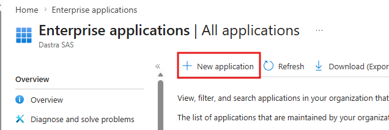
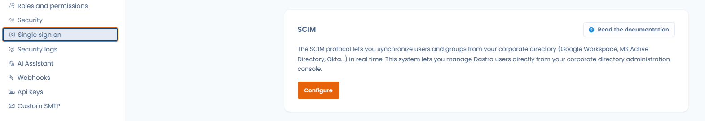
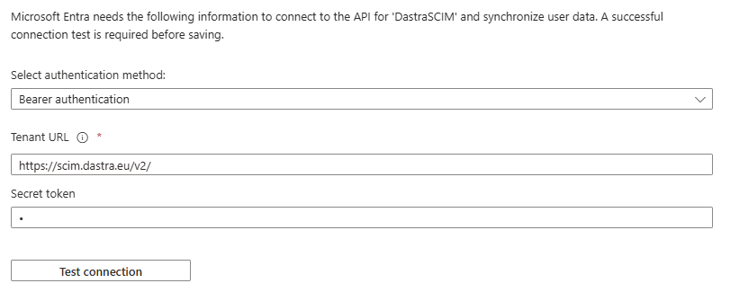
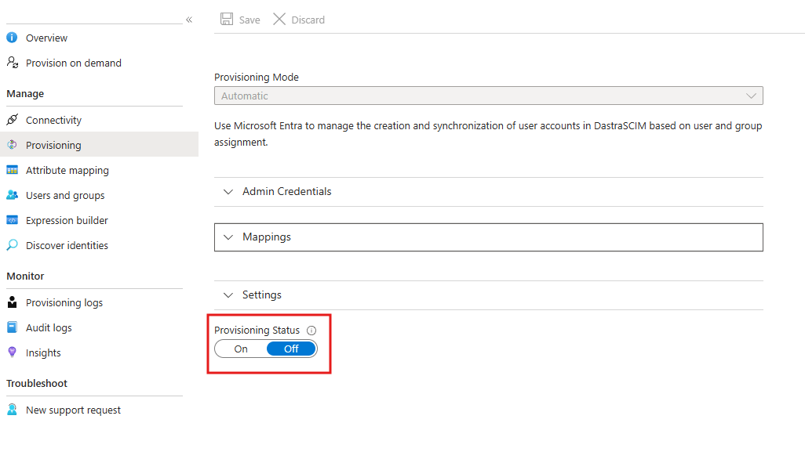

# SCIM

## Funktionsweise

SCIM (System for Cross-domain Identity Management) ist ein offener Standard zur Automatisierung der Nutzerbereitstellung. Das SCIM-Protokoll fungiert als Vermittler: Es sammelt die Identitätsdaten der Nutzer bei den Identitätsanbietern (Microsoft Entra ID, Google Workspace, Okta …) und übermittelt sie an die Dienstanbieter (wie Dastra), die diese Zugangsdaten benötigen.


Die SCIM-Funktion ist Kunden mit einem **Enterprise-Tarif** vorbehalten.

[Siehe unsere Preisseite](https://www.dastra.eu/pricing)



Wir empfehlen dringend, zuerst [SSO einzurichten](sso/README.md) und dabei die **Option „Für alle Nutzer erzwingen“ zu aktivieren**.


## SCIM mit Microsoft Entra ID konfigurieren

Dastra-Nutzer können über SCIM 2.0 hinzugefügt, gelöscht und geändert werden. Sie definieren Gruppen in Entra ID, und Dastra synchronisiert diese Nutzer automatisch, ohne manuelles Eingreifen.

### 1. Im Microsoft-Entra-Portal anmelden

Rufen Sie [https://entra.microsoft.com](https://entra.microsoft.com) auf und melden Sie sich mit einem Administratorkonto an.

### 2. Zu „Enterprise applications“ navigieren

Klicken Sie im linken Menü auf **Entra ID** > **Enterprise applications** > **All applications**.

### 3. Auf „New application“ klicken

Klicken Sie oben in der Anwendungsliste auf **New application**.

<figure><figcaption></figcaption></figure>

### 4. Eine eigene Anwendung erstellen

Klicken Sie auf der Seite „Browse Microsoft Entra App Gallery“ auf **+ Create your own application**.

### 5. Ihre Anwendung benennen und konfigurieren

Gehen Sie im sich öffnenden Bereich so vor:

1. Geben Sie einen Namen für Ihre Anwendung ein (z. B. **Dastra SCIM**).
2. Wählen Sie **„Integrate any other application you don't find in the gallery (Non-gallery)“**.
3. Klicken Sie auf **Create**.

### 6. Die Bereitstellungskonfiguration öffnen

Klicken Sie auf der Seite **Overview** der neu erstellten Anwendung auf **„3. Provision User Accounts“** oder im linken Navigationsmenü auf **Provisioning**.

### 7. SCIM-URL und Token aus Dastra abrufen

Bevor Sie Entra konfigurieren, holen Sie Ihre SCIM-Zugangsdaten aus Dastra.

**Melden Sie sich bei Dastra an** als Inhaber der Organisation. Gehen Sie zu **Organisationseinstellungen** > [**Einmalige Anmeldung**](https://app.dastra.eu/general-settings/sso) > **SCIM**.

<figure><figcaption></figcaption></figure>

Klicken Sie auf die Schaltfläche **Konfigurieren**, um eine neue SCIM-Konfiguration zu erstellen.

<figure><figcaption>
Wählen Sie den Ziel-Mandanten und die Standardrolle für neue Nutzer
</figcaption></figure>

Wählen Sie den zu synchronisierenden **Mandanten** (Teams und Nutzer werden dort automatisch bereitgestellt) und die **Standardrolle**, die neuen Nutzern zugewiesen wird. Die Rollen können von den Dastra-Administratoren weiterhin lokal geändert werden.

Klicken Sie auf **Speichern** und **kopieren Sie anschließend die angezeigte SCIM-URL und das Authentifizierungs-Token**.


Dastra unterstützt die Synchronisierung **eines Mandanten pro Organisation** über SCIM.


### 8. Die automatische Bereitstellung in Entra konfigurieren

Gehen Sie zurück zu Entra, auf die Bereitstellungsseite Ihrer Anwendung:

1. Stellen Sie **Provisioning Mode** auf **Automatic**.
2. Füllen Sie unter **Admin Credentials** Folgendes aus:
   * **Tenant URL**: die aus Dastra kopierte SCIM-URL
   * **Secret Token**: das aus Dastra kopierte Authentifizierungs-Token

<figure><figcaption></figcaption></figure>

3. Klicken Sie auf **Test Connection**, um die Verbindung zu prüfen.
4. Klicken Sie auf **Save**.

Wenn beim Verbindungstest ein Fehler auftritt, prüfen Sie, ob die SCIM-Funktion in Ihrem Abonnement aktiviert ist. [Wenden Sie sich bei Bedarf an den Support](../../getting-started/support/request.md)

### 9. Die Bereitstellung aktivieren

Sobald die Konfiguration gespeichert ist, aktivieren Sie die Bereitstellung, indem Sie den Status auf **On** setzen und auf **Save** klicken.

<figure><figcaption></figcaption></figure>

### 10. Nutzer und/oder Gruppen hinzufügen

Klicken Sie im Navigationsmenü der Anwendung auf **Users and groups** und weisen Sie dann die Entra-Nutzer oder -Gruppen zu, die Sie mit Dastra synchronisieren möchten.

## Ihre Nutzer anmelden lassen

Die Konten Ihres Entra-Verzeichnisses sollten automatisch in Dastra synchronisiert erscheinen. Ist SSO nicht konfiguriert und erzwungen, müssen die Nutzer bei der ersten Anmeldung ihr Passwort zurücksetzen. Ist SSO aktiviert und für alle Nutzer erzwungen, werden sie automatisch zum Anmeldeformular Ihres Identitätsanbieters weitergeleitet (Microsoft Entra ID, Google Workspace, Okta …).

## Verhalten und Grenzen der SCIM-Synchronisierung

### Verwaltung des Nutzerlebenszyklus

**Nutzer in Entra ID deaktiviert**

Wenn ein Nutzer in Entra ID deaktiviert wird:

* Wird sein Profil **in Dastra anonymisiert**.
* Wird der Nutzer später wieder aktiviert:
  * wird ein **neues Nutzerkonto erstellt**,
  * das frühere anonymisierte Konto wird nicht wiederhergestellt.

***

**Vollständige Löschung in Entra ID**

Wenn ein Nutzer dauerhaft aus Entra ID gelöscht wird:

* Wird sein Profil **in Dastra vollständig anonymisiert**.
* Alle früheren Aktionen **bleiben erhalten**.
* Der Nutzer erscheint als **„gelöschter Nutzer“**.

**Auswirkungen auf verknüpfte Daten:**

* Verknüpfte Objekte (z. B. Verarbeitungstätigkeiten, Risiken, Anfragen usw.) werden **nicht gelöscht**.
* Beziehungen (z. B. Inhaber, Zugewiesener) bleiben **erhalten**.
* Nur die Identität des Nutzers wird anonymisiert.

***

### Verwaltung von Gruppen (Teams)

**Gruppe in Entra ID entfernt**

Wenn eine Gruppe in Entra ID entfernt wird:

* Wird das entsprechende **Team in Dastra gelöscht**.
* **Nutzerkonten bleiben aktiv**.
* Einzelne Nutzer sind nicht betroffen.

***

### Zuordnung und Umfang der Synchronisierung

**Gruppen und Mandanten**

* SCIM unterstützt die Synchronisierung **mehrerer Gruppen**.
* Aktuelle Einschränkung:
  * Es kann nur **ein Mandant pro Organisation** synchronisiert werden.
  * Die Synchronisierung mehrerer Mandanten wird **nicht unterstützt**.

***

**Unterstützte Attribute**

Derzeit synchronisiert Dastra:

* bei Nutzern: Anmeldekennung, Vor- und Nachname, E-Mail-Adresse, Aktivstatus, Sprache und Postanschrift (Land, Ort, Postleitzahl, Region); die vollständige Liste finden Sie unter [Welche Attribute und Claims werden unterstützt?](#welche-attribute-und-claims-werden-unterstutzt);
* bei Gruppen: den **Namen (`displayName`)**, die Gruppenkennung (`externalId`) und die **Mitglieder**.

Derzeit nicht unterstützt:

* die Zuordnung zu **Organisationseinheiten**
* die Attribute der Enterprise-Erweiterung (Organisation, Abteilung, Personalnummer, Vorgesetzter …): Identitätsanbieter senden sie standardmäßig, Dastra akzeptiert sie, ohne sie zu speichern.

> Dies könnte künftig über ein spezifisches Attribut mit einer zu Dastra kompatiblen Referenzkennung unterstützt werden.

***

### Lokale Verwaltung in Dastra

Nach der SCIM-Synchronisierung können Administratoren weiterhin:

* **Rollen ändern**
* **Berechtigungen anpassen**

Die feingranulare Zugriffssteuerung bleibt **lokal in Dastra verwaltbar**.

***

### Auswirkungen auf die Lizenzierung

* Die SCIM-Synchronisierung ist begrenzt durch:
  * die **Anzahl der in Ihrem Abonnement enthaltenen Nutzer**.
* Wird das Kontingent überschritten:
  * gibt der SCIM-Server einen **Fehler `403`** vom Typ `limitExceeded` zurück,
  * werden zusätzliche Nutzer **nicht bereitgestellt**.

***

## SCIM-Endpunkte und Discovery

Die SCIM-API von Dastra stellt die standardmäßigen SCIM-2.0-Endpunkte bereit. Alle werden unter Ihrer SCIM-URL angeboten und mit dem SCIM-Token authentifiziert (Anfragen ohne gültiges Token erhalten einen `401`):

| Endpunkt | Zweck |
| --- | --- |
| `/v2/Users` | Nutzer erstellen, lesen, aktualisieren (PATCH) und löschen |
| `/v2/Groups` | Gruppen (Dastra-Teams) erstellen, lesen, aktualisieren (PATCH) und löschen |
| `/v2/ServiceProviderConfig` | Deklariert die Fähigkeiten des SCIM-Dienstes |
| `/v2/ResourceTypes` | Listet die Ressourcentypen (User, Group) auf |
| `/v2/Schemas` | Definition jedes unterstützten Schemas auf Attributebene |

Änderungen erfolgen über `PATCH`; das Ersetzen einer ganzen Ressource mit `PUT` wird nicht unterstützt. Eine erfolgreiche Erstellung (`POST`) gibt `201` mit einem Header `Location` und einem Attribut `meta.location` zurück, das die URL der neuen Ressource angibt.

Die drei **Discovery-Endpunkte** (RFC 7644 §4) sind schreibgeschützt. Identitätsanbieter und SCIM-Konnektoren (Microsoft Entra ID, Okta, eigene Konnektoren usw.) fragen sie ab, um das Attributschema automatisch aufzubauen, ohne manuelle Schemadatei. `/v2/Schemas` beschreibt genau die Attribute, die Dastra liest und schreibt: Es ist die maßgebliche Liste, und ein Attribut, das dort fehlt, wird von der Synchronisierung ignoriert. `ServiceProviderConfig` antwortet auch auf die gängigen Aliasse `/v2/ServiceProviderConfigs` und `/v2/ServiceProviderConfiguration`, da sich die Konnektoren beim Namen nicht einig sind.

Von `ServiceProviderConfig` deklarierte Fähigkeiten, entsprechend dem tatsächlichen Verhalten der API:

* **Unterstützt**: PATCH-Operationen, Filterung (siehe die Einschränkung unten).
* **Nicht unterstützt**: Bulk-Operationen, Sortierung, ETags, Passwortänderung.

### Filterung

Ein Filter enthält **eine einzige Bedingung** mit dem Operator `eq` (gleich) oder `ne` (ungleich) auf eines dieser Attribute:

| Ressource | Filterbare Attribute |
| --- | --- |
| Nutzer | `userName`, `externalId`, `emails.value` |
| Gruppen | `displayName`, `externalId` |

Beispiel: `filter=userName eq "jane.doe@company.com"`. Bei den Attributnamen wird die Groß- und Kleinschreibung nicht beachtet.


Dastra beantwortet nie einen Filter, den es nicht exakt auswerten kann. Ein anderer Operator (`co`, `sw`, `gt` …), ein anderes Attribut oder mehrere mit `and` / `or` verknüpfte Bedingungen liefern einen Fehler `400` vom Typ `invalidFilter`, der das Problem benennt.


### PATCH-Operationen

`PATCH` akzeptiert die drei Formen, die Identitätsanbieter senden: eine Operation mit `path` und einem einfachen Wert, eine Operation mit `path` und einem Objektwert sowie eine Operation ohne `path`, deren Wert die zu ändernden Attribute auflistet. Die Operationen `add`, `replace` und `remove` werden unterstützt.

* **Nutzer**: Die von `/v2/Schemas` aufgelisteten Attribute werden angewendet. Attribute, die Dastra nicht speichert (Enterprise-Erweiterung, Telefonnummern, Titel usw.), werden akzeptiert und ignoriert, damit die Standardzuordnungen von Microsoft Entra ID und Okta ohne Änderungen funktionieren. `userName` und die E-Mail-Adresse können nicht entfernt werden. Das Setzen von `active` auf `false` deaktiviert den Nutzer, wie oben beschrieben.
* **Gruppen**: `displayName` und `externalId` können geändert werden. Mitglieder können hinzugefügt (`add`), insgesamt ersetzt (`replace`) oder entfernt (`remove`) werden, entweder alle auf einmal oder einzeln mit dem Pfad `members[value eq "<user id>"]`.

Ein Nutzer, der nicht zu Ihrer Organisation gehört, wird als nicht gefunden gemeldet (`404`).

### Fehler

Fehler folgen dem SCIM-Format (RFC 7644 §3.12): ein JSON-Body mit `status`, `scimType` und einer Nachricht `detail`, die angibt, was abgelehnt wurde.

| Code | Wann |
| --- | --- |
| `400` | Ungültige Anfrage: fehlender oder fehlerhafter Wert (`invalidValue`), nicht unterstützter Filter (`invalidFilter`), unbekannter Pfad (`invalidPath`), Attribut, das nicht entfernt werden kann (`mutability`) … |
| `401` | Fehlendes oder ungültiges SCIM-Token |
| `403` | Nutzerkontingent Ihres Abonnements erreicht (`limitExceeded`) |
| `404` | Ressource nicht gefunden oder nicht Teil Ihrer Organisation |
| `409` | Ein Nutzer oder eine Gruppe mit derselben Kennung existiert bereits (`uniqueness`) |

***

## Häufig gestellte Fragen

### Welche Rolle spielt SCIM in Dastra?

SCIM ist der **automatisierte Bereitstellungskanal** zwischen Ihrem Unternehmensverzeichnis (Entra ID, Okta, Google Workspace usw.) und Dastra. Seine Rolle ergänzt SSO und ist von ihm getrennt:

|                  | SSO                     | SCIM                                              |
| ---------------- | ----------------------- | ------------------------------------------------- |
| **Rolle**        | Authentifizierung (Anmeldung) | Verwaltung des Nutzerlebenszyklus           |
| **Auslöser**     | Anmeldung des Nutzers   | Aktion im Identitätsanbieter (hinzufügen, ändern, entfernen) |
| **Was es tut**   | Prüft die Identität     | Erstellt, aktualisiert und deaktiviert Konten     |
| **Protokoll**    | SAML 2 / OpenID Connect | SCIM 2.0 (HTTP REST + JSON)                       |

Mit SCIM müssen Sie Konten in Dastra nicht mehr manuell erstellen oder sperren, wenn jemand das Unternehmen verlässt: Ihr Verzeichnis bleibt die **maßgebliche Quelle** für die Identitätsverwaltung.


SCIM verwaltet, **wer in Dastra existiert**. SSO verwaltet, **wie sich diese Personen anmelden**. Beides ist unabhängig voneinander, lässt sich aber ideal kombinieren: über SCIM bereitstellen, über SSO authentifizieren.


***

### Wie läuft die Bereitstellung und Deprovisionierung insgesamt ab?

#### Bereitstellung (Kontoerstellung)

Wenn in Ihrem Identitätsanbieter ein Nutzer oder eine Gruppe der Dastra-Anwendung zugewiesen wird:

1. Sendet der Identitätsanbieter eine Anfrage **`POST /scim/v2/Users`** an den SCIM-Endpunkt von Dastra.
2. Erstellt Dastra das Konto mit der in Ihrer SCIM-Konfiguration festgelegten Standardrolle.
3. Wird der Nutzer dem Ziel-Mandanten hinzugefügt.
4. Wenn SSO aktiviert und erzwungen ist, kann sich der Nutzer sofort ohne Passwort anmelden.

#### Aktualisierungen

Jede Profiländerung im Identitätsanbieter (Name, E-Mail, Sprache, Adresse) löst eine Anfrage **`PATCH /scim/v2/Users/{id}`** aus, die das entsprechende Konto in Dastra aktualisiert. Eine Änderung der Gruppenzugehörigkeit löst eine Anfrage **`PATCH /scim/v2/Groups/{id}`** aus, die die Mitglieder des entsprechenden Teams hinzufügt oder entfernt.

#### Deprovisionierung (Deaktivierung / Löschung)

| Aktion im Identitätsanbieter | SCIM-Anfrage                  | Auswirkung in Dastra                                    |
| ---------------------------- | ----------------------------- | ------------------------------------------------------- |
| Nutzer deaktiviert           | `PATCH` (`active: false`)     | Profil **anonymisiert**                                 |
| Dauerhafte Löschung          | `DELETE /scim/v2/Users/{id}`  | Profil **vollständig anonymisiert**, Daten bleiben erhalten |
| Gruppe entfernt              | `DELETE /scim/v2/Groups/{id}` | Team gelöscht, Nutzer nicht betroffen                   |


Die erneute Aktivierung eines zuvor anonymisierten Nutzers erstellt ein **neues Konto**: Die Historie des alten Kontos wird nicht wiederhergestellt.


***

### Welche Attribute und Claims werden unterstützt?

#### Synchronisierte SCIM-Attribute (Bereitstellung)

Bei der Synchronisierung liest Dastra die folgenden SCIM-2.0-Attribute. `/v2/Schemas` liefert dieselbe Liste.

**Nutzer**

| SCIM-Attribut | Feld in Dastra | Erforderlich |
| --- | --- | --- |
| `userName` | Anmeldekennung, in Ihrer Organisation eindeutig (in der Regel die E-Mail-Adresse) | Ja |
| `emails` | E-Mail-Adresse. Dastra behält eine Adresse: den als `primary` markierten Eintrag, sonst den ersten | Ja |
| `name.givenName` | Vorname | Empfohlen |
| `name.familyName` | Nachname | Empfohlen |
| `active` | Status aktiv / inaktiv | Ja |
| `locale` | Sprache (z. B. `en`, `fr-FR`) | Optional |
| `address` | Land (Code aus zwei Buchstaben), Ort, Postleitzahl, Region (eine einzige Adresse) | Optional |
| `externalId` | Schreibgeschützt: gibt immer denselben Wert wie `userName` zurück. Kann in einem Filter verwendet werden; ein vom Identitätsanbieter gesendeter Wert wird ignoriert | Nicht zutreffend |
| `nickName` | Bei der Erstellung akzeptiert, nie zurückgegeben | Optional |

**Gruppen**

| SCIM-Attribut | Feld in Dastra | Erforderlich |
| --- | --- | --- |
| `displayName` | Teamname (maximal 30 Zeichen) | Ja |
| `externalId` | Gruppenkennung im Identitätsanbieter | Optional |
| `members` | Teammitglieder (Dastra-Nutzerkennungen) | Optional |


Dastra führt pro Nutzer eine einzige Bereitstellungskennung, `userName`. Wenn Sie den `userName` eines Nutzers im Identitätsanbieter ändern, wird er in Dastra aktualisiert; wurde das Konto mit seiner E-Mail-Adresse als `userName` bereitgestellt, folgt die E-Mail-Adresse der Änderung.


#### Bei der Anmeldung verwendete SSO-Claims

Bei der Anmeldung identifiziert Dastra den Nutzer über den E-Mail-Claim, den der Identitätsanbieter sendet. Beide unterstützten SSO-Protokolle verwenden dieselbe Eigenschaft:

| Protokoll      | Verwendeter E-Mail-Claim                                             | Erforderlicher Scope   |
| -------------- | -------------------------------------------------------------------- | ---------------------- |
| SAML 2         | `http://schemas.xmlsoap.org/ws/2005/05/identity/claims/emailaddress` | Keiner                 |
| OpenID Connect | `http://schemas.xmlsoap.org/ws/2005/05/identity/claims/emailaddress` | `openid profile email` |


Die E-Mail-Adresse ist der **Verknüpfungsschlüssel** zwischen SCIM und SSO: Der über SCIM bereitgestellte `userName` muss mit dem bei der SSO-Anmeldung zurückgegebenen E-Mail-Claim **identisch** sein. Jede Abweichung verhindert die Zuordnung des Kontos.


Die vollständige Konfiguration der SSO-Claims finden Sie auf der Seite [Single Sign On (SSO)](sso/README.md).
