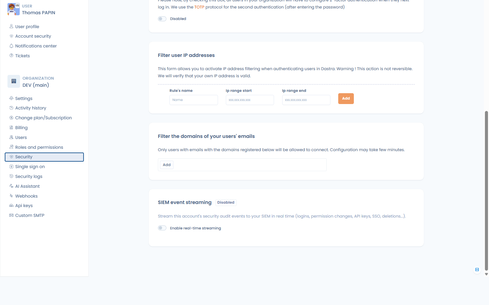
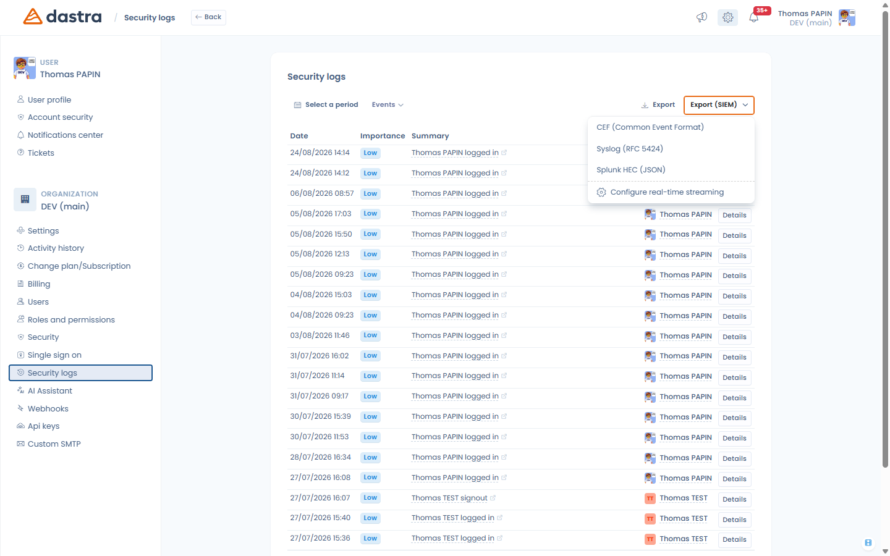

# SIEM-Streaming

### Was ist das?

Das SIEM-Streaming überträgt **die Sicherheits-Auditereignisse Ihres Dastra-Kontos in Echtzeit an Ihr SIEM**: Anmeldungen, Berechtigungsänderungen, API-Schlüssel, MFA- und SSO-Änderungen, Löschungen von Nutzern und Workspaces usw. Alle Auditereignisse des Kontos werden übertragen, damit Ihr Sicherheitsteam den vollständigen Verlauf in dem Tool hat, das es bereits überwacht (Splunk, Sentinel, Sumo Logic, QRadar …).

Unabhängig vom Streaming können die Auditprotokolle auch **manuell in SIEM-Formaten exportiert** werden – siehe [Manueller Export](#manueller-export-aus-den-auditprotokollen) weiter unten.

### Voraussetzungen

* Der **Enterprise-Tarif** (Funktion „Erweiterte Sicherheit").
* Sie müssen **Eigentümer** des Kontos sein: Die Konfiguration befindet sich im **Sicherheitscenter**, unten auf der Seite **Sicherheit** (Abschnitt **SIEM-Ereignis-Streaming**).
* Auf SIEM-Seite: ein über HTTPS erreichbarer HTTP-Event-Collector-Endpunkt (z. B. ein Splunk-HEC-Endpunkt) sowie dessen Token oder API-Schlüssel.

<figure><figcaption>
Der Abschnitt SIEM-Ereignis-Streaming unter Sicherheitscenter > Sicherheit
</figcaption></figure>

### Konfiguration

Füllen Sie das Formular aus und klicken Sie auf **Speichern**:

* **Collector-Endpunkt** (Pflichtfeld) – die HTTP(S)-URL Ihres SIEM-Collectors, z. B. `https://collector.example.com/services/collector/event` für Splunk HEC.
* **Authentifizierung** – wie das Token mit jedem Ereignis gesendet wird:
  * **Bearer** – `Authorization: Bearer <Token>` (Standard),
  * **API Key** – `Authorization: ApiKey <Token>`,
  * **Authorization mit benutzerdefiniertem Schema** – `Authorization: <Schema> <Token>`, wobei Sie das Wort des **Autorisierungsschemas** angeben (z. B. `Splunk` für einen Splunk-HEC-Input, `Api-Token` für Dynatrace),
  * **Custom header** – das Token wird in dem Header gesendet, den Sie unter **Header-Name** angeben (z. B. `X-API-Key`),
  * **None** – kein Authentifizierungs-Header (z. B. wenn das Token Teil der URL ist).
* **Token / API-Schlüssel** – das Token des Collectors. Es wird verschlüsselt gespeichert und nie wieder angezeigt; lassen Sie das Feld später leer, um das aktuelle beizubehalten.
* **Benutzerdefinierte Header (optional)** – zusätzliche HTTP-Header, die mit jedem Ereignis gesendet werden, als Schlüssel/Wert-Paare.
* **Ereignisformat**:
  * **Splunk HEC (JSON)** – das native Format des Splunk HTTP Event Collector. Zwei weitere optionale Felder erscheinen: **Source type** (Standard `dastra:audit`) und **Index**.
  * **Dynatrace (Log Monitoring v2)** – das native Format der Dynatrace-Log-Ingest-API.
  * **CEF (Common Event Format)** – für ArcSight, Sumo Logic und die meisten SIEM, die CEF verarbeiten.
  * **Syslog (RFC 5424)** – strukturierte Syslog-Zeilen.
* **Minimale Schweregrad** – die niedrigste Stufe, die noch übertragen wird: **Alle Ereignisse**, **Notice und höher**, **Warning und höher (Sicherheitsereignisse)** oder **Error und höher**. Die Standardstufe – und empfohlene – ist **Warning und höher**: Sie behalten die sicherheitsrelevanten Signale (fehlgeschlagene Anmeldungen, Änderungen an Berechtigungen, SSO/MFA, API-Schlüsseln, Löschungen …), ohne Ihr SIEM mit alltäglicher Aktivität zu überfluten. Wählen Sie *Alle Ereignisse* nur, wenn Ihr SIEM den vollständigen Auditverlauf verarbeiten soll.
* **TLS-Zertifikat prüfen** – lassen Sie die Option aktiviert; deaktivieren Sie sie nur für einen selbstsignierten Entwicklungs-Collector.

Aktivieren Sie anschließend **Echtzeit-Streaming aktivieren**.


**Gängige Beispiele** – Splunk HEC: Endpunkt `https://<Host>:8088/services/collector/event`, Format *Splunk HEC (JSON)*, Authentifizierung *Bearer* (oder *Authorization mit benutzerdefiniertem Schema* + `Splunk` für klassische HEC-Inputs). Dynatrace: Endpunkt `https://<Umgebung>.live.dynatrace.com/api/v2/logs/ingest`, Format *Dynatrace (Log Monitoring v2)*, Authentifizierung *Authorization mit benutzerdefiniertem Schema* + `Api-Token`.


<figure><figcaption>
Konfiguration des SIEM-Streamings
</figcaption></figure>

### Verbindung testen

**Verbindung testen** sendet ein synthetisches Testereignis mit den Werten des Formulars an Ihren Collector und zeigt das Ergebnis an („Testereignis erfolgreich zugestellt" oder den vom Collector zurückgegebenen HTTP-Fehler). Nutzen Sie die Funktion nach jeder Änderung – der Test erfordert nicht, dass das Streaming aktiviert ist.


Das Streaming gilt für das gesamte Konto (alle Workspaces). Es gibt eine SIEM-Konfiguration pro Konto.


### Was wird an das SIEM gesendet?

Jedes Auditereignis wird einzeln und fortlaufend mit folgendem Inhalt zugestellt:

| Feld | Inhalt |
| --- | --- |
| `id` | Eindeutige Kennung des Auditereignisses |
| `time` / `timestamp` | Zeitpunkt des Ereignisses (UTC) |
| `action` | Ereignistyp, z. B. `UserLogin`, `PermissionChange`, `ApiKeyAdded` |
| `message` | Lesbare Beschreibung |
| `objectType` / `objectId` | Betroffener Datensatz, falls vorhanden |
| `severity` | Schweregrad nach Syslog-Art (siehe unten) |
| `outcome` | `success` oder `failure` |
| `actorId` / `actorName` / `actorEmail` | Wer die Aktion durchgeführt hat |
| `tenantId` / `workspaceId` / `workspaceName` / `areaId` | Wo sie stattgefunden hat |
| `url` | Direktlink zum Datensatz in Dastra |

Sicherheitsrelevante Ereignisse werden unabhängig von ihrer Anzeigepriorität in Dastra im Schweregrad angehoben: Wiederholte fehlgeschlagene Anmeldungen werden als **Error** gesendet (mit `outcome: failure`); Berechtigungsänderungen, das Erstellen/Löschen von API-Schlüsseln, MFA- und SSO-Änderungen, Sperrungen und Löschungen von Nutzern sowie Löschungen von Workspaces werden als **Warning** gesendet. Auf diesem Schweregrad beruht auch die Einstellung **Minimale Schweregrad** – *Warning und höher* (die empfohlene Einstellung) beschränkt den Datenstrom auf diese Sicherheitsereignisse.


Die Ereignisse enthalten Namen und E-Mail-Adresse des Urhebers der Aktion – die Informationen, die bereits im Dastra-Auditprotokoll angezeigt werden. Es werden keine Dateninhalte (personenbezogene Daten von Betroffenen, Dokumentinhalte …) übertragen.


### Manueller Export aus den Auditprotokollen

Sie können den Sicherheits-Auditverlauf bei Bedarf in denselben Formaten exportieren, ohne das Streaming zu konfigurieren:

1. Öffnen Sie **Sicherheitscenter > Sicherheitsprotokolle**.
2. Stellen Sie die Filter (Zeitraum, Workspace …) nach Bedarf ein.
3. Öffnen Sie das Menü **Exportieren (SIEM)** neben der üblichen Export-Schaltfläche und wählen Sie **CEF (Common Event Format)**, **Syslog (RFC 5424)** oder **Splunk HEC (JSON)**.

Die Datei (`dastra-security-logs-<Datum>`) enthält die passenden Auditereignisse, bis zu 100.000, und kann direkt in Ihr SIEM eingelesen werden.

Dasselbe Menü bietet außerdem **Echtzeit-Streaming konfigurieren**, eine Verknüpfung zur oben beschriebenen Streaming-Konfiguration.

<figure><figcaption>
Einmaliger SIEM-Export aus den Sicherheitsprotokollen
</figcaption></figure>

### Fehlerbehebung

* **Test fehlgeschlagen: HTTP 401/403** – prüfen Sie Token und Authentifizierungsschema, die Ihr Collector erwartet (Splunk HEC erwartet das Token so, wie es im HEC-Input konfiguriert ist; manche Collector erwarten einen benutzerdefinierten Header).
* **Test fehlgeschlagen: Zertifikatsfehler** – Ihr Collector verwendet ein Zertifikat, das Dastra nicht prüfen kann. Korrigieren Sie die Zertifikatskette; deaktivieren Sie **TLS-Zertifikat prüfen** nur für einen Entwicklungs-Collector.
* **Es kommen keine Ereignisse an** – prüfen Sie, ob **Echtzeit-Streaming aktivieren** eingeschaltet ist, und sehen Sie in den Ingest-Protokollen Ihres Collectors nach. Mit **Verbindung testen** trennen Sie Konnektivität und Konfiguration.
