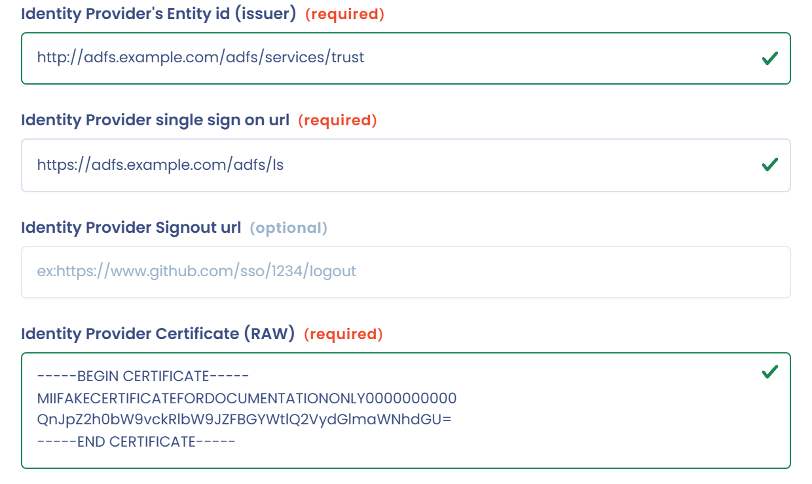
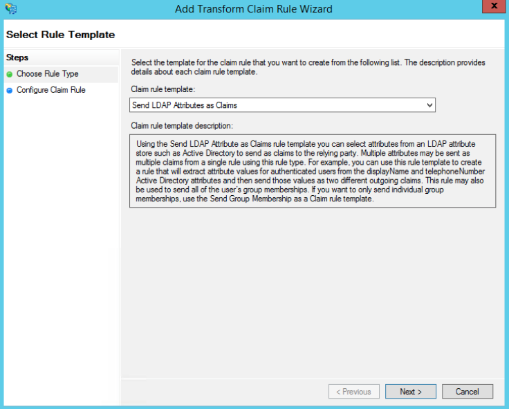

# ADFS

## Über ADFS

Active Directory Federation Services (üblicherweise mit ADFS abgekürzt) sind eine von Microsoft entwickelte Lösung für die einmalige Anmeldung (SSO). Diese Dienste, eine Komponente der Betriebssysteme Windows Server, ermöglichen es Nutzern, sich über Active Directory (AD) zu authentifizieren, wenn sie auf eine Anwendung zugreifen möchten, die die integrierte Windows-Authentifizierung (IWA) nicht verwenden kann.

## ADFS in Dastra konfigurieren

**Schritt 1: Eine SAML-Anmeldung in Dastra erstellen.**

* Öffnen Sie die [Konfigurationsseite der Dastra-SSO-Anmeldungen](https://app.dastra.eu/general-settings/sso) (**Konfiguration der Organisation** > **Einmalige Anmeldung**)
* Klicken Sie auf **SSO-Login hinzufügen**
* Wählen Sie unter **Auswahl des SSO-Protokolls** den Eintrag **SAML2** und dann **Manuelle Konfiguration**
* Geben Sie im Feld **Identitätsanbieter-Entitäts-ID (Aussteller)** die folgende URL ein: `http://<adfs server url>/adfs/services/trust`
* Geben Sie im Feld **Identitätsanbieter (Identity Provider) Single Sign-On-URL** Folgendes ein: `https://<adfs server url>/adfs/ls`

**Schritt 2: Das ADFS-Zertifikat abrufen**

* Öffnen Sie das Verzeichnis **Certificates** des ADFS-Servers
* Rufen Sie das .CER-Zertifikat Ihres ADFS-Servers über das Zertifikat **Token-Signing** ab.

<figure><figcaption></figcaption></figure>

* Klicken Sie auf **View Certificates**.

<figure><figcaption></figcaption></figure>

Kopieren Sie den Code des X509-Zertifikats, indem Sie die CER-Datei mit einem Texteditor öffnen. Fügen Sie ihn in das Zertifikatfeld zwischen `-----BEGIN CERTIFICATE-----` und `-----END CERTIFICATE-----` ein. Ihre Anmeldekonfiguration sollte so aussehen:

<figure><figcaption></figcaption></figure>

**Schritt 3:** Notieren Sie sich die folgenden Werte:

* **SP-Weiterleitungs-URI** (Format: `https://account.dastra.eu/xxxxx-xxxx-xxxx-xxxx/Acs`): die Callback-URL der Anwendung, an die das SAML-Token gesendet wird. Unterstützt werden die Algorithmen SHA-256 und höher. Kopieren Sie sie oben im SAML-Formular.
* **Identitätsanbieter-Entitäts-ID (Aussteller)**, oben im selben Formular angezeigt.

Diese beiden Werte werden verwendet, um den ADFS-Server so zu konfigurieren, dass er SSO-Anfragen von Dastra akzeptiert.

## Den Dastra-Client in ADFS konfigurieren

So konfigurieren Sie das Dastra-SSO mit ADFS SSO SAML2P.

**Schritt 1:** Öffnen Sie auf Ihrem ADFS-Server die **AD FS Management**.

**Schritt 2:** Klicken Sie mit der rechten Maustaste auf **Relying Party Trusts** und wählen Sie **Add Relying Party Trust**. Der Assistent Add Relying Party Trust startet.

<figure><figcaption></figcaption></figure>

**Schritt 3:** Wählen Sie auf dem Bildschirm **Select Data Source** die Option **Enter data about the relying party manually**.

<figure><figcaption></figcaption></figure>

**Schritt 4:** Geben Sie einen **Display name** ein, zum Beispiel „Dastra", und klicken Sie dann auf **Next**.

**Schritt 5:** Wählen Sie **AD FS profile** (SAML 2.0) und klicken Sie auf **Next**.

**Schritt 6:** Klicken Sie auf dem Bildschirm **Configure Certificate** auf **Next**, ohne ein Zertifikat auszuwählen.

**Schritt 7:** Wählen Sie **Enable support for the SAML 2.0 WebSSO protocol**.

<figure><figcaption></figcaption></figure>

Geben Sie im Feld **Relying party SAML 2.0 SSO service URL** die **SP-Weiterleitungs-URI** aus Dastra ein. Sie sieht so aus: `https://account.dastra.eu/xxxx-xxxx-xxxx-xxxx/Acs`

**Schritt 8:** Fügen Sie im Abschnitt **Relying party trust identifier** zwei Werte hinzu: `account.dastra.eu` und `https://account.dastra.eu`.

**Schritt 9:** Klicken Sie auf **Next**, bis der Assistent beendet ist.

**Schritt 10:** Aktivieren Sie das Kontrollkästchen **Open the Edit Claim Rules dialog**, bevor Sie auf **Close** klicken. Das Fenster **Edit Claim Rules** erscheint.

<figure><figcaption></figcaption></figure>

**Schritt 11:** Klicken Sie auf **Add Rule** und wählen Sie die Claim-Regelvorlage **Send LDAP Attributes as Claims**.

<figure><figcaption></figcaption></figure>

**Schritt 12:** Ordnen Sie die Claims wie folgt zu. Die Namen der Claims können je nach Konfiguration Ihres Servers variieren. Dastra benötigt drei Attribute: E-Mail-Adresse (erforderlich), Nachname und Vorname des Nutzers.

<figure><figcaption></figcaption></figure>

**Schritt 13:** Klicken Sie auf **Finish** und dann erneut auf **Add Rule**. Wählen Sie diesmal die Vorlage **Transform an Incoming Claim** und klicken Sie auf **Next**.

**Schritt 14:** Konfigurieren Sie die folgende Regel: **Email Address** => **Name ID** => **Email**.

<figure><figcaption></figcaption></figure>

Klicken Sie anschließend auf **Apply**.

**Schritt 15:** Klicken Sie im Fenster **AD FS Management** mit der rechten Maustaste auf die Relying Party von Dastra und wählen Sie **Properties**. Wählen Sie auf der Registerkarte **Advanced** SHA-256 als sicheren Hash-Algorithmus.

**Schritt 16:** Die Konfiguration ist abgeschlossen.

## Abschluss und Test

Wenn auf beiden Seiten alles konfiguriert ist, gehen Sie zurück zu Dastra und klicken Sie in der Liste der SSO-Anmeldungen rechts neben der Verbindung auf **Testen**.
