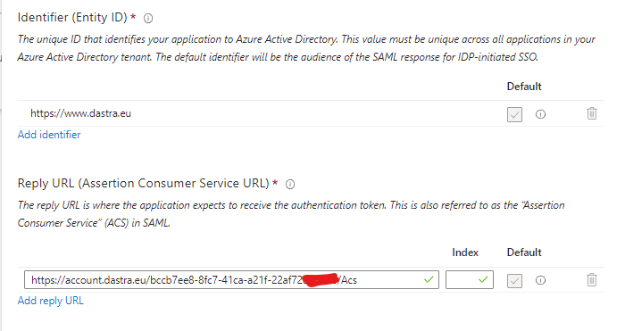
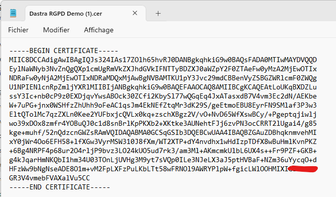
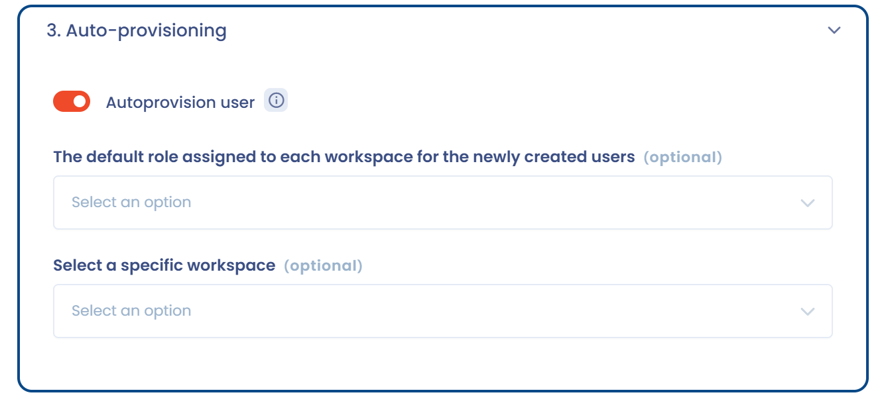

# Active Directory (Microsoft Entra ID)

## Die Anwendung in Microsoft Entra ID konfigurieren

* Öffnen Sie das Microsoft Entra Admin Center: [https://entra.microsoft.com](https://entra.microsoft.com)
* Klicken Sie in der linken Navigation auf **Entra ID** > **Enterprise apps**
* Klicken Sie auf **New application** und dann auf **Create your own application**
* Geben Sie den Namen der Anwendung ein, zum Beispiel „Dastra"
* Wählen Sie **Integrate any other application you don't find in the gallery (Non-gallery)** und erstellen Sie dann die Anwendung
* Klicken Sie im Abschnitt **Manage** auf **Single sign-on** und wählen Sie **SAML**
* Sie gelangen auf diese Seite:

<figure><figcaption></figcaption></figure>

## Den SSO-Client in Dastra konfigurieren

### Schritt 1: Eine SAML-SSO-Anmeldung in Dastra erstellen

* Öffnen Sie die [Konfigurationsseite der Dastra-SSO-Anmeldungen](https://app.dastra.eu/general-settings/sso) (**Konfiguration der Organisation** > **Einmalige Anmeldung**)
* Klicken Sie auf **SSO-Login hinzufügen**
* Wählen Sie unter **Auswahl des SSO-Protokolls** den Eintrag **SAML2** und dann **Manuelle Konfiguration**
* Geben Sie unter **Bezeichnung der SSO-Anmeldung** eine Bezeichnung für die Verbindung ein, zum Beispiel „Active Directory"

### Schritt 2: Die SSO-Anmeldung in Microsoft Entra ID konfigurieren

* Gehen Sie zurück zur SAML-Konfigurationsseite von Microsoft Entra ID
* Klicken Sie im Abschnitt **Basic SAML Configuration** auf **Edit**
* Geben Sie die Verbindungsinformationen ein, die oben im SAML-Formular von Dastra angezeigt werden: **Identifier (Entity ID)** und **Reply URL (Assertion Consumer Service URL)**:

<figure><figcaption></figcaption></figure>

* Klicken Sie auf **Save**
* Gehen Sie direkt zum Abschnitt **SAML Certificates**, um **das Zertifikat im Format Base64 herunterzuladen**:

<figure><figcaption></figcaption></figure>

* Öffnen Sie die CER-Datei mit einem Texteditor (zum Beispiel Notepad) und kopieren Sie den Inhalt (Strg + C):

<figure><figcaption></figcaption></figure>

### Schritt 3: Das Zertifikat zum Dastra-Client hinzufügen

* Gehen Sie zurück zum Bildschirm zur Erstellung der SAML-Verbindung in Dastra
* Fügen Sie den Text des Zertifikats (Strg + V) in das Feld **Identitätsanbieter-Zertifikat (RAW)** ein

### Schritt 4: Die URLs des Identitätsanbieters in Dastra konfigurieren

* Kopieren Sie im Abschnitt **Set up** der Entra-ID-Anwendung die drei Werte **Login URL**, **Microsoft Entra Identifier** und **Logout URL**:

<figure><figcaption></figcaption></figure>

* Fügen Sie sie in Dastra gemäß dieser Zuordnung ein:
  * **Login URL**: **Identitätsanbieter (Identity Provider) Single Sign-On-URL**
  * **Microsoft Entra Identifier**: **Identitätsanbieter-Entitäts-ID (Aussteller)**
  * **Logout URL**: **Identity Provider Abmelde-URL**
* Ihr SSO-Konfigurationsformular in Dastra sollte so aussehen:

<figure><figcaption></figcaption></figure>

* Sie können die Option **Nutzer wird erstellt, wenn der Nutzer noch nie zu Dastra eingeladen wurde** im Abschnitt **Automatische Erstellung von Nutzern** aktivieren. In diesem Fall werden Konten Ihres Verzeichnisses, die in Dastra noch nicht existieren, bei der ersten Anmeldung erstellt:

<figure><figcaption></figcaption></figure>

* Speichern Sie Ihre Änderungen in Dastra


Stellen Sie vor dem Test der Verbindung sicher, dass der neuen Anwendung ein Nutzer zugewiesen ist.


### Ihre SSO-Verbindung testen

Klicken Sie in Microsoft Entra ID im Abschnitt **Test single sign-on** der Anwendung auf die Schaltfläche **Test**. Wenn alles funktioniert, werden Sie zu Dastra weitergeleitet.


Wenn Sie die automatische Nutzererstellung nicht aktiviert haben, verweigert Dastra den Zugriff, bis das lokale Konto durch eine Einladung erstellt wurde.


### Weiterführende Informationen


[Bekannte Probleme](known-problems.md)



[SAML 2](saml.md)

