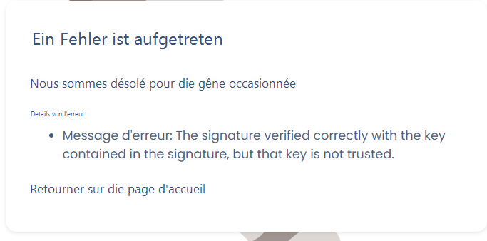

# Bekannte Probleme

Diese Seite fasst die SSO-Vorfälle zusammen, auf die unsere Kunden tatsächlich stoßen, samt Lösungsweg. Sie ist nach **Symptom** gegliedert: Suchen Sie nach dem, was Sie auf dem Bildschirm sehen.


**Richten Sie immer ein Ausnahmekonto ein, bevor Sie SSO für alle erzwingen.**

Wenn Sie „Für alle Nutzer erzwingen" aktivieren und das SSO ausfällt (abgelaufenes Zertifikat, Versionswechsel des Identity Providers, Konfigurationsfehler), **kann sich niemand mehr anmelden — auch Eigentümer nicht**. Tragen Sie mindestens einen Nutzer im Feld **„Von SSO ausgenommene Nutzer"** ein — idealerweise ein lokales Dienstkonto —, damit Sie wieder in die Konfiguration gelangen und sie korrigieren können.


## Die 5 Prüfungen, die zuerst kommen

Gehen Sie vor jeder tiefergehenden Diagnose diese Liste durch:

1. **Testen Sie die Konfiguration.** Die Schaltfläche **Testen** auf der SSO-Verbindungskarte prüft den Dialog mit Ihrem Identity Provider. Schlägt sie fehl, liegt das Problem in der Konfiguration, nicht im Nutzerkonto.
2. **Existiert der Nutzer in der Organisation?** Das SSO ist mit der Organisation verknüpft: Der Nutzer muss in der [Nutzerliste](https://app.dastra.eu/general-settings/users) vorhanden sein.
3. **Stimmt die E-Mail-Adresse exakt überein?** Dastra ordnet das Konto über die **vom Identity Provider zurückgegebene E-Mail-Adresse** zu. Schon ein einziges abweichendes Zeichen genügt, und der Nutzer wird nicht erkannt.
4. **Ist der Nutzer auf Seiten des Identity Providers für die Dastra-Anwendung berechtigt?** Das ist die häufigste Ursache, wenn nur eine einzelne Person betroffen ist.
5. **Testen Sie im privaten Modus** und prüfen Sie, ob **die Uhr des Rechners synchronisiert** ist — eine Zeitabweichung macht die Token ungültig.

***

## Der Nutzer wird vom SSO nicht erkannt

### Die vom IdP zurückgegebene E-Mail-Adresse entspricht nicht dem Dastra-Konto

Mit Abstand die häufigste Ursache. Dastra verwendet den **E-Mail-Claim**, um die SSO-Identität einem bestehenden Konto zuzuordnen. Weichen die beiden Werte voneinander ab, betrachtet Dastra dies als **neuen** Nutzer; ist die automatische Kontoerstellung deaktiviert, wird die Anmeldung daraufhin **abgelehnt**.

Typische Fälle aus der Praxis:

* Das Dastra-Konto lautet `vorname.nachname@firma.com`, der Test-IdP liefert jedoch `vorname.nachname@firma-stg.com`;
* der UPN wurde im Unternehmensverzeichnis geändert (Namensänderung, Domain-Migration), ohne dass dies in Dastra nachgezogen wurde;
* der Nutzer wurde in Dastra mit einer Kurzform seiner Adresse angelegt (`vnachname@…`), während der IdP die Langform zurückgibt.

**Lösung** — gleichen Sie beide Werte in die eine oder andere Richtung an:

* Lassen Sie den IdP exakt die in Dastra hinterlegte Adresse zurückgeben, **oder**
* legen Sie das Dastra-Konto mit der vom IdP gelieferten Adresse an bzw. korrigieren Sie es entsprechend.


Um den tatsächlich übermittelten Wert zu ermitteln, prüfen Sie die SAML-Assertion oder das vom IdP zurückgegebene ID Token (siehe [Diagnoseinformationen sammeln](#diagnoseinformationen-sammeln)).


### Der Name des Claims mit der E-Mail-Adresse passt nicht

Selbst wenn die Adresse korrekt übermittelt wird, findet Dastra sie womöglich nicht: Der Claim wird **über seinen exakten Namen** gesucht.

Standardmäßig erwartet Dastra den Claim:

```
http://schemas.xmlsoap.org/ws/2005/05/identity/claims/emailaddress
```

Manche IdPs veröffentlichen das Attribut jedoch unter einem Kurznamen, zum Beispiel:

```xml
Name="emailaddress"
NameFormat="http://schemas.xmlsoap.org/ws/2005/05/identity/claims/emailaddress"
```

Dastra stützt sich auf die Eigenschaft **`Name`**, nicht auf `NameFormat`: Der Wert ist zwar in der SAML-Antwort vorhanden, der erwartete Claim bleibt aber unauffindbar.

**Lösung**:

1. Öffnen Sie Ihre SSO-Konfiguration, Reiter **Konfiguration**.
2. Ersetzen Sie im Feld **„Der Name des Claims, der die E-Mail-Adresse enthält"** den Wert durch den tatsächlich von Ihrem IdP veröffentlichten Namen (hier: `emailaddress`).
3. Speichern Sie und führen Sie einen neuen Anmeldetest **in einem privaten Browserfenster** durch, damit eine neue Sitzung entsteht.

### Der Nutzer ist auf Seiten des Identity Providers nicht berechtigt

Wenn ein einzelner Nutzer blockiert ist, während sich alle anderen normal anmelden, liegt das Problem fast immer beim IdP.

**Lösung**: Prüfen Sie, ob die Person in Ihrem Verzeichnis angelegt **und** der Dastra-Anwendung mit den nötigen Zugriffsrechten zugewiesen ist. Ein guter Unterscheidungstest: Lassen Sie den Nutzer sich **ohne SSO** anmelden (Ausnahmekonto oder Passwort). Funktioniert das, ist das Dastra-Konto in Ordnung und die Blockade kommt von der Berechtigung auf IdP-Seite.

### Der Nutzer ist ein „externer Nutzer"

Das SSO gilt nur für Konten, die **intern** zu Ihrer Organisation gehören. Hatte der Nutzer bereits ein Dastra-Konto (andere Organisation, Testkonto, privates Konto), ist seine **Hauptorganisation** eine andere: Deren Sicherheitseinstellungen gelten, nicht Ihre, und er erscheint bei Ihnen als **externer Nutzer**.

Prüfen Sie seinen Status in der [Nutzerliste der Organisation](https://app.dastra.eu/general-settings/users). Die Zuordnung zur Hauptorganisation lässt sich nicht über die Oberfläche ändern: Wenden Sie sich mit der betroffenen E-Mail-Adresse an den Support.

***

## Die automatische Kontoerstellung funktioniert nicht

### „SSO users autoprovisioning is not allowed for your organization"

Diese Meldung bedeutet, dass die Option **„Automatische Kontoerstellung"** in Ihrer SSO-Konfiguration nicht aktiviert ist. Solange sie deaktiviert ist, kann sich nur ein **bereits in Dastra eingeladener** Nutzer per SSO anmelden.

**Lösung**: Ein **Eigentümer der Organisation** aktiviert die Option in der SSO-Konfiguration, Reiter **Automatische Erstellung der Nutzer**, und wählt die standardmäßig zugewiesene Rolle.


Nur ein **Eigentümer** kann die SSO-Konfiguration ändern. Ein Administrator sieht diese Seite nicht.


### Die Option ist aktiviert, aber es werden trotzdem keine Konten erstellt

Das automatische Provisioning **wird nur ausgelöst, wenn der Nutzer über den SSO-Link kommt**. Für einen Nutzer, der die klassische Anmeldeseite verwendet, wird kein Konto angelegt.

Verteilen Sie den Link Ihrer SSO-Verbindung an Ihre Nutzer, in dieser Form:

```
https://account.dastra.eu/account/loginexternal?provider={ID Ihres Providers}&returnUrl=https://app.dastra.eu
```

Sie erhalten ihn über die Schaltfläche **Link kopieren** auf der Karte der SSO-Verbindung.

### Externe Fragebogen-Befragte werden nicht provisioniert

Wer den SSO-Link nie geöffnet hat, ist kein Dastra-Nutzer: Die automatische Erstellung gilt daher nicht für Befragte, die zu einem externen Fragebogen eingeladen wurden.

Zwei Umgehungslösungen:

* **Konten im Vorfeld provisionieren** — siehe [Import einer Nutzerliste](../../../getting-started/setup/users.md);
* den Fragebogen über ein **Trust Center** verteilen, das Besuchern eine SSO-Anmeldung anbietet.

***

## Authentifizierungsschleife oder Fehler bei der Rückkehr zu Dastra (OpenID Connect)

Symptome: Weiterleitungsschleife zwischen Dastra und dem IdP, Fehler **„An error was encountered while handling the remote login"** oder **HTTP-Fehler 400 beim Abruf des Tokens**.

In diesem Fall funktionieren die Weiterleitung zum IdP und die Authentifizierung: Die **Verarbeitung des OIDC-Rückkanals** schlägt fehl. Prüfen Sie die folgenden Punkte in dieser Reihenfolge.

### Das Feld „Authority/Domain" verweist auf den falschen Endpunkt

Ein sehr häufiger Konfigurationsfehler. Dieses Feld muss **die Root-URL des OIDC-Issuers** enthalten — jene, die `/.well-known/openid-configuration` bereitstellt — und **nicht** den Endpunkt `/authorize`.

| | |
| --- | --- |
| ❌ Falsch | `https://login.beispiel.de/user/IdPOAuth2/authorize/FB6CB139F80BCAEB` |
| ✅ Richtig | `https://login.beispiel.de/user/IdPOAuth2/FB6CB139F80BCAEB` |

Die Endpunkte `/authorize` und `/token` werden anschließend automatisch über das Well-known-Dokument ermittelt.

### Der Antworttyp (response type) ist falsch

Das Feld **Response Type** muss **exakt** einen von Ihrem IdP veröffentlichten Wert enthalten — typischerweise `id_token` oder `code`.

Achten Sie auf Varianten mit Bindestrich: Ein Wert `id-token` statt `id_token` führt zu einer Authentifizierungsschleife samt 400-Fehler beim Abruf des Tokens. Prüfen Sie Zeichen für Zeichen.

Scheitert der Flow `id_token`, versuchen Sie `code`: Manche IdPs erlauben den impliziten Flow nicht.

### Die Authentifizierungsmethode des Token-Endpunkts passt nicht

Wirkt die Konfiguration korrekt, lässt sich das Token aber nicht abrufen, passen Sie das Feld **Authentifizierungsmethode des Token-Endpunkts** an:

1. Versuchen Sie zunächst **`client_secret_basic` (Basic-Auth-Header)**;
2. Reicht das nicht, wechseln Sie auf **Private Key JWT** und füllen Sie die Felder **privater Schlüssel** und **Zertifikatsinhalt** aus.


Seit März 2026 unterstützt Dastra die Authentifizierung per **Private Key JWT**: Ein geheimer Schlüssel muss nicht mehr hinterlegt werden. Denken Sie daran, **einmal zu speichern**, damit die JSON-Public-Key-URI (`jwks_uri`) bereitgestellt wird.


### Das ID Token ist mit HS256 signiert

Je nach Integration kann Dastra eine **asymmetrische RS256-Signatur** verlangen, mit über die `jwks_uri` veröffentlichtem öffentlichem Schlüssel. Ein mit **HS256** signiertes ID Token kann bei der Validierung abgelehnt werden.

Prüfen Sie auf IdP-Seite, ob sich der Dastra-Client mit einer **RS256**-Signatur konfigurieren lässt.

### Weitere auszuschließende Ursachen

* **Die Weiterleitungs-URL ist auf IdP-Seite nicht deklariert.** Sie muss unverändert im Format `https://account.dastra.eu/signin-{schemeId}` in der bei Ihrem Provider deklarierten Anwendung hinterlegt sein (bei Azure etwa unter *App Registration → Authentication*).
* **Die verwendete `redirect_uri` ist nicht exakt identisch** mit der konfigurierten.
* **Der Issuer des Tokens entspricht nicht exakt** der in Dastra konfigurierten URL.
* **Die Scopes sind nicht freigegeben.** Behalten Sie `openid profile email` bei; prüfen Sie, dass alle drei auf IdP-Seite erlaubt sind.
* **Der Claim `email` fehlt im ID Token.**

### „Der Wert des Parameters response\_type ist unbekannt"

Erscheint diese Meldung **auf der Seite Ihres Identity Providers** (und nicht auf Dastra), funktioniert die Weiterleitung: Das Problem liegt in der Deklaration des OIDC-Clients auf IdP-Seite.

Prüfen Sie:

* die auf der im SSO deklarierten Anwendung zugelassenen `response_type`-Werte;
* die Konfiguration des mit Dastra verknüpften OIDC-Clients;
* den verwendeten Delegationsmodus (z. B. CAS/OIDC).

***

## Zertifikatsfehler (SAML 2)

Sie erhalten eine Fehlermeldung dieser Art:

<figure><figcaption></figcaption></figure>

1. **Stellen Sie sicher, dass Sie ein gültiges Zertifikat haben** — ein abgelaufenes Zertifikat erzeugt genau dieses Symptom, oft „über Nacht" und ohne jede Änderung Ihrerseits.
2. **Überprüfen Sie, dass beim Kopieren/Einfügen des Zertifikats keine Zeilenumbrüche oder Leerzeichen eingefügt wurden.**
3. **Prüfen Sie, ob das in Dastra hinterlegte Zertifikat tatsächlich das des IdP der betreffenden Umgebung ist**: Ein häufiger Fehler ist, das Test-Zertifikat in der Produktionskonfiguration stehen zu lassen.

### Ein SSO-Zertifikat erneuern

Die Aktualisierung des Zertifikats erfolgt direkt über die [SSO-Konfiguration Ihrer Organisation](https://app.dastra.eu/general-settings/sso). Ersetzen Sie als **Eigentümer** das aktuelle Zertifikat durch das neue, von Ihren Teams bereitgestellte, und nutzen Sie anschließend die Schaltfläche **Testen**.


Planen Sie den Ablauf vorausschauend: Terminieren Sie die Erneuerung **vor** dem Ablaufdatum und prüfen Sie vor dem Eingriff, dass Ihr SSO-Ausnahmekonto noch funktioniert.


### Die Konfiguration funktioniert in der Testumgebung, aber nicht in der Produktion

Wird die Produktionskonfiguration einer funktionierenden Testumgebung nachgebildet, weichen fast immer drei Parameter ab:

* **die auf IdP-Seite deklarierte ACS- / Reply-URL** muss **exakt** der von Dastra bereitgestellten Produktions-Callback-URL entsprechen — stellen Sie sicher, dass nicht die Test-URL übernommen wurde;
* **das SAML-Zertifikat** muss das des Produktions-IdP sein;
* **die Tenant ID** muss die der Produktion sein. Dieser Parameter wird nicht in Dastra konfiguriert: Er lässt sich nur auf IdP-Seite prüfen.

***

## Der Nutzer meldet sich an, hat aber auf nichts Zugriff

### „Sie sind nicht berechtigt, auf diese Funktion oder Ressource zuzugreifen (area/entity)"

Wenn sich der Nutzer **korrekt authentifiziert** und anschließend bei der Auswahl seines Mandanten auf dieser Seite landet, liegt das Problem nicht beim SSO, sondern bei seinen **Berechtigungen**.

Eine in der Produktion identifizierte Ursache: Der Nutzer trägt eine **benutzerdefinierte Rolle, die überhaupt keine Berechtigung enthält**. Dastra kann ihm dann keinen Zugriff gewähren und leitet ihn auf diese Seite um.

**Lösung**: Öffnen Sie die betreffende Rolle und weisen Sie ihr **mindestens eine Berechtigung** zu, passend zum erwarteten Zugriffsniveau. Cache leeren oder weiter am SSO suchen ist nicht nötig.


[roles-et-permissions.md](../roles.md)


### Fehler „Zugriff verweigert (401)" nach der SSO-Anmeldung

Bevor Sie das SSO verdächtigen, prüfen Sie, ob **die Uhr des Rechners mit dem Internet synchronisiert** ist: Die Ablauffristen der Token werden mit der Zeit des Rechners verglichen. Das ist eine klassische Ursache für einen 401 direkt nach erfolgreicher Authentifizierung.

Siehe auch den Abschnitt 401 in den [allgemeinen bekannten Problemen](../../../other/known-problems.md).

***

## Änderung der E-Mail-Adresse und Domain-Migration (UPN)

In Dastra ist **die E-Mail-Adresse die strukturgebende Kennung des Kontos**: Sie trägt Identifikation, Einladungen, Authentifizierung und die Zuordnung zu Plattformelementen. Daher lässt sie sich nicht in großer Zahl über die Administrationsoberfläche ändern.

Die unmittelbare Folge für das SSO: Ändert sich der UPN im Verzeichnis, ohne dass die Adresse in Dastra nachgezogen wird, **wird der Nutzer nicht mehr erkannt**.

| Situation | Vorgehen |
| --- | --- |
| Ein einzelner Nutzer | **Der Nutzer ändert seine Adresse selbst** in den Einstellungen seines Profils. Diese Aktion kann nur die betroffene Person ausführen. |
| Domain-Migration in großer Zahl | Ein von Dastra durchgeführter Ausnahmevorgang, **in einem einzigen Durchgang**, auf Basis einer vollständigen, geprüften Datei, die Sie übermitteln (alte Adresse ↔ neue Adresse). Eröffnen Sie vorab ein Support-Ticket. |


Für eine Massenmigration gelten drei Regeln:

* **ein einziger Durchgang** — aufeinanderfolgende Teilmigrationen erzeugen Inkonsistenzen beim SSO, bei der Nutzeridentifikation, den Rechten und den Zuordnungen;
* **keine Zwischenadresse** — übermitteln Sie direkt die **endgültige Zieladresse**; dasselbe Konto kann nicht zweimal migriert werden;
* **rechnen Sie mit Nebenwirkungen** — laufende Betroffenenanfragen und Fragebögen können die alten Adressen enthalten: Geben Sie ausdrücklich an, ob sie ebenfalls aktualisiert werden sollen.



Löschen Sie Konten nicht „der Geschwindigkeit halber" und legen Sie sie neu an: Sie verlören die Historie und die Verknüpfung zwischen der Person und den von ihr verantworteten Elementen. Beachten Sie außerdem: Wird ein gelöschter Nutzer erneut eingeladen, bleiben Vor- und Nachname erhalten — das ist das erwartete Verhalten.


***

## Zwei SSO-Konten im selben Browser

Es ist **nicht möglich, mehrere verschiedene SSO-Konten gleichzeitig** über denselben Browser oder denselben Rechner anzumelden, auch nicht mit getrennten Browserprofilen.

**Umgehung**: Melden Sie sich beim zweiten Konto mit **klassischer Authentifizierung** (E-Mail / Passwort) statt per SSO an. Unterliegt dieses Konto dem SSO, tragen Sie es bei den **ausgenommenen Nutzern** ein.

Dieses Verhalten erklärt auch manche Fehler im privaten Modus, wenn andernorts bereits eine SSO-Sitzung geöffnet ist.

***

## Die Anmeldemaske des Identity Providers erscheint bei jeder Anmeldung

Bei OpenID Connect weicht der Ablauf leicht von SAML ab:

* **Bei der ersten Anmeldung** gibt der Nutzer seine E-Mail-Adresse auf der Dastra-Anmeldeseite ein; damit wird seine Organisation ermittelt und er zu Ihrem Identity Provider weitergeleitet. Ein Cookie merkt sich diesen Provider dann als bevorzugte Anmeldemethode;
* **bei den folgenden Anmeldungen** wird der Nutzer automatisch zum IdP weitergeleitet, ohne seine Adresse erneut einzugeben.

Erscheint die Anmeldemaske systematisch, obwohl auf IdP-Seite bereits eine Sitzung aktiv ist, kann eine OIDC-Einstellung die Anzeige des Authentifizierungsbildschirms erzwingen. Prüfen Sie diesen Punkt auf Seiten des Identity Providers und melden Sie es dem Support, falls das Verhalten bestehen bleibt.

***

## Das SSO funktioniert nach einem Versionswechsel des IdP nicht mehr

Ein Upgrade Ihrer Identitätsinfrastruktur (Versionswechsel von OpenAM oder ADFS, Migration nach Entra ID …) kann Zertifikate, Validierungsmechanismen und die Behandlung der OIDC-Flows verändern. Typisches Symptom: eine **Authentifizierungsschleife**, obwohl sich auf Dastra-Seite nichts geändert hat.

**Vorgehen**:

1. Arbeiten Sie in einer **Test- / Sandbox-Umgebung**, niemals direkt in der Produktion.
2. **Erstellen Sie die SSO-Konfiguration vollständig neu**, statt die bestehende zu korrigieren — so schließen Sie einen aus der alten Version geerbten Parameter aus.
3. Achten Sie besonders auf die **Aktualisierung und Validierung der Zertifikate**.
4. Gehen Sie die Prüfungen aus dem Abschnitt [OpenID Connect](#authentifizierungsschleife-oder-fehler-bei-der-ruckkehr-zu-dastra-openid-connect) oben erneut durch.

***

## Niemand kann sich mehr anmelden


Aus Gründen der Sicherheit und der Zugriffs-Governance **erstellt und ändert das Dastra-Support-Team keine Nutzerkonten innerhalb von Kundenorganisationen** und erzeugt keine Anmeldedaten. Nur ein **Eigentümer Ihrer Organisation** kann dies tun.


Wenn das SSO für alle erzwungen ist und ausfällt:

1. Melden Sie sich mit einem **SSO-Ausnahmekonto** an (vorab im Feld „Von SSO ausgenommene Nutzer" hinterlegt).
2. **Deaktivieren Sie über dieses Konto die SSO-Verbindung**, solange Sie die Konfiguration korrigieren, damit die Nutzer wieder per Passwort arbeiten können.
3. Korrigieren, mit der Schaltfläche **Testen** prüfen, dann wieder aktivieren.

Existiert kein Ausnahmekonto, wenden Sie sich umgehend an den Support und nennen Sie den Namen Ihrer Organisation. Legen Sie eines an, sobald der Zugriff wiederhergestellt ist.

***

## Diagnoseinformationen sammeln

Lässt sich das Problem mit den obigen Punkten nicht lösen, ermöglicht ein Netzwerk-Export unseren Teams die genaue Analyse des Authentifizierungsflusses. So gehen Sie vor.

**Schritt 1 — Entwicklertools öffnen**

* Öffnen Sie ein **privates Browserfenster** (Chrome oder Edge).
* Drücken Sie `F12` (oder `Strg + Umschalt + I`).
* Wählen Sie den Reiter **Network** (Netzwerk).

**Schritt 2 — Protokollerhaltung aktivieren**

Aktivieren Sie die Option **Preserve log**. Sie ist unerlässlich: Ohne sie geht der Verlauf bei den Weiterleitungen zwischen Dastra und Ihrem Identity Provider verloren.

**Schritt 3 — Das Problem reproduzieren**

Starten Sie die SSO-Anmeldung und gehen Sie bis zum Fehler oder zur Weiterleitungsschleife. **Schließen Sie das Fenster nach dem Fehler nicht.**

**Schritt 4 — Exportieren**

* **Option A (empfohlen)**: Rechtsklick in die Anfrageliste → **„Save all as HAR with content"** / „Alles als HAR mit Inhalt speichern", dann übermitteln Sie uns die Datei `.har`.
* **Option B**: Screenshots des Reiters Network, einschließlich der Anfragen `/authorize`, `/token`, `/signin` sowie aller fehlerhaften Anfragen (400, 401, 403 …).

**Schritt 5 — Den Kontext beschreiben**

Teilen Sie uns außerdem mit:

* wann genau die Blockade auftritt: beim Klick auf den SSO-Link, bei Anzeige der Authentifizierungsseite, nach Eingabe der Zugangsdaten oder nach Absenden des Anmeldeformulars;
* die **exakte Fehlermeldung** (Screenshot);
* für OIDC: **Issuer**, **client\_id** und **redirect\_uri** auf IdP-Seite, den **Signaturalgorithmus** des Tokens sowie die zurückgegebenen Claims (`sub`, `email`, `preferred_username` …), sensible Daten maskiert;
* für SAML: die empfangene **Assertion** (sensible Daten maskiert).


Eine **Videoaufzeichnung** des gesamten Ablaufs (z. B. per Loom) mit geöffneten Entwicklertools beschleunigt die Diagnose erheblich.

Am hilfreichsten ist ein **Testkonto**, das sich über Ihr SSO authentifizieren kann und denselben Zugriffstyp wie die betroffenen Nutzer besitzt: Damit können wir den Ablauf von Anfang bis Ende nachstellen. Das Konto kann temporär sein und nach Abschluss der Untersuchung gelöscht werden.



[faire-une-demande-de-support.md](../../../getting-started/support/request.md)

