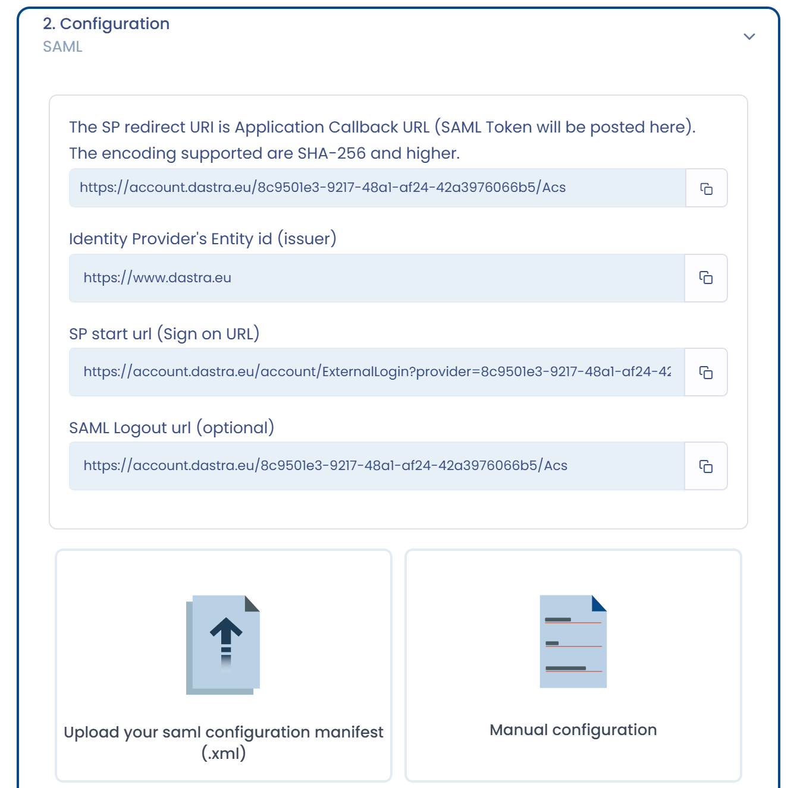

# SAML 2

Die Einrichtung des SSO mit SAML 2 umfasst drei Schritte:

* den Authentifizierungsanbieter (**Identity Provider - IdP**) konfigurieren: Active Directory, Google Workspace usw.;
* den Dienstanbieter (**Service Provider - SP**) konfigurieren: Dastra;
* die Authentifizierung testen.

Für **ADFS-Server** gibt es eine eigene Seite:


[adfs.md](adfs.md)


## 1. Den Authentifizierungsanbieter konfigurieren

Richten Sie bei Ihrem Authentifizierungsanbieter eine SAML-Konfiguration ein.

* Für AD FS: siehe die Seite [ADFS](adfs.md).
* Für Microsoft Entra ID (früher Azure AD): siehe die Seite [Active Directory (Microsoft Entra ID)](entra-id.md) und die [Microsoft-Dokumentation](https://learn.microsoft.com/en-us/entra/identity/enterprise-apps/add-application-portal-setup-sso).
* Für Google: [https://support.google.com/a/answer/6087519?hl=de](https://support.google.com/a/answer/6087519?hl=de)

Um die lokalen Konten (die in Dastra gehosteten) zu verknüpfen, müssen Sie eine Eigenschaft mit der E-Mail-Adresse des Nutzers übermitteln (standardmäßig sucht Dastra nach der Eigenschaft mit dem Namen [http://schemas.xmlsoap.org/ws/2005/05/identity/claims/emailaddress](http://schemas.xmlsoap.org/ws/2005/05/identity/claims/emailaddress)). Diesen Namen können Sie im Feld **Der Name des Anspruchs, der die E-Mail-Adresse enthält** ändern.

Diese Informationen benötigen Sie, um den Dienstanbieter auszufüllen:

* **Identitätsanbieter-Entitäts-ID** (Aussteller);
* **Single Sign-On-URL**;
* **das Zertifikat im RAW-Format** (Base64-codiert).

Um Ihren Authentifizierungsanbieter zu konfigurieren, benötigen Sie die folgenden Informationen, die oben im SAML-Formular in Dastra angezeigt werden:

* **Aussteller (Issuer)**: standardmäßig `https://www.dastra.eu`;
* **SP-Weiterleitungs-URI** (ACS): `https://account.dastra.eu/{connection identifier}/Acs`. Diese URL ist für jede Verbindung spezifisch: Kopieren Sie sie oben im SAML-Formular, wenn Sie die SSO-Anmeldung in Dastra hinzufügen (Schritt 2), und speichern Sie diese Anmeldung dann;
* **SP-Start-URL (Anmelde-URL)**, wenn Ihr Anbieter eine Anmelde-URL für die Anwendung verlangt;
* **SAML-Abmelde-URL (optional)**, wenn Ihr Anbieter die Abmeldung verwaltet.

## 2. Den Dienstanbieter konfigurieren

Öffnen Sie in Dastra die [Administrationsseite des SSO](https://app.dastra.eu/general-settings/sso) (**Konfiguration der Organisation** > **Einmalige Anmeldung**, nur für Inhaber der Organisation verfügbar) und klicken Sie auf **SSO-Login hinzufügen**. Wählen Sie das Protokoll **SAML2**.

<figure><figcaption></figcaption></figure>

Wählen Sie dann, wie Sie die Konfiguration Ihres Identitätsanbieters angeben:

* **Bitte laden Sie Ihre SAML-Konfigurationsdatei (.xml) hoch.**: Laden Sie die Metadatendatei (XML-Manifest) hoch, die Ihr Anbieter bereitstellt. Dastra füllt die Formularfelder anhand dieser Datei aus. Klicken Sie auf die Zurück-Schaltfläche, um die Methode zu wechseln.
* **Manuelle Konfiguration**: Füllen Sie die Felder selbst aus.

<figure><figcaption></figcaption></figure>

Füllen Sie bei der manuellen Konfiguration die Formularfelder mit den Informationen Ihres Authentifizierungsanbieters aus:

<figure><figcaption></figcaption></figure>


Sie können alle Nutzer der Organisation zwingen, ein bestimmtes SSO zu verwenden (Option **Für alle Nutzer erzwingen**). Vorsicht: Wenn das SSO nicht funktioniert, können Sie als Administrator nicht mehr auf Ihr Konto zugreifen. Halten Sie ein lokales Ausweichkonto bereit oder nehmen Sie Nutzer über das Feld **Bestimmte Nutzer, die von der SSO ausgenommen sind (z. B. Sicherheitsadministratoren)** aus (siehe [Single Sign On (SSO)](README.md)). Die Verwaltung des SSO pro Nutzer ist vorzuziehen.



**Sonderfall externer Nutzer**\
Nur Konten, die zu einem Abonnement gehören, unterliegen dem SSO. Konten externer Nutzer (die ein zusätzliches Abonnement haben) unterliegen dem SSO nicht.


## 3. Das SSO testen

Wenn die Konfiguration abgeschlossen ist, testen Sie die Authentifizierung, indem Sie in der Liste rechts neben der Verbindung auf **Testen** klicken. Wenn Sie auf ein Problem stoßen, eröffnen Sie ein Ticket über die [Supportseite](https://app.dastra.eu/general-settings/support).

<figure><figcaption></figcaption></figure>
