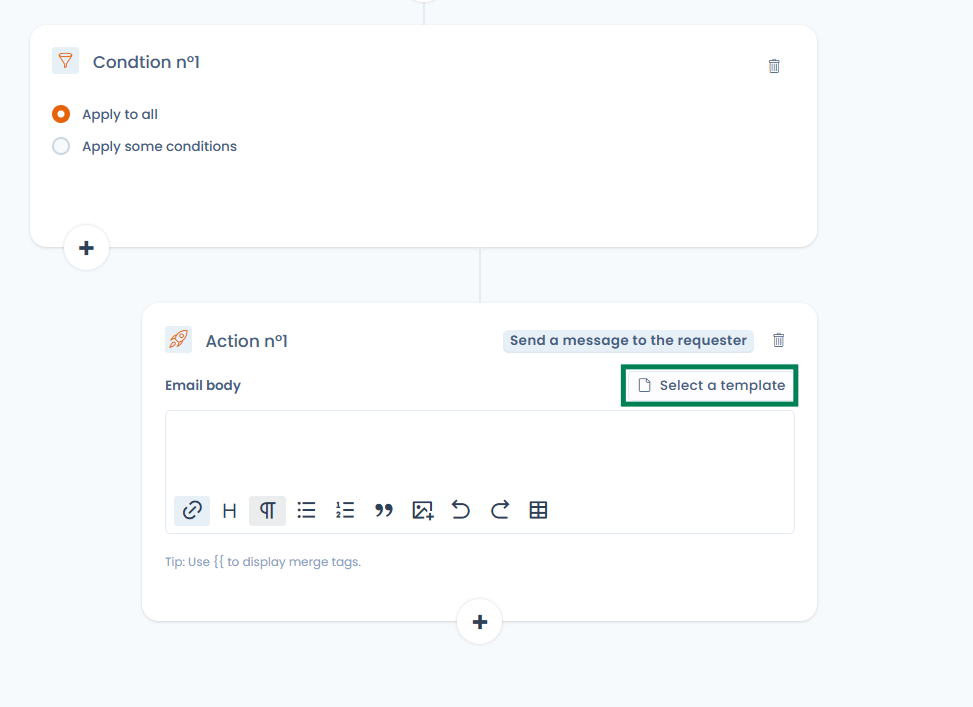
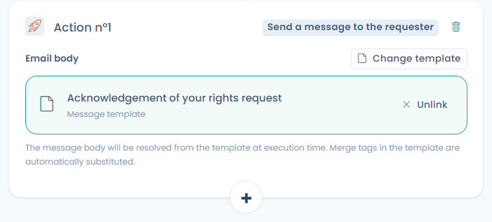
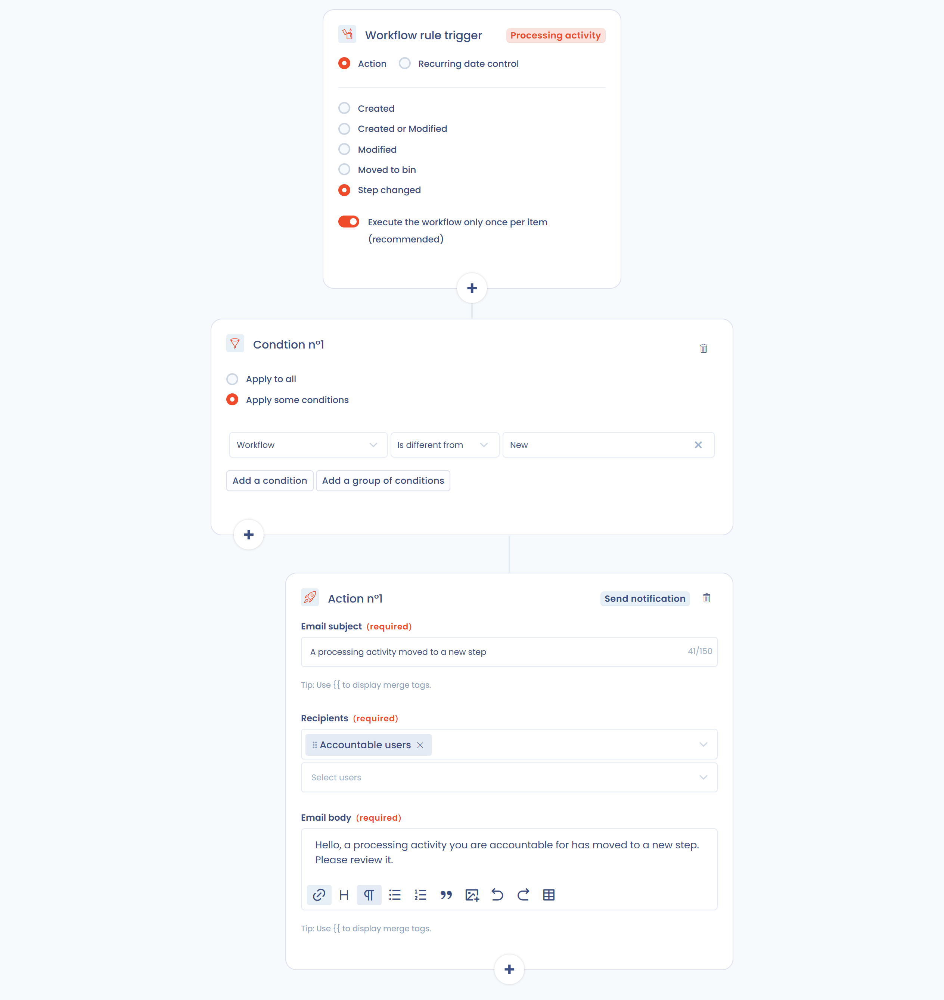

# Workflow-Regeln


**Prozessschritte vs. Workflow-Regeln**

Die [Prozessschritte](workflow-stages.md) definieren die Status, die Objekte durchlaufen (z. B. Neu → In Bearbeitung → Erledigt). Die **Workflow-Regeln** automatisieren Aktionen, wenn diese Schritte oder andere Ereignisse eintreten. Beide Funktionen ergänzen sich.


## Das Funktionsprinzip

Die Workflow-Regeln in Dastra sind eine Reihe von Aktionen (E-Mail-Benachrichtigungen, Planung eines Fragebogens, Aufgaben und Feldaktualisierungen), die ausgeführt werden, wenn bestimmte Bedingungen erfüllt sind. Diese Regeln automatisieren den Prozess des Versendens von E-Mail-Benachrichtigungen, der Aufgabenzuweisung und der Aktualisierung bestimmter Felder eines Datensatzes, wenn eine Regel ausgelöst wird.

Jede Regel folgt einer dreiteiligen Logik: ein Auslöser, Bedingungen und Aktionen.

<figure><figcaption><p>Auslöser, Bedingungen und Aktionen</p></figcaption></figure>

Eine Regel gilt für einen Objekttyp. Die angebotenen Typen hängen von den Modulen ab, die in Ihrem Abonnement aktiviert sind:

| Objekttyp                      |
| ------------------------------ |
| Datenverarbeitung              |
| Anfrage                        |
| Verletzungen des Datenschutzes |
| Aufgabe                        |
| Asset                          |
| Stakeholder                    |
| Daten                          |
| Sicherheitsmaßnahme            |
| Betroffenenkategorie           |
| KI-System                      |
| Vertrag                        |
| Einreichung des Fragebogens    |


Die Anzahl der verfügbaren Workflow-Regeln hängt von Ihrem Plan ab, **von 25 bis 100 Regeln**. Eine zusätzliche Kapazität kann bei Bedarf erworben werden. Kontaktieren Sie Ihren Account Manager für weitere Details.


## Eine Workflow-Regel erstellen

1. Öffnen Sie im Seitenmenü den Eintrag **Workflow-Regeln** oder gehen Sie auf [die Konfigurationsseite der Workflow-Regeln Ihres Mandanten](https://app.dastra.eu/workspace/0/settings/workflow-rules).
2. Klicken Sie auf **Erstellen Sie eine Workflow-Regel**.
3. Wählen Sie **Von Grund auf**, um mit einer leeren Vorlage zu beginnen, oder **Basierend auf einem Modell** (siehe [Bibliothek der Regelvorlagen](#bibliothek-der-regelvorlagen)).
4. Geben Sie den **Namen der Regel** und den **Elementtyp** (Verarbeitung, Verletzungen...) ein und bestätigen Sie.

Sie gelangen in den Regel-Designer. Oben auf dem Bildschirm aktiviert oder deaktiviert der Schalter **Status** die Regel. Die Schaltflächen für den Verlauf und **Ausführen** werden weiter unten beschrieben. Das Menü der Schaltfläche **Speichern** bietet außerdem **Speichern und beenden** und **Vorlage speichern**.

### Definition des Auslösers

Sie können eine Workflow-Regel durch zwei Ereignisse auslösen:

* Bei **einer Aktion auf eine betroffene Entität** (**Maßnahme**): Die Regel wird ausgelöst, wenn ein Ereignis am Objekt eintritt. Die Ereignisse sind **Erstellung**, **Erstellung oder Änderung**, **Änderung**, **In den Papierkorb verschieben** und **Änderung der Stufe**. Das Verschieben in den Papierkorb wird für Assets, Stakeholder, Daten, Sicherheitsmaßnahmen und Betroffenenkategorien nicht angeboten.

<figure><figcaption><p>Erstellung eines aktionsbasierten Auslösers</p></figcaption></figure>

*   **Regelmäßige Überprüfung des Datums**: Die Regel wird täglich zu einer konfigurierten Uhrzeit ausgewertet und wird in Abhängigkeit eines Datumsfeldes des Objekts ausgelöst. Konfigurieren Sie die folgenden Parameter:

    * **Täglich um**: die Uhrzeit der täglichen Prüfung (mit Zeitzonen-Verwaltung, z. B. 00:00 Europe/Paris).
    * Das zu prüfende Datumsfeld: das auszuwertende Datumsfeld (z. B. Abschlussdatum, Erstellungsdatum, Überprüfungsdatum…).
    * Die Bedingung für das Datum, zur Auswahl:
      * **Ist überholt**: löst am Tag aus, an dem das Datum erreicht wird.
      * **Datumsmodifikatoren**: fügen Sie einen Offset zum Datum hinzu:
        * **Wird in**: löst N Stunden / Tage / Monate / Jahre _vor_ dem Datum aus (z. B. 30 Tage vor Vertragsablauf).
        * **Wurde seitdem überholt**: löst N Stunden / Tage / Monate / Jahre _nach_ dem Datum aus (z. B. 1 Tag nach Abschluss).

    Die Schaltfläche **Die heute betroffenen Elemente anzeigen** ermöglicht die Vorschau der Objekte, die aktuell der Regel entsprechen würden, nützlich zum Testen vor der Aktivierung.

<figure><figcaption><p>Erstellung eines Auslösers auf eine regelmäßige Datumsprüfung</p></figcaption></figure>

Pro Workflow-Regel kann nur ein Auslöser (oder Trigger) definiert werden.

Bei den Ereignissen **Erstellung oder Änderung**, **Änderung**, **In den Papierkorb verschieben** und **Änderung der Stufe** ist die Option **Führen Sie den Workflow einmal pro Element aus (empfohlen).** standardmäßig aktiviert. **Es wird dringend empfohlen, sie aktiviert zu lassen**: Die mehrfache Ausführung einer Regel für dasselbe Element kann zu wiederholter Aufgabenerstellung oder doppelten Benachrichtigungen führen.

### Definition von Bedingungen

Eine Regel hat bis zu fünf Bedingungen. Jede Bedingung hat ihre eigenen Aktionen. Die **+**-Schaltflächen des Designers fügen eine Bedingung hinzu.

Wählen Sie für jede Bedingung:

* **Gilt für alle Elemente**: Die Regel wird für jedes Element ausgeführt, das dem Auslöser entspricht, ohne weitere Filterung.
* **Bedingungen festlegen**: Filtern Sie nach dem Wert eines oder mehrerer Felder des Objekts (z. B. „Schritt ist gleich Neu“).

Die Bedingungen können auf alle Felder des Objekts angewendet werden und können innerhalb von Gruppen zusammengefasst werden, um Ihnen die Umsetzung aller möglichen Szenarien zu ermöglichen (mit der Möglichkeit, die Verknüpfung „Und“ oder „Oder“ zu ändern). Mit **Eine Bedingung hinzufügen** fügen Sie eine Zeile innerhalb einer Gruppe hinzu, mit **Eine Gruppe von Bedingungen hinzufügen** einen separaten logischen Block.

<figure><figcaption><p>Hier wird die Aktion ausgelöst, wenn der Schritt „Identitätsvalidierung“ oder „Neu“ ist UND das E-Mail-Validierungsdatum ausgefüllt ist</p></figcaption></figure>

### Definition der Aktionen

Um eine Aktion hinzuzufügen, klicken Sie auf die Schaltfläche **+** einer Bedingung und wählen Sie die Aktion im Fenster **Bitte wählen Sie eine auszuführende Aktion aus**. Eine Bedingung kann bis zu **20 Aktionen** enthalten. Darüber hinaus ist die Schaltfläche zum Hinzufügen deaktiviert und eine Meldung weist darauf hin, dass die maximale Anzahl erreicht ist.

<figure><figcaption><p>Eine Bedingung kann bis zu 20 Aktionen enthalten</p></figcaption></figure>

Hier sind die **verschiedenen Aktionstypen**, die Sie auslösen können:

| Aktion                                         | Funktion                                                                                                        | Ausgeschlossene Objekttypen                                                                |
| ---------------------------------------------- | --------------------------------------------------------------------------------------------------------------- | ------------------------------------------------------------------------------------------ |
| **Ein Feld bearbeiten**                        | Aktualisierung eines Feldes der betroffenen Entität                                                             |                                                                                            |
| **Zugewiesenen Nutzer definieren**             | Das Objekt einem Nutzer, einem Mitglied eines Teams oder einer Variablen des Objekts zuweisen                   | Stakeholder, Daten, Sicherheitsmaßnahme, Betroffenenkategorie, Einreichung des Fragebogens |
| **Aufgabe hinzufügen**                         | Automatische Erstellung einer mit dem Objekt verknüpften Aufgabe                                                |                                                                                            |
| **Eine Benachrichtigung senden**               | Versand einer E-Mail-Benachrichtigung                                                                           |                                                                                            |
| **Tags hinzufügen**                            | Hinzufügen eines oder mehrerer Tags zur Entität                                                                 | Daten, Einreichung des Fragebogens                                                         |
| **Planung einer Antwort auf einen Fragebogen** | Automatische Planung einer Fragebogenantwort                                                                    | Einreichung des Fragebogens                                                                |
| **Einen KI-Agenten ausführen**                 | Einen KI-Agenten ausführen (siehe [Einen KI-Agenten ausführen](#einen-ki-agenten-ausfuhren))                    |                                                                                            |
| **Eine Teams-Benachrichtigung senden**         | Eine Karte in einem Microsoft-Teams-Kanal veröffentlichen, wenn die Microsoft-Teams-Integration installiert ist |                                                                                            |
| **Send an HTTP request**                       | Die API einer externen Plattform aufrufen, wenn die Integration HTTP / Benutzerdefinierte API aktiviert ist     |                                                                                            |

Für Rechteausübungsanfragen stehen zusätzliche Aktionen zur Verfügung:

* **Bitte senden Sie eine Anfrage**: eine Nachricht an den Antragsteller senden.
* **Anfrage abschließen**
* **Anonymisierung der Anfrage** (nur möglich, wenn die Anfrage geschlossen ist)

Die Aktion **In den Papierkorb verschieben** steht für Anfragen und für Verarbeitungstätigkeiten zur Verfügung.

Es ist möglich, Bedingungen zu verketten. Sie können mehrere Aktionen pro Bedingung hinzufügen, indem Sie erneut auf **Eine Aktion hinzufügen** klicken.


Beispiel: Eine Benachrichtigung an mehrere Personen bei der Erstellung einer Aufgabe senden. Wählen Sie dazu den Elementtyp **Aufgabe** und je nach Aufgabenbedingungen (zum Beispiel das Hinzufügen eines Tags) eine Aktion **Eine Benachrichtigung senden** hinzufügen.


### Organisationseinheit einer erstellten Aufgabe

Die Aktion **Aufgabe hinzufügen** enthält ein Feld **Organisationseinheit**, das die Einheit festlegt, der die erstellte Aufgabe zugeordnet wird:

* **Standardwert (vom Objekt geerbt)**: Die Aufgabe wird der Organisationseinheit des auslösenden Objekts zugeordnet, sofern es eine hat. Dieser Wert gilt, wenn das Feld leer bleibt.
* **Eine bestimmte Einheit**: Wählen Sie eine Einheit in der Baumstruktur aus; die Aufgabe wird dieser Einheit zugeordnet, unabhängig von der Einheit des auslösenden Objekts.

Für Regeln auf Objekten der Referenzsysteme (**Asset**, **Daten**, **Sicherheitsmaßnahme**, **Stakeholder**, **Betroffenenkategorie**), die keine Organisationseinheit haben, ist das Feld ein Pflichtfeld.

<figure><figcaption><p>Auswahl der Organisationseinheit der von der Regel erstellten Aufgabe</p></figcaption></figure>

### Zugewiesene Person und Inhaber einer erstellten Aufgabe

Die Aktion **Aufgabe hinzufügen** enthält die Felder **Zugewiesen an** und **Inhaber**. Jedes akzeptiert eine Variable des auslösenden Objekts (seinen Ersteller, seinen Inhaber, seinen Genehmiger usw.) oder einen benannten Nutzer. Ist die Variable am Objekt nicht ausgefüllt, wird die Aufgabe trotzdem erstellt.

Die Variable **OU Owner** weist die Aufgabe dem Inhaber der Organisationseinheit des auslösenden Objekts zu. Hat diese Einheit keinen Inhaber, wird der Inhaber der nächstgelegenen übergeordneten Einheit verwendet. Hat das Objekt keine Organisationseinheit, verwendet die Aktion die in der Aktion ausgewählte **Default organizational unit** mit derselben Regel. Wird kein Inhaber gefunden, wird die Aufgabe ohne zugewiesene Person erstellt, ohne die Regel zu blockieren.

Um die Arbeit auf ein Team zu verteilen, wählen Sie in der Aktion zum Festlegen des Inhabers **Bitte wählen Sie einen Nutzer aus dem Team aus.** und dann das Team unter **Bitte wählen Sie ein Team aus**. Dastra wählt einen Nutzer des Teams nach dem Round-Robin-Verfahren: Jedes Mal, wenn die Regel ausgelöst wird, kommt das nächste Mitglied des Teams an die Reihe.

### Eine Nachrichtenvorlage mit einer Aktion verknüpfen

Bei Regeln für **Betroffenenanfragen** kann die Aktion **Bitte senden Sie eine Anfrage** (Nachricht an den Antragsteller) auf eine bestehende **Nachrichtenvorlage** zurückgreifen, statt manuell eingegebene Inhalte zu verwenden.

<figure><figcaption><p>Die Aktion Nachricht an den Antragsteller bietet die Auswahl einer Vorlage</p></figcaption></figure>

Klicken Sie in der Aktion auf **Wählen Sie eine Vorlage aus** und wählen Sie dann eine Vorlage vom Typ Anfragenachricht aus Ihrem Mandanten. Wenn die Regel ausgelöst wird, wird der Inhalt der Vorlage abgerufen und benutzerdefinierte Variablen (zum Beispiel `{{ givenName }}`, `{{ refId }}`) werden automatisch ersetzt.

<figure><figcaption><p>Auswahl einer Anfragenachricht-Vorlage des Mandanten</p></figcaption></figure>

* Die gesendete Nachricht verwendet immer die aktuelle Version der Vorlage, auch wenn sie nach der Erstellung der Regel geändert wird.
* Wird die verknüpfte Vorlage gelöscht, schlägt die Ausführung ausdrücklich fehl: Die Nachricht wird nicht stillschweigend gesendet.
* Regeln mit manuell eingegebenem Inhalt sind nicht betroffen. Sie können jederzeit von einer verknüpften Vorlage zu manuellem Inhalt zurückwechseln, indem Sie auf **Entfernen** klicken.

<figure><figcaption><p>Nach der Verknüpfung lässt sich die Vorlage wechseln oder entfernen; die Variablen werden bei der Ausführung ersetzt</p></figcaption></figure>

### Eine Teams-Benachrichtigung senden

Wenn die [Microsoft-Teams-Integration](../integrations/microsoft-teams.md) im Mandanten installiert und aktiviert ist, veröffentlicht die Aktion **Eine Teams-Benachrichtigung senden** eine Karte im Teams-Kanal, der mit dem Webhook verknüpft ist. Es gibt keinen Empfänger auszuwählen.

Füllen Sie die folgenden Felder aus:

* **Titel der Karte** (Pflichtfeld, höchstens 150 Zeichen).
* **Nachricht**: Rich-Text, der in der Karte angezeigt wird.
* **Einen Link zum Objekt in die Karte einfügen**: Fügt der Karte einen direkten Link zum auslösenden Objekt in Dastra hinzu. Diese Option ist standardmäßig aktiviert.

Titel und Nachricht akzeptieren benutzerdefinierte Variablen des auslösenden Objekts: Geben Sie `{{` ein, um die Liste der verfügbaren Variablen anzuzeigen (siehe [Benutzerdefinierte Variablen](#benutzerdefinierte-variablen)).


Die Aktion erscheint nur dann in der Liste der Aktionen, wenn die Microsoft-Teams-Integration installiert und aktiviert ist. Wird die Integration deinstalliert oder deaktiviert, zeigt das Aktionsformular eine Warnung an: Die Aktion schlägt fehl, bis die Integration eingerichtet ist.


### Eine HTTP-Anfrage senden

Die Aktion **Send an HTTP request** ruft beim Auslösen der Regel die API einer externen Plattform auf: Ticketing-Tool, ITSM, interner Dienst, Automatisierungs-Hub. Nutzen Sie sie, wenn es für Ihr Tool keinen nativen Konnektor gibt.

**Voraussetzung**: Die Integration [HTTP / Benutzerdefinierte API](../integrations/custom-http.md) ist unter **Mandanteneinstellungen** > **Integrationen** aktiviert, mit einer Verbindung für die Zielplattform (API-Schlüssel, Basic-Zugangsdaten oder OAuth 2.0). Das Hinzufügen oder Bearbeiten dieser Aktion erfordert die Berechtigung **Integrationen** im Mandanten.

Füllen Sie die folgenden Felder aus:

* **Method** (GET, POST, PUT, PATCH oder DELETE) und absolute **URL** (`https://…`). Der Host ist fest; der Pfad und der Query-String können Variablen enthalten.
* Tab **Authentication**: die zu verwendende Verbindung oder **No authentication** für einen öffentlichen Endpunkt. Die Zugangsdaten bleiben in der Verbindung, nie in der Regel.
* Tab **Headers**: bis zu 20 Header, deren Werte Variablen akzeptieren.
* Tab **Body** (POST, PUT und PATCH): ein Body im Format **JSON** oder **XML**, als Vorlage geschrieben.

Geben Sie `{{` in der URL, in einem Header oder im Body ein, um die Felder des auslösenden Objekts einzufügen (siehe [Benutzerdefinierte Variablen](#benutzerdefinierte-variablen)). Der gerenderte Body muss gültiges JSON oder XML sein; andernfalls wird nichts gesendet und die Ausführung wird als Fehler protokolliert.

* **Test the request** rendert die Anfrage mit einem echten Objekt des Mandanten. **Preview** sendet nichts; **Send the request** führt den echten Aufruf aus und zeigt die Antwort des Ziels an.
* **Generate with AI** entwirft die Anfrage anhand einer Anweisung und des vom Ziel erwarteten Payloads. Nur Feldnamen und Typen werden an den Assistenten weitergegeben, nie Ihre Daten oder Zugangsdaten.

<figure><figcaption><p>Die Aktion Send an HTTP request</p></figcaption></figure>


Das Deaktivieren oder Deinstallieren der Integration HTTP / Benutzerdefinierte API oder das Löschen einer Verbindung deaktiviert automatisch die Regeln, die davon abhängen. Aktivieren Sie sie erneut, sobald die Abhängigkeit wiederhergestellt ist. Jede gesendete Anfrage wird in den Protokollen der Integration nachverfolgt.


### Einen KI-Agenten ausführen

Die Aktion **Einen KI-Agenten ausführen** führt beim Auslösen der Regel einen [KI-Agenten](../general/ai-assistant/agents/README.md) Ihres Mandanten aus. Sie ist Plänen vorbehalten, die benutzerdefinierte KI-Agenten enthalten, und Nutzern, die diese verwalten dürfen.

Füllen Sie die folgenden Felder aus:

* **Auszuführender KI-Agent**: Es werden nur Agenten angeboten, die im Agentenmodus veröffentlicht sind. Ist die Liste leer, erstellen Sie zuerst einen Agenten im Modul KI-Agenten.
* **Anleitung**: eine optionale Nachricht, die bei jeder Ausführung an den Agenten gesendet wird. Sie akzeptiert benutzerdefinierte Variablen des auslösenden Objekts (geben Sie `{{` ein).
* **Eingabefelder des Agenten**: Die vom Agenten definierten Felder erscheinen, nachdem Sie ihn ausgewählt haben. Füllen Sie mindestens die Pflichtfelder aus.

### Benutzerdefinierte Variablen

Sehr oft ist es in benutzerdefinierten Benachrichtigungen zum Beispiel interessant, Informationen aus dem Objekt einzufügen, das in den Workflow eingetreten ist: der Name der Verarbeitung, ihr Veröffentlichungsdatum usw. sind alles Variablen, die Sie dank des Variableninjektionssystems in den Text Ihrer Benachrichtigungen einfügen können.

Intern verwendet Dastra eine Templating-Engine basierend auf [LiquidJS](https://shopify.github.io/liquid/basics/introduction/).

Um auf die verschiedenen Variablen des auslösenden Objekts zuzugreifen, tippen Sie `{{`: Es wird eine Liste der verfügbaren Variablen angezeigt. Die benutzerdefinierten Felder des Mandanten stehen als `customFields.<key>` zur Verfügung.

Um eine Variable vom Typ Zeichenkette anzuzeigen (die Referenz einer Verarbeitung):

```
{{ref}}
```

Um alle Werte einer Variablen vom Typ Array anzuzeigen (die Tags):

```

  {{ tag.label }}

```

Um nur den ersten Wert einer Variablen vom Typ Array anzuzeigen (erster Genehmiger einer Verarbeitung):

```

{{accountable.displayName}}
```

### Beispiele

**Beispiel eines aktionsbasierten Workflows**

Dieses Beispiel zeigt die Verwendung eines aktionsbasierten Workflows, der die Genehmiger einer Verarbeitung bei einer Schrittänderung benachrichtigt, wenn der aktuelle Schritt nicht „Neu“ ist.

<figure><figcaption></figcaption></figure>

**Beispiel eines „komplexen“ datumsbasierten Workflows**

Dieses Beispiel zeigt die Verwendung eines datumsbasierten Workflows, der automatisch Betroffenenanfragen bereinigt, bei denen die Identität des Nutzers einen Monat nach der Erstellung nicht validiert wurde.

<figure><figcaption><p><strong>Jeden Tag die Betroffenenanfragen schließen und anonymisieren, bei denen die Identität des Antragstellers einen Monat nach der Erstellung nicht validiert wurde</strong></p></figcaption></figure>

## Verlauf der Ausführungen

Jede Regel führt einen Verlauf ihrer Ausführungen. Klicken Sie im Designer auf die Schaltfläche für den Verlauf, um für jedes verarbeitete Objekt Folgendes zu sehen:

* **Datum der letzten Ausführung**
* **Status**
* **Anzahl der Ausführungen**
* Das Ergebnis: **Erfolg**, **Letzte Ausführung mit Fehler** oder **Fehler**, mit der Anzahl der Fehler

Das Menü jeder Zeile bietet:

* **Siehe zugehöriges Objekt**: das Objekt öffnen, das die Regel ausgelöst hat.
* **Die Ausführung der Regel erneut starten**: die Regel für dasselbe Objekt erneut ausführen.
* **Zurücksetzen**: den Verlaufseintrag dieses Objekts löschen.

## Manuelle Ausführung

Sie können eine Regel jederzeit mit der Schaltfläche **Ausführen** des Designers oder mit **Workflow ausführen** im Menü der Schaltfläche **Speichern** ausführen. Ein Fenster fordert Sie auf, das Objekt auszuwählen, für das die Regel ausgeführt werden soll. Der Auslöser wird ignoriert: Es werden nur die Bedingungen und die Aktionen angewendet.

Die manuelle Ausführung ist nützlich, um eine Regel zu testen oder sie auf ein Objekt anzuwenden, das vor der Regel erstellt wurde. Sie ist erst verfügbar, wenn die Regel gespeichert ist.

## Bibliothek der Regelvorlagen

Die Bibliothek der Workflow-Regelvorlagen umfasst zwei Quellen:

* **Die Standard-Bibliothek von Dastra**: einsatzbereite Regeln, die die häufigsten Automatisierungsszenarien abdecken: Verwaltung von Datenschutzverletzungen, Vertragsablauf, Lieferantenüberprüfung, Lebenszyklus der Rechteausübungsanfragen… Von Dastra gepflegt und erweitert.
* **Die benutzerdefinierten Vorlagen Ihrer Organisation**: jede Regel, die Ihr Team als Vorlage gespeichert hat. Diese Vorlagen sind in derselben Bibliothek zugänglich und für alle Nutzer des Mandanten wiederverwendbar.

Die Vorlagen können nach Objekttyp und Sprache gefiltert werden.

**Eine Regel aus einer Vorlage erstellen**

Wählen Sie beim Erstellen einer Regel **Basierend auf einem Modell**, um mit einer fertigen Konfiguration statt mit einer leeren Vorlage zu beginnen.

<figure><figcaption><p>Wählen Sie, ob Sie mit einer Vorlage statt mit einer leeren Vorlage beginnen</p></figcaption></figure>

<figure><figcaption><p>Auswahl einer Vorlage aus der Bibliothek</p></figcaption></figure>

**Eine Regel als Vorlage speichern**

Öffnen Sie eine bestehende Workflow-Regel und klicken Sie im Menü der Schaltfläche **Speichern** auf **Vorlage speichern**. Geben Sie einen Namen und eine Beschreibung ein und bestätigen Sie. Die Vorlage ist sofort in der Bibliothek verfügbar und für alle Nutzer des Mandanten wiederverwendbar.

<figure><figcaption><p>Eine Workflow-Regel als wiederverwendbare Vorlage speichern</p></figcaption></figure>

Diese Funktionalität ermöglicht die Harmonisierung der Automatisierungsregeln auf Organisationsebene und vermeidet den Neuaufbau identischer Workflows für jedes Objekt oder jede Entität.
