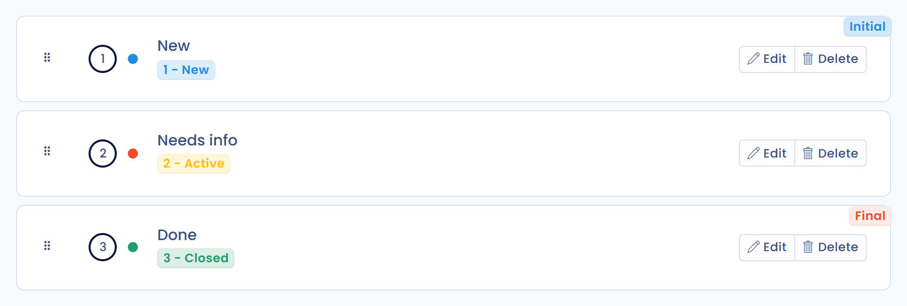

# Prozessschritte


**Prozessschritte und Workflow-Regeln**

Prozessschritte legen die Status fest, die Objekte durchlaufen. Wenn Sie Aktionen automatisieren möchten, sobald sich ein Schritt ändert (eine Benachrichtigung senden, eine Aufgabe erstellen …), lesen Sie [Workflow-Regeln](workflow-rules.md).


## Zweck der Prozessschritte

Prozessschritte bilden einen Arbeitsablauf ab: Objekte wandern von einem Schritt zum nächsten. Sie können Ihre Compliance-Verfahren operativ gliedern, indem Sie die zu durchlaufenden Schritte direkt in Dastra festlegen.

Jeder Objekttyp hat seine eigenen konfigurierbaren Schritte:

* Betroffenenanfragen
* Datenschutzvorfälle
* Aufgaben
* Verarbeitungstätigkeiten
* Assets
* Stakeholder
* Datenfelder
* Sicherheitsmaßnahmen
* Kategorien betroffener Personen
* KI-Systeme
* Verträge

Jeder Schritt ist mit einem **internen Status** verknüpft, der vom Objekttyp abhängt. Bei einer Verarbeitungstätigkeit sind die Status zum Beispiel „Entwurf“ und „Veröffentlicht“.

## Prozessschritte anpassen

Klicken Sie im Seitenmenü auf **Mandanteneinstellungen** und dann im Bereich **Prozess** auf **Prozessschritte**. Diese Seite ist Nutzern vorbehalten, die die erweiterten Einstellungen verwalten dürfen.

<figure><figcaption>
Der Eintrag Prozessschritte in den Mandanteneinstellungen
</figcaption></figure>

Wählen Sie oben auf der Seite den Objekttyp in der Liste aus: Sie sehen die für diesen Prozess verfügbaren Schritte mit ihrem internen Status. Passen Sie sie an die Prozesse Ihrer Organisation an und klicken Sie dann auf **Speichern**.

* Mit **Bearbeiten** ändern Sie bei einem Schritt den Namen, die Beschreibung und den internen Status und können die Bearbeitung des Objekts in diesem Schritt Nutzern mit einer bestimmten Rolle vorbehalten.
* Mit **Schritt hinzufügen** erstellen Sie einen neuen Schritt.
* Ziehen Sie einen Schritt per Drag-and-drop, um die Reihenfolge zu ändern. Der erste Schritt ist mit **Initial** gekennzeichnet, der letzte mit **Final**.

<figure><figcaption>
Die Schritte des Prozesses einer Verarbeitungstätigkeit
</figcaption></figure>

## Einen Prozessschritt löschen

Um einen Schritt zu löschen, klicken Sie neben ihm auf **Löschen** und bestätigen Sie.

Alle Objekte, die dem gelöschten Schritt zugeordnet sind, werden automatisch dem ersten Schritt mit demselben internen Status zugewiesen.

Wenn Sie zum Beispiel den Schritt „In Bearbeitung“ im Aufgabenprozess löschen:

<figure><figcaption>
Der Aufgabenprozess vor dem Löschen des Schritts „In Bearbeitung“
</figcaption></figure>

Die zugeordneten Objekte wechseln in den ersten Schritt mit demselben Status, zum Beispiel „Needs info“:

<figure><figcaption>
Der Aufgabenprozess nach dem Löschen
</figcaption></figure>
