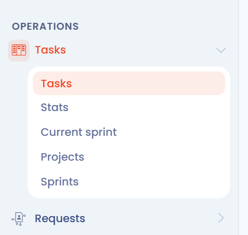

# Planung

Das Planungsmodul vereint die Aufgaben des Maßnahmenplans Ihres Mandanten. Sie erstellen Aufgaben, weisen sie zu, verfolgen ihren Fortschritt und exportieren sie. Das Modul richtet sich an Datenschutzbeauftragte (DSB) und Compliance-Teams, die nachweisen müssen, was sie getan haben.

## Warum einen Maßnahmenplan führen

Artikel 24 der DSGVO legt den Grundsatz der Rechenschaftspflicht fest:

> (...) setzt der Verantwortliche geeignete technische und organisatorische Maßnahmen um, um sicherzustellen und den Nachweis dafür erbringen zu können, dass die Verarbeitung gemäß dieser Verordnung erfolgt.

Sobald eine Organisation ihre Verarbeitungstätigkeiten kartiert und bewertet hat, muss sie technische und organisatorische Maßnahmen zu deren Schutz umsetzen. Die Verordnung verlangt, dass Sie die Einhaltung nachweisen, ohne präzise Indikatoren vorzugeben. Ein klarer, gemeinsamer und nachvollziehbarer Maßnahmenplan liefert dafür konkrete Belege: Jede Aufgabe hat eine zuständige Person, ein Fälligkeitsdatum, einen Schritt und einen Verlauf.

## Das Modul öffnen

Klicken Sie im Seitenmenü auf **Aufgaben**. Das Menü klappt zu fünf Seiten auf:

* **Kanban-Board**: die Liste der Aufgaben mit den Ansichten Spalten, Tabelle, Baumstruktur und Kalender;
* **Statistiken**: Kennzahlen und Fortschrittsdiagramme;
* **Aktuelle Inkremente**: die Aufgaben des laufenden Sprints;
* **Projekte**: die Projekte, die Aufgaben gruppieren;
* **Sprints**: die Arbeitszeiträume.

<figure><figcaption>
Die Seiten des Planungsmoduls im Seitenmenü
</figcaption></figure>

Die Seite **Kanban-Board** öffnet sich standardmäßig in der Ansicht **Spalten**, in der die Aufgaben nach Schritten angeordnet sind.

<figure><figcaption>
Die Seite Kanban-Board in der Ansicht Spalten
</figcaption></figure>


Der Eintrag **Aufgaben** erscheint nur, wenn Ihre Rolle Zugriff auf Aufgaben gewährt und das Modul für Ihre Organisation aktiviert ist.


## Weiterführende Informationen


[Eine Aufgabe erstellen oder bearbeiten](create.md)



[Ein Projekt oder einen Sprint erstellen oder bearbeiten](projects.md)



[Aufgaben verfolgen, filtern oder exportieren](export.md)



[Den Aufgaben-Workflow anpassen](workflow.md)



[Als Kalender teilen](calendar-sync.md)



[Häufig gestellte Fragen](faq.md)

