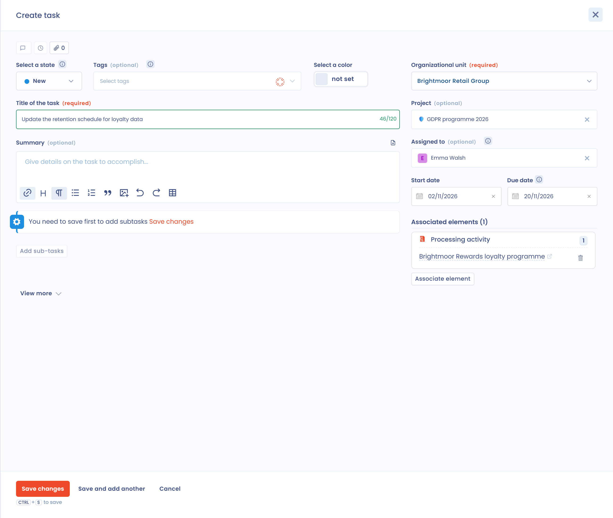
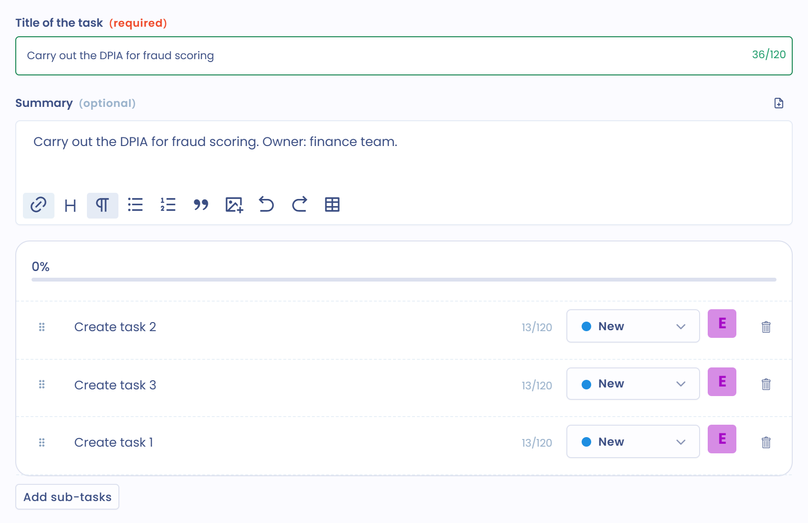

# Eine Aufgabe erstellen oder bearbeiten

In Dastra ist eine Aufgabe eine zu erledigende Arbeit. Sie hat eine zuständige Person, ein Fälligkeitsdatum und einen Verfolgungsschritt. Diese Seite erklärt, wie Sie eine Aufgabe erstellen, zuweisen, bearbeiten und löschen.

## Eine Aufgabe erstellen

Sie können eine Aufgabe auf drei Wegen erstellen:

* auf der Seite **Kanban-Board** des Planungsmoduls;
* im Datensatz eines anderen Elements der Anwendung;
* aus einer E-Mail, die an einer Sammeladresse eingeht.

### Im Planungsmodul

1. Klicken Sie im Seitenmenü auf **Aufgaben** und wählen Sie im Untermenü **Kanban-Board**.
2. Klicken Sie auf **Aufgabe erstellen**. Rechts auf dem Bildschirm öffnet sich das Fenster **Aufgabe erstellen**.

<figure><figcaption>
Die Schaltfläche Aufgabe erstellen und die Aktionen ihres Menüs
</figcaption></figure>

3. Füllen Sie den **Aufgabentitel** (höchstens 120 Zeichen) und die **Organisationseinheit** aus, die beide erforderlich sind. Ergänzen Sie die übrigen Felder nach Bedarf.
4. Klicken Sie auf **Speichern**. Um mehrere Aufgaben hintereinander zu erstellen, klicken Sie auf **Speichern und neu anlegen**.

<figure><figcaption>
Das Fenster zum Erstellen einer Aufgabe
</figcaption></figure>

Das Fenster enthält:

* **Organisationseinheit**: vorausgefüllt mit der im Mandanten ausgewählten Einheit oder mit der ersten verfügbaren Einheit;
* **Projekt**, **Sprint** und **Tags**, um die Aufgabe einzuordnen;
* **Zugewiesen an**, **Startdatum** und **Fälligkeitsdatum**;
* **Priorität** und **Interne Referenz** im ausklappbaren Teil des Fensters;
* die benutzerdefinierten Felder, die Sie den Aufgaben hinzugefügt haben.

### Eine Aufgabe mit Elementen verknüpfen

Eine Aufgabe kann mit einem oder mehreren Elementen der Anwendung verknüpft werden. Klicken Sie im Fenster auf **Ein Element verknüpfen**, wählen Sie die Art des Elements und dann ein oder mehrere Elemente dieser Art. Die verknüpften Elemente erscheinen unter **Verwandte Elemente**.

Folgende Arten stehen zur Verfügung:

* **Datenverarbeitung**;
* **Anfrage**;
* **Verletzung des Datenschutzes**;
* **Einreichung des Fragebogens**;
* **Stakeholder**;
* **Asset**;
* **Datensatz**;
* **Risikobewertung**;
* **Kontrollpunkt**;
* **Sicherheitsmaßnahme**;
* **KI-System**;
* **Vertrag**;
* **Daten**;
* **Betroffenenkategorie**;
* **Compliance-Projekt**;
* **Compliance-Audit**.

Die Aufgabe finden Sie anschließend im Datensatz jedes dieser Elemente (siehe unten). Der Filter **In Verbindung mit** der Seite **Kanban-Board** listet die Aufgaben auf, die mit einer bestimmten Art von Element verknüpft sind.

### Im Datensatz eines anderen Elements

Die Datensätze von Verarbeitungstätigkeiten, Betroffenenanfragen, Datenschutzverletzungen, Stakeholdern, Assets, Datensätzen, Sicherheitsmaßnahmen, Verträgen, KI-Systemen, Kontrollpunkten und Risikobewertungen haben eine Aufgabenschaltfläche: ein Listensymbol mit Häkchen und der Anzahl der verknüpften Aufgaben.

1. Öffnen Sie den Datensatz des Elements.
2. Klicken Sie auf die Aufgabenschaltfläche. Das Fenster **Zugehörige Aufgaben** listet die mit diesem Element verknüpften Aufgaben auf, mit Filtern nach Schritt und nach Tag.
3. Klicken Sie auf **Aufgabe erstellen**. Die Aufgabe wird mit dem Element verknüpft und übernimmt dessen Organisationseinheit.

<figure><figcaption>
Das Fenster Zugehörige Aufgaben im Datensatz einer Verarbeitungstätigkeit
</figcaption></figure>

Die Schaltfläche **In der Planung anzeigen** des Fensters öffnet die Seite **Kanban-Board** mit den Aufgaben des Elements.


Ein Maßnahmenplan kann auch aus einem validierten Fragebogen erzeugt werden. Siehe [Fragebögen überwachen](../questionnaires/monitor.md).


### Aus einer E-Mail

Dastra kann jede an einer Sammeladresse eingehende E-Mail samt Anhängen in eine Aufgabe umwandeln. Um die Adresse einzurichten, klicken Sie auf den Pfeil der Schaltfläche **Aufgabe erstellen** und dann auf **E-Mails in Aufgaben umwandeln**. Die Einrichtungsseite öffnet sich unter **Mandanteneinstellungen** > **Integrationen**. Siehe [E-Mail-Adressen für Datenerfassung](../settings/mailboxes.md). Dieser Eintrag erfordert die Berechtigung zum Verwalten von Integrationen.

### Unteraufgaben erstellen

Eine Aufgabe kann eine Liste von Unteraufgaben enthalten. Speichern Sie zuerst die Aufgabe: Die Schaltfläche **Eine Unteraufgabe hinzufügen** bleibt inaktiv, bis die Aufgabe existiert. Bearbeiten Sie die Aufgabe anschließend und klicken Sie auf **Eine Unteraufgabe hinzufügen**.

<figure><figcaption>
Die Unteraufgaben einer Aufgabe
</figcaption></figure>

Sind alle Unteraufgaben geschlossen, bietet Dastra an, die Hauptaufgabe zu schließen.

## Eine Aufgabe zuweisen

Zwei Felder bezeichnen die beteiligten Personen:

* **Zugewiesen an**: die Person, die die Aufgabe ausführt. Beim Erstellen der Aufgabe sind standardmäßig Sie das;
* **Inhaber**: die für die Aufgabe verantwortliche Person. Sie wird benachrichtigt, wenn sich der Schritt ändert.

Das Feld **Inhaber** befindet sich im ausklappbaren Teil des Fensters. Jeder Nutzer erhält Benachrichtigungen entsprechend seinen Einstellungen: siehe [Benachrichtigungen](../settings/notifications.md). Um bei jemandem nachzufassen, erwähnen Sie die Person in der Diskussion der Aufgabe (siehe die [FAQ](faq.md)).

## Eine Aufgabe bearbeiten

Um eine Aufgabe zu bearbeiten, klicken Sie sie an: Das Fenster **Aufgabe bearbeiten** öffnet sich. In der Ansicht **Tabelle** können Sie auch auf die drei Punkte am Zeilenende und dann auf **Bearbeiten** klicken.

<figure><figcaption>
Das Menü einer Aufgabe in der Ansicht Tabelle
</figcaption></figure>

Dieses Menü bietet außerdem **Link kopieren**, **Duplizieren**, **Zusammenführen** und **In den Papierkorb verschieben**. **Duplizieren** kopiert die Aufgabe und ihre Unteraufgaben: Der Titel der Kopie endet mit " - copy".


Um den Schritt einer Aufgabe zu ändern, ziehen Sie sie in der Ansicht **Spalten** per Drag-and-drop. Die Standardschritte sind **Neu**, **Informationen anfordern**, **In Bearbeitung** und **Fait**. Um sie zu ändern, klicken Sie auf den Pfeil der Schaltfläche **Aufgabe erstellen** und dann auf **Spalten konfigurieren**: siehe [Den Aufgaben-Workflow anpassen](workflow.md).


### Eine Aufgabe an Jira senden

Wenn die Jira-Integration für Aufgaben aktiv ist, bietet das Aktionsmenü der Aufgabe den Eintrag **Send to Jira**. Siehe [Jira](../integrations/jira.md).

## Eine Aufgabe in den Papierkorb verschieben oder löschen

Eine Aufgabe im Papierkorb ist nicht gelöscht: Sie trägt den Vermerk **Im Papierkorb** und verschwindet aus den Listen. Sie können sie jederzeit wiederherstellen.

1. Klicken Sie im Dreipunktmenü der Aufgabe oder im Aktionsmenü des Fensters auf **In den Papierkorb verschieben** und bestätigen Sie.
2. Um die Aufgaben des Papierkorbs zu finden, öffnen Sie **Filter** und wählen Sie **Papierkorb anzeigen**.

<figure><figcaption>
Der Filter Papierkorb anzeigen
</figcaption></figure>

3. Klicken Sie im Menü der Aufgabe auf **Wiederherstellen**, um sie in die Liste zurückzulegen, oder auf **Löschen** und bestätigen Sie, um sie zu löschen.

<figure><figcaption>
Die Aktionen einer Aufgabe im Papierkorb
</figcaption></figure>


Das Löschen einer Aufgabe ist endgültig. Ihre Unteraufgaben werden mit ihr gelöscht.


Um Aufgaben zu löschen, ohne den Papierkorb zu nutzen, siehe die [FAQ](faq.md).

## Weiterführende Informationen


[Ein Projekt oder einen Sprint erstellen oder bearbeiten](projects.md)

