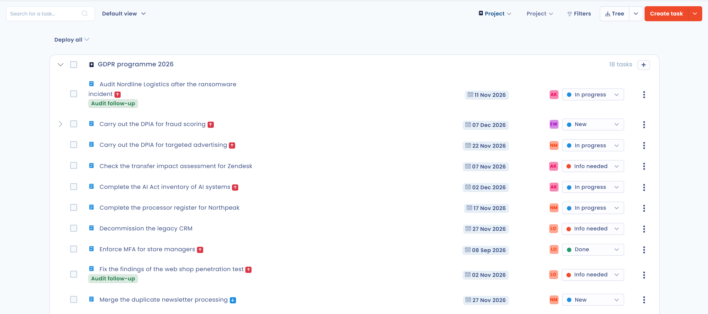
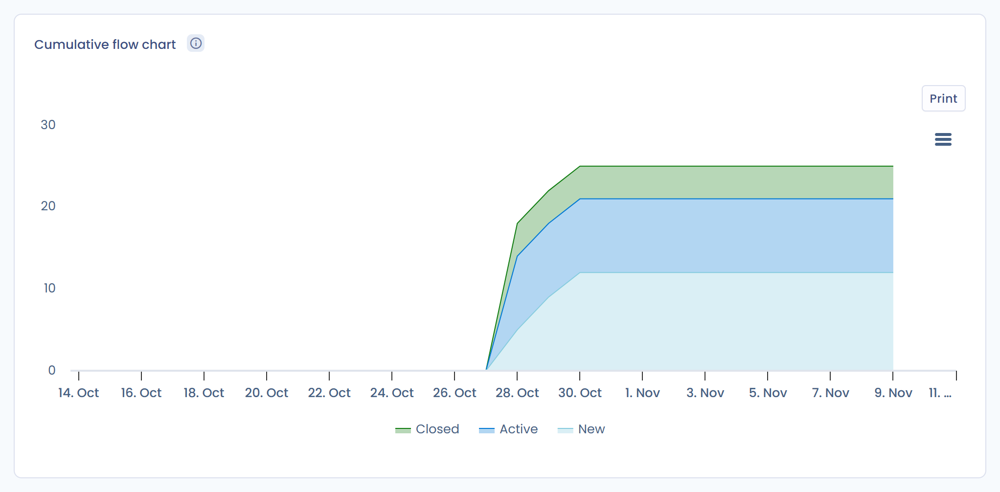

# Aufgaben verfolgen, filtern oder exportieren

Alle Aufgaben des Maßnahmenplans können auf der Seite **Kanban-Board** des Planungsmoduls und auf der Seite **Statistiken** verfolgt und anschließend exportiert werden. So steuern Sie Ihre Prozesse mit Kennzahlen, um die Rechenschaftspflicht Ihrer Organisation nach der DSGVO nachzuweisen.

## Eine Ansicht wählen

Die Ansichtsauswahl in der Symbolleiste der Seite **Kanban-Board** bietet vier Ansichten: **Spalten**, **Tabelle**, **Baumstruktur** und **Kalender**.

### Ansicht Spalten

Die Ansicht **Spalten** ordnet die Aufgaben nach Workflow-Schritt an, eine Spalte pro Schritt. Ziehen Sie eine Aufgabe per Drag-and-drop von einer Spalte in eine andere, um ihren Schritt zu ändern.

<figure><figcaption>
Die Ansicht Spalten
</figcaption></figure>

Klicken Sie in der Kopfzeile einer Spalte auf den Namen des Schritts, um ihn umzubenennen, oder auf **+**, um in diesem Schritt eine Aufgabe zu erstellen. Die Schaltfläche **Eine Spalte hinzufügen** fügt einen Schritt hinzu. Um die Schritte neu anzuordnen oder ihren internen Status festzulegen, siehe [Den Aufgaben-Workflow anpassen](workflow.md).

### Ansicht Tabelle

Die Ansicht **Tabelle** zeigt die Liste aller Aufgaben. Klicken Sie auf eine Zeile, um die Aufgabe zu öffnen. Wählen Sie Zeilen aus, um eine Sammelaktion anzuwenden: **Felder bearbeiten**, **Zusammenführen**, **Exportieren**, **Aufgaben mit Objekten verknüpfen**, **In den Papierkorb verschieben** oder **Löschen**.

Klicken Sie auf **Spalten anpassen**, um die angezeigten Spalten zu wählen, und auf **Filter**, um die Liste zu filtern.

<figure><figcaption>
Die Ansicht Tabelle
</figcaption></figure>

### Ansicht Baumstruktur

Die Ansicht **Baumstruktur** gruppiert die Aufgaben nach dem Kriterium, das Sie in der Liste **Gruppieren nach** wählen. Standardmäßig wird nach **Projekt** gruppiert. Die weiteren Kriterien sind **Sprint**, **Organisationseinheit**, **Zugewiesen an**, **Datenverarbeitung**, **Anfrage**, **Stakeholder**, **Asset**, **Verletzung des Datenschutzes**, **Datensatz**, **Kontrollpunkt** und **Sicherheitsmaßnahme**.

Klicken Sie auf **Alle ausblenden** oder **Alle anzeigen**, um alle Gruppen zu schließen oder zu öffnen.

<figure><figcaption>
Die nach Projekt gruppierte Ansicht Baumstruktur
</figcaption></figure>

### Ansicht Kalender

Die Ansicht **Kalender** legt jede Aufgabe zwischen ihr Startdatum und ihr Fälligkeitsdatum. Wählen Sie die Darstellung **Tag**, **Woche** oder **Monat** und navigieren Sie mit **Heute** und den Pfeilen.

Die Schaltfläche **Ungeplante Aufgaben** öffnet die Liste der Aufgaben ohne Startdatum oder ohne Fälligkeitsdatum. Ziehen Sie eine Aufgabe auf einen Tag des Kalenders, um sie zu planen: Ihr Startdatum und ihr Fälligkeitsdatum werden dann ausgefüllt. Eine bereits geplante Aufgabe behält ihre Dauer, wenn Sie sie verschieben. Um die Termine einer Aufgabe zu entfernen, ziehen Sie sie in den Bereich **Bitte hinterlegen Sie hier eine Aufgabe, um sie zu planen.**

<figure><figcaption>
Die Ansicht Kalender und ihre ungeplanten Aufgaben
</figcaption></figure>

## Aufgaben filtern

In jeder Ansicht grenzen das Suchfeld und die Schaltfläche **Filter** die angezeigten Aufgaben ein. Die Filter betreffen Organisationseinheit, Projekt, Sprint, zugewiesene Person, Priorität, Schritt, Tags, Status, Art des verknüpften Elements und Papierkorb.

<figure><figcaption>
Die Filter der Seite Kanban-Board
</figcaption></figure>

## Den Fortschritt anhand der Statistiken verfolgen

Klicken Sie im Seitenmenü auf **Aufgaben** und dann auf **Statistiken**. Die Seite hat zwei Reiter.

Der Reiter **Grundlegende Grafiken** zeigt die allgemeinen Kennzahlen des Maßnahmenplans und das Diagramm **Aufgabenstatus-Verteilung**. Dieses Diagramm zeigt die Anzahl der Aufgaben pro Schritt. Wählen Sie das Kriterium in der Liste **Gruppieren nach**: Die Aufgaben werden standardmäßig nach Projekt gruppiert, Sie können sie auch nach Organisationseinheit, Sprint, zugewiesener Person oder verknüpftem Element gruppieren.

<figure><figcaption>
Der Reiter Grundlegende Grafiken
</figcaption></figure>

Der Reiter **Erweiterte Grafiken** enthält drei Diagramme. Standardmäßig decken sie die letzten 30 Tage ab. Sie können sie auf einen Sprint, einen Zeitraum oder eine Organisationseinheit beschränken.

### Burn-down-Diagramm

Das Burn-down-Diagramm zeigt, wie sich die verbleibende Arbeit über einen bestimmten Zeitraum entwickelt, zum Beispiel über einen Sprint.

<figure><figcaption>
Das Burn-down-Diagramm
</figcaption></figure>

### Cumulative-Flow-Diagramm

Dieses Diagramm zeigt im Zeitverlauf, wie sich die Aufgaben auf die Schritte ihres Lebenszyklus verteilen.

<figure><figcaption>
Das Cumulative-Flow-Diagramm
</figcaption></figure>

### Velocity-Diagramm

Dieses Diagramm zeigt die Entwicklung der Anzahl der pro Sprint abgeschlossenen Aufgaben.

<figure><figcaption>
Das Velocity-Diagramm
</figcaption></figure>

## Aufgaben exportieren

1. Klicken Sie auf der Seite **Kanban-Board** auf den Pfeil der Schaltfläche **Aufgabe erstellen** und dann auf **Exportieren**. Um nur bestimmte Aufgaben zu exportieren, wählen Sie sie in der Ansicht **Tabelle** aus und wählen Sie die Sammelaktion **Exportieren**.
2. Wählen Sie im Fenster das Exportformat. Der Export berücksichtigt die auf der Seite gesetzten Filter.
3. Klicken Sie auf **Datei herunterladen**.

<figure><figcaption>
Das Exportfenster für Aufgaben
</figcaption></figure>

## Benutzerdefinierte Ansichten

Eine benutzerdefinierte Ansicht speichert unter einem Namen die Kombination aus Filtern und Spalten einer Ansicht. Zwischen den gespeicherten Ansichten wechseln Sie anschließend über die Auswahl in der Symbolleiste neben dem Suchfeld.

<figure><figcaption>
Die Auswahl der benutzerdefinierten Ansichten
</figcaption></figure>

### Eine Ansicht erstellen

1. Wenden Sie in der Ansicht **Spalten**, **Tabelle** oder **Baumstruktur** die gewünschten Filter und die Spaltenauswahl an.
2. Öffnen Sie die Ansichtsauswahl (sie zeigt **Alle Elemente**) und klicken Sie auf **Benutzerdefinierte Ansicht speichern**.
3. Geben Sie den **Namen Ihrer benutzerdefinierten Ansicht** ein und klicken Sie auf **Speichern**.

Die Ansicht erscheint in der Auswahl unter **Meine personalisierten Ansichten**. Wenn Sie die Filter einer aktiven Ansicht ändern, speichert der Eintrag **Aktualisieren** dieser Ansicht die Änderungen.

<figure><figcaption>
Eine benutzerdefinierte Ansicht speichern
</figcaption></figure>

### Eine Ansicht teilen

Aktivieren Sie im Speicherfenster **Diese personalisierte Ansicht mit anderen Nutzern teilen**. Diese Option ist Nutzern vorbehalten, die die erweiterten Einstellungen verwalten. Die anderen Nutzer des Mandanten finden die Ansicht unter **Gemeinsame Ansichten**. Das hilft, die Überwachung des Maßnahmenplans in einem Team zu vereinheitlichen.

### Beispiele für Ansichten

* "Überfällige Aufgaben": Aufgaben, deren Fälligkeitsdatum überschritten ist und deren Schritt nicht **Fait** ist.
* "Mein Backlog": Ihnen zugewiesene Aufgaben im Schritt **Neu**.
* "Aktueller Sprint": Aufgaben des laufenden Sprints.

## Weiterführende Informationen


[Als Kalender teilen](calendar-sync.md)

