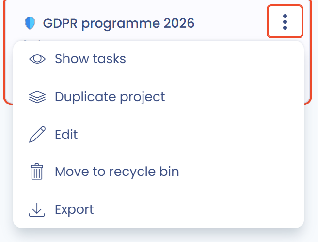
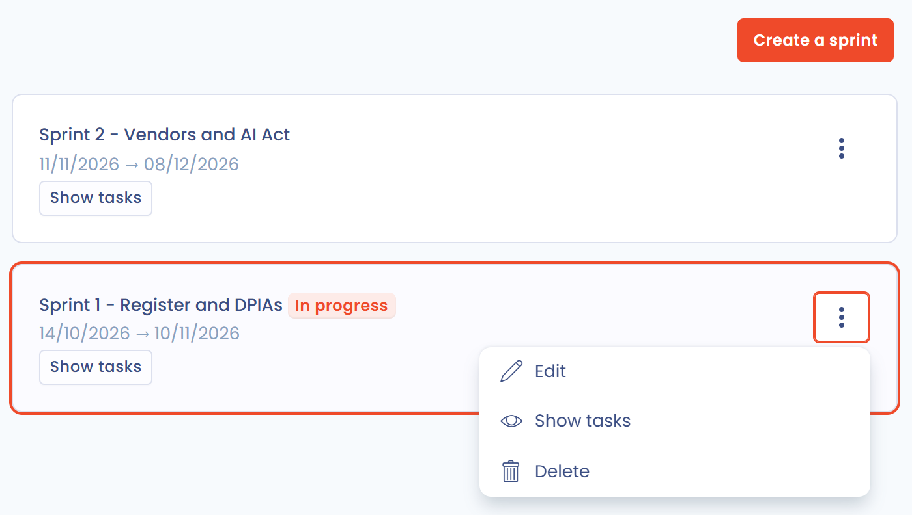
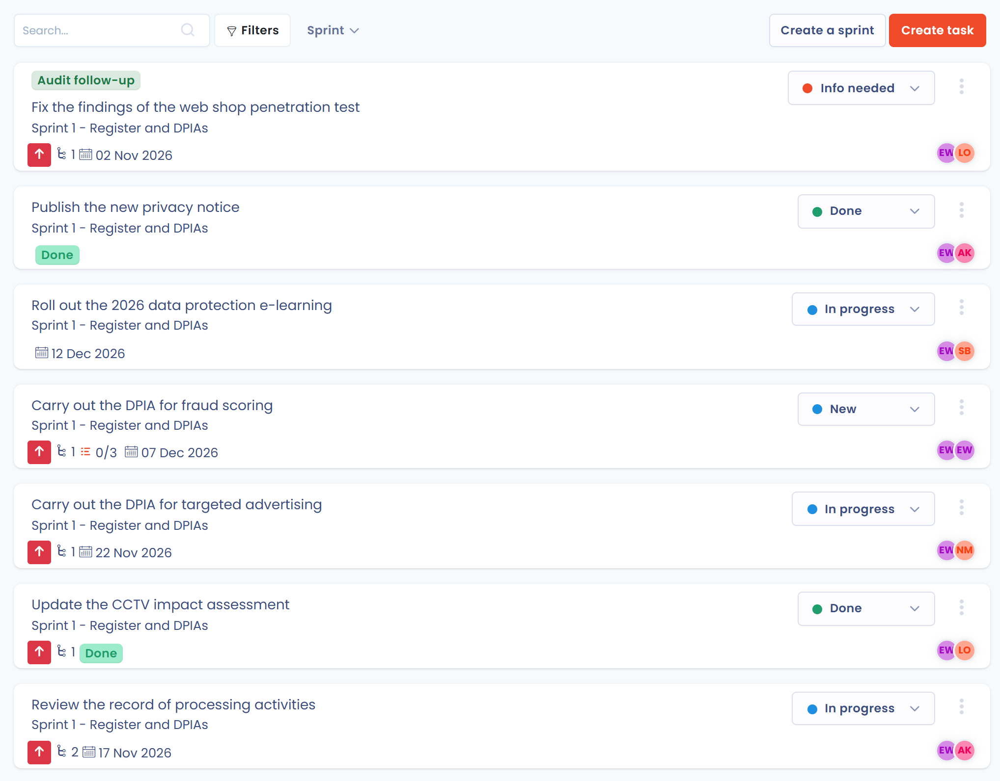

# Ein Projekt oder einen Sprint erstellen oder bearbeiten

In Dastra gilt:

* Ein Projekt gruppiert Aufgaben, in der Regel rund um einen fachlichen Geltungsbereich.
* Ein Sprint gruppiert Aufgaben, die in einem bestimmten Zeitraum zu erledigen sind. Im Französischen heißt dasselbe Konzept Iteration.

Eine Aufgabe kann zu einem Projekt und zu einem Sprint gehören: Das sind die Felder **Projekt** und **Sprint** im Aufgabenfenster.

## Ein Projekt erstellen oder bearbeiten

1. Klicken Sie im Seitenmenü auf **Aufgaben** und dann auf **Projekte**.
2. Klicken Sie auf **Projekt erstellen**. Geben Sie den **Namen** des Projekts ein, wenn Sie möchten mit einem Emoji, und eine optionale Beschreibung. Klicken Sie dann auf **Speichern**.

Um ein bestehendes Projekt zu bearbeiten, klicken Sie auf die drei Punkte auf seiner Karte und dann auf **Bearbeiten**.

<figure><figcaption>
Die Seite Projekte
</figcaption></figure>

Jede Projektkarte zeigt die Anzahl der geschlossenen Aufgaben im Verhältnis zur Gesamtzahl der Aufgaben. Klicken Sie auf den Namen des Projekts, um seine Aufgaben auf der Seite **Kanban-Board** anzuzeigen.

### Aktionen für ein Projekt

Das Dreipunktmenü einer Karte bietet:

* **Aufgaben anzeigen**: öffnet die Seite **Kanban-Board**, gefiltert auf das Projekt;
* **Projekt duplizieren**: erstellt eine Kopie des Projekts;
* **Bearbeiten**;
* **In den Papierkorb verschieben**: entfernt das Projekt aus der Liste. Wählen Sie in den Filtern **Papierkorb anzeigen**, um es wiederzufinden, und klicken Sie dann auf **Wiederherstellen** oder **Löschen**;
* **Exportieren**: lädt das Projekt im gewählten Format herunter (CSV, XLSX, JSON oder MD).

<figure><figcaption>
Das Menü eines Projekts
</figcaption></figure>

### Ein Projekt importieren oder aus einer Vorlage erstellen

Der Pfeil der Schaltfläche **Projekt erstellen** öffnet zwei Einträge:

* **Erstellen Sie auf der Grundlage von Vorlagen**: erstellt ein Projekt aus der Bibliothek der Vorlagen;
* **Importieren**: öffnet das Fenster **Importieren Sie ein Projekt**, in dem Sie Projekte im JSON-Format auswählen. Die Datei muss der Dastra-Projektvorlage entsprechen. Um sie zu sehen, exportieren Sie zunächst eines Ihrer Projekte als JSON und öffnen Sie die Datei.

## Einen Sprint erstellen oder bearbeiten

1. Klicken Sie im Seitenmenü auf **Aufgaben** und dann auf **Sprints**.
2. Klicken Sie auf **Ein Sprint erstellen**. Füllen Sie den **Namen**, das **Startdatum** und das **Enddatum** aus und klicken Sie dann auf **Speichern**.

Um einen Sprint zu bearbeiten, klicken Sie auf die drei Punkte auf seiner Karte und dann auf **Bearbeiten**. Dasselbe Menü erlaubt es, die Aufgaben des Sprints mit **Aufgaben anzeigen** zu öffnen oder den Sprint zu **Löschen**. Ein laufender Sprint trägt den Vermerk **In Bearbeitung**, ein beendeter Sprint den Vermerk **Vergangenheit**.

<figure><figcaption>
Die Seite Sprints
</figcaption></figure>

Auf der Seite **Kanban-Board** bietet das Menü am Pfeil der Schaltfläche **Aufgabe erstellen** außerdem **Sprints verwalten**, das diese Seite öffnet.

### Die Aufgaben des aktuellen Sprints ansehen

Im Menü **Aufgaben** listet die Seite **Aktuelle Inkremente** alle Aufgaben des laufenden Sprints auf.

<figure><figcaption>
Die Seite Aktuelle Inkremente
</figcaption></figure>

## Weiterführende Informationen


[Aufgaben verfolgen, filtern oder exportieren](export.md)

