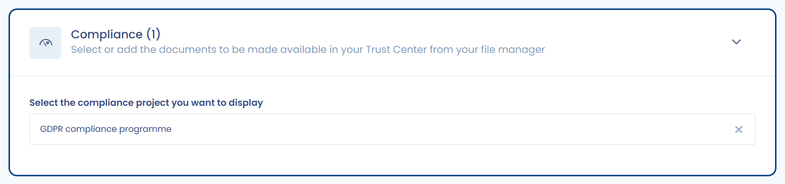

# Ihr Trust Center konfigurieren

Diese Seite stellt die Bearbeitungsseite eines Trust Centers vor, erklärt, wie Sie es veröffentlichen, und beschreibt, wie ein Compliance-Projekt angezeigt wird. Sie richtet sich an die Personen, die das Portal konfigurieren.

## Die Bearbeitungsseite

Die Bearbeitungsseite besteht aus Abschnitten, die Sie mit einem Klick öffnen oder schließen. Die ersten drei sind immer verfügbar:

* **Konfiguration**: der Name, die Organisationseinheit, die Inhaber, die Willkommensnachricht, die anzuzeigenden Funktionen und die Schnellzugriff-Links. Siehe [Startseite und allgemeine Konfiguration](home.md).
* **Sicherheit**: obligatorische Authentifizierung, Genehmigung von Downloads und Filterung von IP-Adressen. Siehe [Sicherheit](security.md).
* **Erscheinungsbild und Design**: das Logo, das Titelbild und die Akzentfarbe. Siehe [Erscheinungsbild und Design](design.md).

Die folgenden Abschnitte werden freigeschaltet, wenn die entsprechende Funktion unter **Konfiguration** aktiviert ist:

* **Fragebögen**: siehe [Fragebögen](questionnaires.md).
* **Betroffenenanfragen**: siehe [Betroffenenanfragen](data-subject-requests.md).
* **Dokumente**: siehe [Dokumente](attachments.md).
* **Compliance**: siehe [Das Compliance-Projekt anzeigen](#das-compliance-projekt-anzeigen) auf dieser Seite.

Die übrigen Funktionen werden mit einem Kontrollkästchen aktiviert, ohne eigenen Abschnitt: [Verarbeitungsverzeichnis](ropa.md), [Organigramm](org-chart.md), [Kontakte](contacts.md) und [KI-Systeme](ai-systems.md).

<figure><figcaption>
Die Schaltflächen der Bearbeitungsseite eines Trust Centers im Entwurf
</figcaption></figure>

## Veröffentlichen und die Veröffentlichung abbrechen

Ein neu erstelltes Trust Center ist ein Entwurf: Die Anzeige oben rechts auf der Seite lautet **Das Trust Center befindet sich im Entwurfsmodus** und das Portal ist online nicht zugänglich.

So veröffentlichen Sie es:

1. Klicken Sie oben rechts auf der Bearbeitungsseite auf **Veröffentlichen**. Die Schaltfläche ist deaktiviert, solange ein Pflichtfeld leer ist.
2. Bestätigen Sie die Frage „Möchten Sie das Trust Center speichern und veröffentlichen?“. Alle Änderungen werden gespeichert.

Die Anzeige lautet dann **Das Trust Center wurde veröffentlicht** und das Portal ist für alle zugänglich, die über den Link verfügen, im Rahmen der Regeln des Abschnitts **Sicherheit**.

Um das Portal unzugänglich zu machen, klicken Sie auf **Veröffentlichung abbrechen**. Das gilt sofort und ohne Bestätigung. In der Liste der Trust Center bietet das Menü jeder Zeile außerdem **Aktivieren** und **Deaktivieren**.

## Das Compliance-Projekt anzeigen

Diese Funktion fügt dem Portal einen Tab **Compliance** hinzu. Er zeigt eine Zusammenfassung eines Compliance-Projekts: für jedes Framework des Projekts das aktive Audit mit seinen Anhängen und die angewendeten Kontrollen. Sie erfordert die Funktion [Compliance](../../compliance/README.md) in Ihrem Abonnement.

### Das anzuzeigende Projekt auswählen

1. Aktivieren Sie im Abschnitt **Konfiguration** das Kontrollkästchen **Anzeige des Compliance-Projekts**.
2. Öffnen Sie den Abschnitt **Compliance**.
3. Wählen Sie im Auswahlfeld für das anzuzeigende Compliance-Projekt das Projekt aus. Ein Trust Center zeigt ein Projekt an.
4. Speichern Sie und veröffentlichen Sie das Trust Center, falls es noch nicht veröffentlicht ist.

Der Abschnitt **Compliance** wird als Fehler markiert, solange kein Projekt ausgewählt ist.

<figure><figcaption>
Das anzuzeigende Compliance-Projekt auswählen
</figcaption></figure>

### Was Besucher sehen

Der Tab **Compliance** des Portals zeigt links eine Karte pro Framework. Aufgelistet werden nur die Frameworks des Projekts, die ein [aktives Audit](../../compliance/projects/audits.md) haben. Wenn ein Besucher auf ein Framework klickt, zeigt die Seite:

* **Details zur Prüfung**: Typ, Status, Name sowie Start- und Enddatum des aktiven Audits, anschließend seine Anhänge;
* **Kontrollen**: die angewendeten Kontrollen des Frameworks, die aktiv sind und deren Tests alle bestanden sind. Jede Kontrolle zeigt ihre Referenz, ihren Titel, ihre Beschreibung und die Referenzen der Anforderungen, auf die sie antwortet.

<figure><figcaption>
Der Tab Compliance des öffentlichen Portals
</figcaption></figure>

Damit das Portal aktuell bleibt, legen Sie im Compliance-Projekt das aktive Audit jedes Frameworks fest und halten Sie die Tests Ihrer Kontrollen auf dem neuesten Stand. Siehe [Audits](../../compliance/projects/audits.md).
