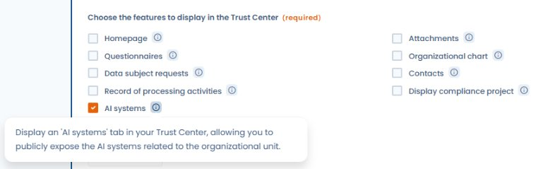
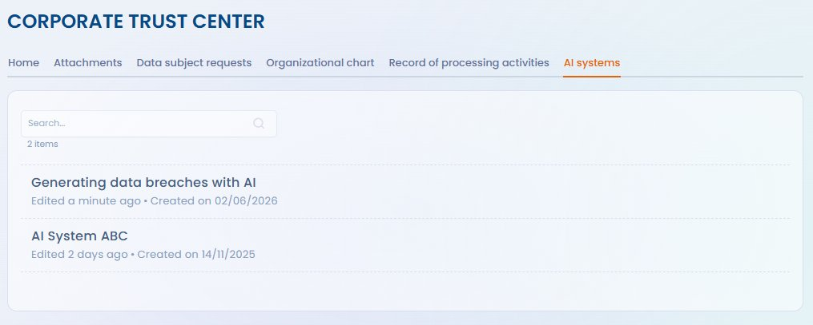

# KI-Systeme

Mit dem Dastra Trust Center können Sie die in Ihrem Workspace erfassten KI-Systeme öffentlich (oder eingeschränkt) darstellen. Diese Funktion unterstützt die Transparenzpflichten der KI-Verordnung (AI Act) und stärkt das Vertrauen Ihrer Kunden, Partner und betroffenen Personen.

***

## Den Tab KI-Systeme aktivieren

Aktivieren Sie in der Konfiguration Ihres Trust Centers das Modul **KI-Systeme** unter **Trust Center > Konfiguration > KI-Systeme**.

<figure><figcaption>
Aktivieren Sie „AI systems" bei den anzuzeigenden Funktionen, um den Tab im öffentlichen Portal einzublenden
</figcaption></figure>


Der Tab KI-Systeme ist nur für Organisationen verfügbar, deren Abonnement das Modul KI-Systeme enthält. Wenn Sie diese Option in der Konfiguration Ihres Trust Centers nicht sehen, wenden Sie sich an das Dastra-Team, um das Modul zu aktivieren.


Nach der Aktivierung erscheint im öffentlichen Portal ein eigener Tab. Er listet die KI-Systeme auf, die Sie sichtbar machen möchten.

<figure><figcaption>
Öffentliche Ansicht des Trust Centers mit dem Tab „AI systems", der die veröffentlichten Systeme auflistet
</figcaption></figure>

***

## Die zu veröffentlichenden Systeme auswählen

Standardmäßig wird kein KI-System veröffentlicht. Für jedes im Dastra-Modul KI-Systeme erfasste System können Sie festlegen, ob es:

* **Sichtbar** ist – es erscheint im Tab des Trust Centers
* **Ausgeblendet** ist – es bleibt intern und wird im Portal nicht angezeigt

Mit dieser Granularität veröffentlichen Sie nur die für Ihre Stakeholder relevanten Systeme (z. B. Systeme mit direktem Kontakt zu Kunden oder betroffenen Personen) und halten interne Systeme aus der öffentlichen Ansicht heraus.

***

## Angezeigte Informationen

Für jedes veröffentlichte KI-System kann das Trust Center Folgendes anzeigen:

* **Name** und **Beschreibung** des Systems
* **Zweck** und **Kategorien betroffener Personen**
* Die **Risikostufe nach AI Act** (minimal, begrenzt, hohes Risiko, verboten)
* Die **Kontaktdaten der verantwortlichen Person** bzw. der KI-Ansprechperson
* Die umgesetzten **Transparenzmaßnahmen**

Die angezeigten Felder hängen von den Angaben im Datenblatt des KI-Systems und von Ihren Konfigurationsentscheidungen im Trust Center ab.

***

## Bezug zu den Pflichten des AI Act

Die Anzeige der KI-Systeme im Trust Center trägt zur Erfüllung der Transparenzpflichten des AI Act (Art. 13 und 50) für Betreiber von Systemen mit begrenztem und hohem Risiko bei. Sie ersetzt nicht die gegebenenfalls erforderlichen individuellen Informationen, bietet aber eine zentrale Referenzstelle für Ihre Stakeholder.


Für als **hohes Risiko** eingestufte Systeme gelten besondere Dokumentationspflichten (Art. 13 AI Act). Die Veröffentlichung im Trust Center ergänzt die nach der Verordnung erforderliche technische Dokumentation, ersetzt sie aber nicht.

