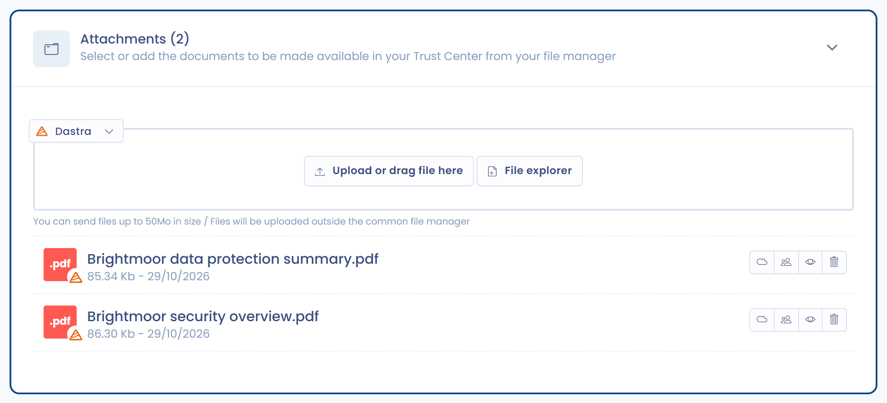
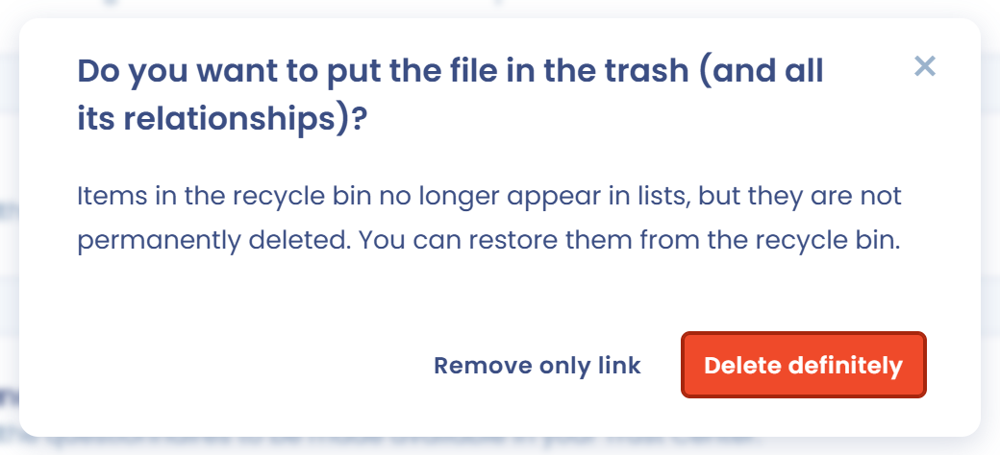

# Dokumente

Diese Seite erklärt, wie Sie den Besuchern Ihres Trust Centers Dokumente zur Verfügung stellen.

## Die Funktion aktivieren

Aktivieren Sie im Abschnitt **Konfiguration** das Kontrollkästchen **Dokumente**, wie unter [Startseite und allgemeine Konfiguration](home.md) beschrieben. Ihrem Trust Center wird dann eine öffentliche Seite **Dokumente** hinzugefügt und der Abschnitt **Dokumente** wird auf der Bearbeitungsseite freigeschaltet.

<figure><figcaption>
Der Konfigurationsabschnitt für Dokumente
</figcaption></figure>

## Dokumente zu Ihrem Trust Center hinzufügen

Fügen Sie im Abschnitt **Dokumente** Dateien hinzu, indem Sie sie hochladen oder aus den vorhandenen Dateien der Dokumentenverwaltung auswählen. Sie werden dann auf der öffentlichen Seite **Dokumente** Ihres Trust Centers aufgelistet. Dateien, die Sie aus diesem Abschnitt hochladen, werden im Ordner **Trust Center** der Dokumentenverwaltung gespeichert.

Standardmäßig muss ein Besucher den Zugriff auf ein Dokument beantragen, bevor er es herunterladen kann. Wie Sie dieses Verhalten ändern, erfahren Sie unter [Sicherheit](security.md).

## Einen Anhang entfernen

Klicken Sie im Abschnitt **Dokumente** auf das Papierkorb-Symbol einer Datei. Dastra fragt, ob die Datei mit allen ihren Beziehungen in den Papierkorb verschoben werden soll, und bietet zwei Möglichkeiten an:

* **Remove only link**: Die Datei wird in diesem Trust Center nicht mehr bereitgestellt, bleibt aber im Dateimanager und in ihren anderen Verwendungen erhalten;
* **Delete definitely**: Die Datei wird an allen Stellen, an denen sie verwendet wird, in den Papierkorb verschoben.

<figure><figcaption>
Der Dialog zum Entfernen eines Anhangs
</figcaption></figure>

[Mehr Informationen zur Dokumentenverwaltung in Dastra.](../../files/README.md)
