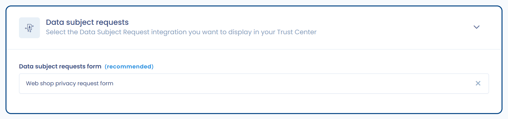

# Betroffenenanfragen

Diese Seite erklärt, wie Sie in Ihrem Trust Center ein Erfassungsformular für Betroffenenanfragen anzeigen.

## Die Funktion aktivieren

Aktivieren Sie im Abschnitt **Konfiguration** das Kontrollkästchen **Betroffenenanfragen**, wie unter [Startseite und allgemeine Konfiguration](home.md) beschrieben. Ihrem Trust Center wird dann eine öffentliche Seite **Betroffenenanfragen** hinzugefügt und der Abschnitt **Betroffenenanfragen** wird auf der Bearbeitungsseite freigeschaltet.

<figure><figcaption>
Der Konfigurationsabschnitt für Betroffenenanfragen
</figcaption></figure>

## Voraussetzungen

* Ihr Abonnement enthält die Funktion Betroffenenanfragen.
* Sie haben [ein Erfassungsformular konfiguriert und veröffentlicht](../../requests/widget.md).
* In Ihrer Organisation existiert ein öffentlicher API-Schlüssel. Ohne ihn wird auf der Bearbeitungsseite eine Warnung angezeigt und das Widget kann im Trust Center nicht funktionieren. Wie Sie einen erstellen, erfahren Sie unter [Verwaltung der API-Schlüssel](../../settings/api-keys.md).

## Das Erfassungsformular auswählen

Im Abschnitt **Betroffenenanfragen** können Sie im Feld **Widget zur Erfassung von Betroffenenanfragen** das anzuzeigende Erfassungsformular auswählen. Ein Trust Center zeigt nur ein Formular an.

Solange kein Formular ausgewählt ist, weist die öffentliche Seite darauf hin, dass der Administrator kein Erfassungsformular konfiguriert hat.
