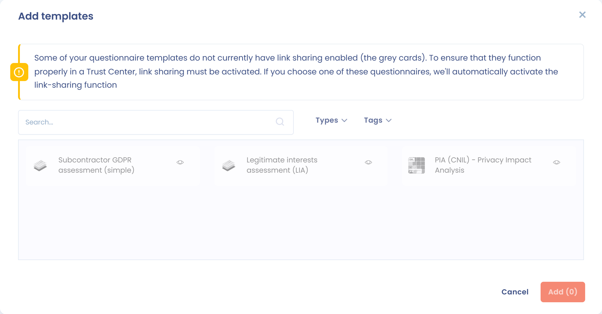

# Fragebögen

Diese Seite erklärt, wie Sie den Besuchern Ihres Trust Centers Fragebögen zur Verfügung stellen.

## Die Funktion aktivieren

Aktivieren Sie im Abschnitt **Konfiguration** das Kontrollkästchen **Fragebögen**, wie unter [Startseite und allgemeine Konfiguration](home.md) beschrieben. Ihrem Trust Center wird dann eine öffentliche Seite **Fragebögen** hinzugefügt und der Abschnitt **Fragebögen** wird auf der Bearbeitungsseite freigeschaltet.

<figure><figcaption>
Der Konfigurationsabschnitt für die Fragebögen Ihres Trust Centers
</figcaption></figure>

## Einen Fragebogen hinzufügen

1. Klicken Sie im Abschnitt **Fragebögen** auf **Fragebögen hinzufügen**.
2. Wählen Sie im Auswahlfenster einen oder mehrere Fragebögen aus. Es sind die Fragebögen, die Sie im Modul Fragebögen dieses Mandanten installiert haben.
3. Klicken Sie zur Bestätigung auf **Hinzufügen**.

<figure><figcaption>
Das Auswahlfenster für Fragebögen
</figcaption></figure>

Sie können jederzeit Fragebögen entfernen oder weitere hinzufügen. Die hinzugefügten Fragebögen sind auf der öffentlichen Seite **Fragebögen** sichtbar.

## Anweisungen für Fragebögen

Das Feld **Anweisungen für Fragebögen** ist ein Rich-Text-Editor. Er ermöglicht es, den Text zu formatieren und Bilder oder Videos einzubetten. Die Nachricht erscheint auf der öffentlichen Seite **Fragebögen** oberhalb der Liste der Fragebögen.

## Fragebögen umbenennen

Standardmäßig trägt ein Fragebogen im Trust Center den Namen der installierten Vorlage. Um den im Portal angezeigten Namen und die Beschreibung zu ändern, ohne die ursprüngliche Vorlage zu ändern, öffnen Sie das Menü des Fragebogens und klicken Sie auf **Name und Beschreibung ändern**.

<figure><figcaption>
Den im Trust Center angezeigten Namen und die Beschreibung ändern
</figcaption></figure>

## Die Anzeigereihenfolge ändern

Ordnen Sie die Fragebögen per Drag-and-Drop neu an. Die Reihenfolge im öffentlichen Portal entspricht der Reihenfolge dieser Konfigurationsseite.

## Fragebögen anheften

Um einen Fragebogen hervorzuheben, klicken Sie auf sein Pinnnadel-Symbol. Angeheftete Fragebögen erscheinen unabhängig von ihrer Konfigurationsreihenfolge immer oben in der Liste. Sie erscheinen außerdem in der Seitenleiste der Startseite, wenn die Startseite aktiviert ist.

<figure><figcaption>
Einen Fragebogen anheften
</figcaption></figure>

## Auswirkung der Organisationseinheit auf die Antworten

Die Besucher Ihres Trust Centers können alle Fragebögen beantworten, die ihnen zur Verfügung gestellt werden. Die Antworten werden im Modul Fragebögen gespeichert und der Organisationseinheit des Trust Centers zugeordnet (siehe [Startseite und allgemeine Konfiguration](home.md)).


Damit ein Fragebogen in einem Trust Center verwendet werden kann, muss die Linkfreigabe aktiviert sein. Ist sie es nicht, wird sie beim Hinzufügen des Fragebogens automatisch aktiviert. Sie kann nicht mehr deaktiviert werden, solange sich der Fragebogen in einem Trust Center befindet.

