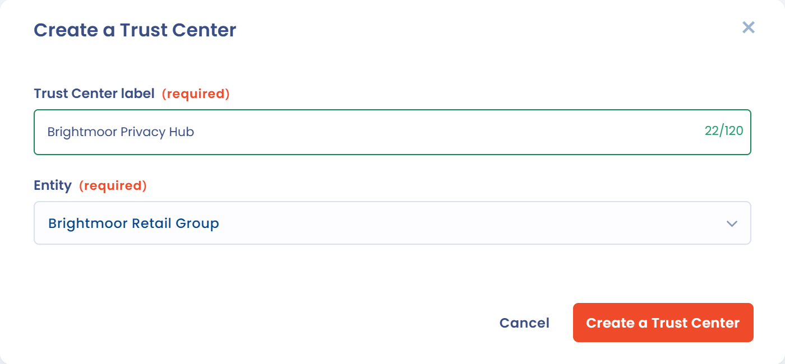
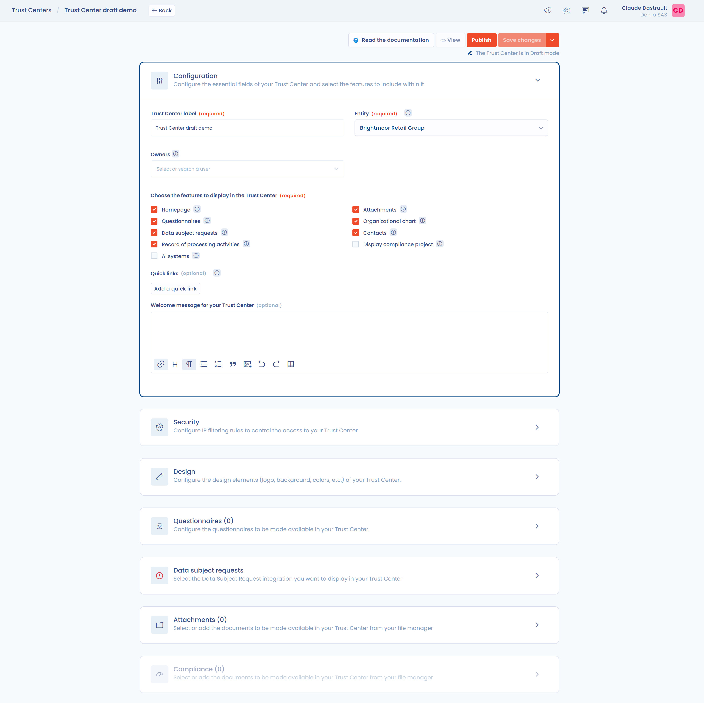

# Ein Trust Center erstellen

Diese Seite erklärt, wie Sie ein Trust Center erstellen. Für die Erstellung benötigen Sie einen Namen und eine Organisationseinheit; alles Weitere konfigurieren Sie auf der Bearbeitungsseite.

## Das Trust Center erstellen

1. Klicken Sie in der seitlichen Navigationsleiste auf **Trust Center**.
2. Klicken Sie auf **Ein Trust Center erstellen**.
3. Füllen Sie im geöffneten Fenster die Felder **Name des Trust Centers** und **Organisationseinheit** aus. Beide Felder sind Pflichtfelder.
4. Klicken Sie zur Bestätigung auf **Ein Trust Center erstellen**.

Die Schaltfläche **Ein Trust Center erstellen** ist deaktiviert, wenn Sie das Trust-Center-Kontingent Ihres Plans erreicht haben. Das verwendete Kontingent wird oben in der Liste angezeigt.

<figure><figcaption>
Ein Trust Center aus der Liste der Trust Center erstellen
</figcaption></figure>

<figure><figcaption>
Das Fenster zur Erstellung eines Trust Centers
</figcaption></figure>

Das Feld **Organisationseinheit** enthält die Organisationseinheit des Trust Centers. Diese Einheit bestimmt, welche Daten das Trust Center veröffentlicht. Näheres zu ihrer Wirkung finden Sie unter [Startseite und allgemeine Konfiguration](configuration/home.md).

## Nach der Erstellung

Sobald das Trust Center erstellt ist, werden Sie zu seiner Bearbeitungsseite weitergeleitet. Es ist ein Entwurf: Niemand kann darauf zugreifen, solange Sie es nicht veröffentlichen.

Die Startseite, die Fragebögen, die Betroffenenanfragen, das Verarbeitungsverzeichnis, die Dokumente, das Organigramm und die Kontakte sind standardmäßig aktiviert. KI-Systeme und das Compliance-Projekt sind es nicht.

<figure><figcaption>
Die Bearbeitungsseite eines Trust Centers
</figcaption></figure>

Wie Sie Ihr Trust Center konfigurieren und veröffentlichen, erfahren Sie unter [Ihr Trust Center konfigurieren](configuration/README.md).
