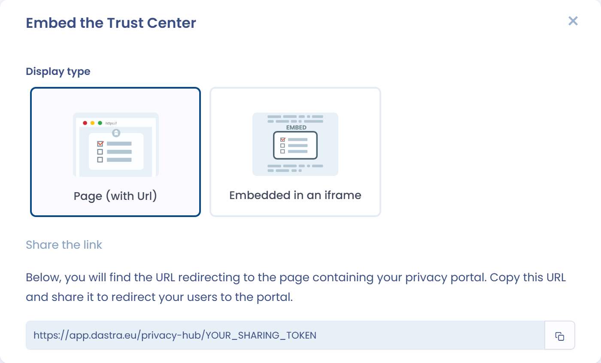
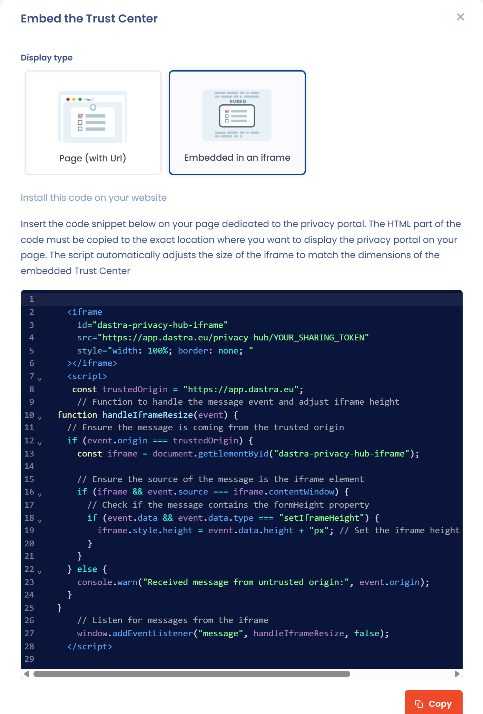

# Ihr Trust Center in der Vorschau anzeigen und teilen

Diese Seite erklärt, wie Sie Ihr Trust Center so anzeigen, wie Ihre Besucher es sehen, und wie Sie es per Link teilen oder in Ihre Website einbetten.

## Ihr Trust Center in der Vorschau anzeigen

Klicken Sie oben rechts auf der Bearbeitungsseite auf **Anzeigen**. Das öffentliche Portal öffnet sich in einem neuen Tab.

Die Schaltfläche ist deaktiviert, solange das Trust Center nicht veröffentlicht ist. Wie Sie es veröffentlichen, erfahren Sie unter [Ihr Trust Center konfigurieren](configuration/README.md#veroffentlichen-und-die-veroffentlichung-abbrechen).

Wenn Sie die Konfiguration ändern, speichern Sie Ihre Änderungen und aktualisieren Sie dann den Tab des Portals, um sie zu sehen.

## Ihr Trust Center teilen

Sobald die Konfiguration abgeschlossen ist, können Sie die URL Ihres Trust Centers teilen:

* Kopieren Sie die URL des Portal-Tabs;
* oder klicken Sie oben rechts auf der Bearbeitungsseite auf den Pfeil der Schaltfläche **Speichern** und dann auf **Link kopieren**.

In der Liste der Trust Center befindet sich **Link kopieren** im Menü der Zeile des Trust Centers.

<figure><figcaption>
Die Freigabeoptionen im Menü der Schaltfläche Speichern
</figcaption></figure>

**Link kopieren** und **integrieren** sind nur aktiviert, wenn das Trust Center veröffentlicht ist.

Die Regeln der Seite [Sicherheit](configuration/security.md), etwa die obligatorische Authentifizierung oder die Filterung von IP-Adressen, gelten auch für Besucher, die den Link verwenden.

## Ihr Trust Center in Ihre Website einbetten

Klicken Sie auf den Pfeil der Schaltfläche **Speichern** und dann auf **integrieren**. Das Fenster **Trust Center integrieren** bietet zwei Anzeigearten, die Sie unter **Anzeigetyp** auswählen:

* **Seite (URL angegeben)**: Das Fenster zeigt die URL des Trust Centers. Kopieren Sie sie und teilen Sie sie oder verweisen Sie mit einem Link Ihrer Website darauf.
* **In einen Iframe integriert**: Das Fenster zeigt einen Codeausschnitt. Klicken Sie auf **Kopieren** und fügen Sie dann den HTML-Teil an der Stelle Ihrer Seite ein, an der das Trust Center erscheinen soll. Das mitgelieferte Skript passt die Größe des Iframes automatisch an die Größe des Trust Centers an.

<figure><figcaption>
Der Anzeigetyp Seite (URL angegeben)
</figcaption></figure>

<figure><figcaption>
Der Anzeigetyp In einen Iframe integriert
</figcaption></figure>
