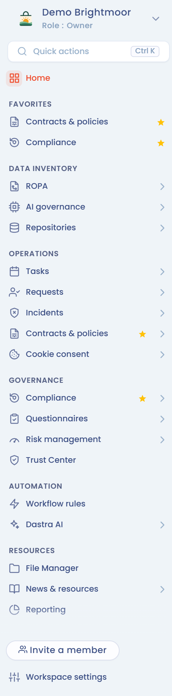
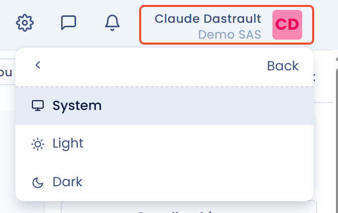
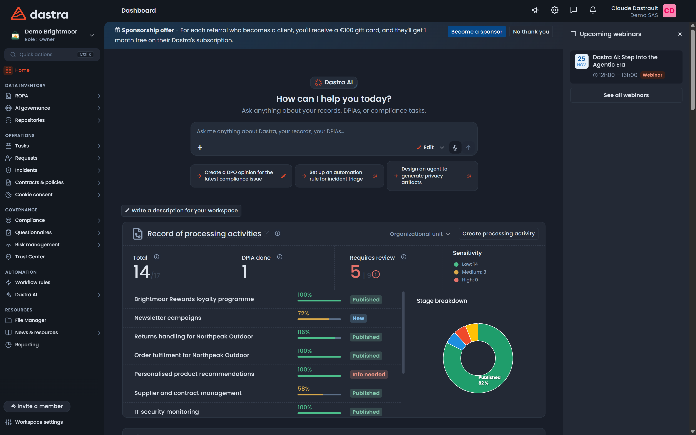
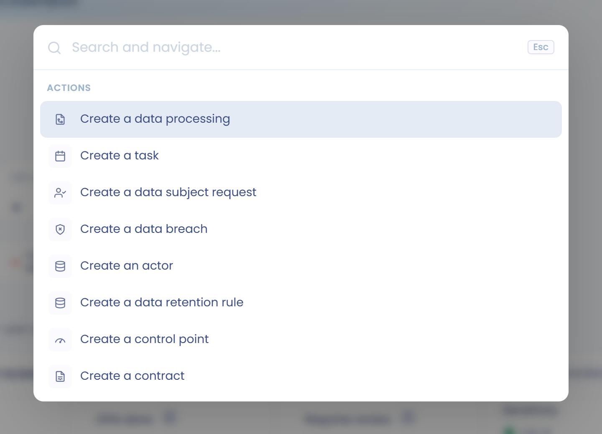

# In Dastra navigieren

Diese Seite stellt vor, womit Sie sich in Dastra bewegen: das Seitenmenü, die obere Leiste, das Design und die Befehlspalette. Sie richtet sich an alle, die die Anwendung kennenlernen.

Welche Module Sie sehen, hängt vom Tarif Ihrer Organisation und von Ihren Rechten ab. Ein Modul, das Sie nicht sehen, ist entweder nicht in Ihrem Tarif enthalten oder setzt ein Recht voraus, das Ihre Rolle nicht hat.

***

## Das Seitenmenü

Das Seitenmenü befindet sich links auf dem Bildschirm. Von oben nach unten enthält es:

* die Mandantenauswahl, die Ihre Rolle im aktuellen Mandanten anzeigt;
* die Schaltfläche **Quick actions**, die die [Befehlspalette](navigation.md#die-befehlspalette) öffnet;
* den Eintrag **Dashboard**, um zur Startseite des Mandanten zurückzukehren;
* den Bereich **Favorites**, sobald Sie mindestens ein Modul angeheftet haben;
* die fünf Modulbereiche;
* die Schaltfläche **Invite a member**, wenn Sie das Recht haben, Nutzer zu verwalten, und den Eintrag **Mandanteneinstellungen**.

<figure><figcaption>
Das Seitenmenü
</figcaption></figure>

Klicken Sie auf ein Modul, um seine Seiten aufzuklappen, oder auf den Pfeil rechts von seinem Namen. Auf einem kleinen Bildschirm öffnet sich das Menü über die Schaltfläche oben links in der oberen Leiste.

### Die fünf Bereiche

| Bereich | Module |
| --- | --- |
| **Dateninventar** | **Verarbeitungsverzeichnis**, **KI-Register**, **Metadaten** |
| **Betrieb** | **Aufgaben**, **Anfragen**, **Vorfälle**, **Verträge und Richtlinien**, **Cookie-Banner** |
| **Governance** | **Compliance**, **Fragebögen**, **Risikomanagement**, **Trust Center** |
| **Automatisierung** | **Workflow-Regeln**, **Dastra AI** |
| **Ressourcen** | **Dateimanager**, **Newsfeed**, **Personalisierte Berichte** |

Das Modul **Dastra AI** fasst die Unterhaltungen im Vollbild, die Artefakte und, je nach Tarif und Rechten, die Agenten, den Posteingang und die Funktionen zusammen. Siehe [Dastra AI](../features/general/ai-assistant/README.md).

Ein Bereich, in dem Ihnen kein Modul zur Verfügung steht, wird ausgeblendet.

### Favoriten

Um ein Modul anzuheften, zeigen Sie im Menü auf seinen Namen und klicken Sie auf den Stern, der rechts erscheint. Das Modul kommt in den Bereich **Favorites** oben im Menü und bleibt zugleich in seinem ursprünglichen Bereich. Klicken Sie erneut auf den Stern, um es zu entfernen.

Favoriten sind persönlich und gelten für jede Organisation einzeln. Sie ändern das Menü anderer Nutzer nicht.

### Die Mandantenauswahl

Oben im Menü zeigt die Auswahl den Namen des aktuellen Mandanten und Ihre Rolle darin an (**Inhaber**, wenn Sie die Organisation besitzen). Haben Sie mehrere Rollen, werden alle aufgelistet; zeigen Sie auf die Zeile, um sie vollständig zu sehen.

Klicken Sie auf die Auswahl, um den Mandanten zu wechseln, und finden Sie über das Suchfeld einen Mandanten nach seinem Namen. Ihre bevorzugten Mandanten, in der Liste mit einem Stern markiert, stehen zuerst. Zum Begriff des Mandanten siehe [Wichtige Begriffe](setup/key-concepts.md).

***

## Die obere Leiste

Die obere Leiste zeigt den Pfad der aktuellen Seite an. Rechts bietet sie Zugriff auf:

* ein Formular, um dem Dastra-Team Feedback zu senden;
* die **Organisationseinstellungen**, mit dem Zahnrad-Symbol;
* die Kommentare und das Benachrichtigungscenter;
* Ihr Profilmenü, in dem Sie die Organisation und das Design wechseln und in dem Sie Ihr Nutzerprofil, das Benachrichtigungscenter und die Hilfe finden.

***

## Das helle oder dunkle Design

Dastra gibt es in einem hellen und einem dunklen Design. So wählen Sie:

1. Öffnen Sie oben rechts Ihr Profilmenü.
2. Klicken Sie auf **Theme**.
3. Wählen Sie **Light**, **Dark** oder **System**.

Mit **System** folgt Dastra den Einstellungen Ihres Computers und wechselt das Design mit ihnen. Ihre Wahl wird in Ihrem Konto gespeichert, Sie finden sie also in Ihren anderen Browsern wieder.

Haben Sie noch nicht gewählt und ist Ihr Computer im dunklen Modus, wechselt Dastra zum dunklen Design und öffnet das Fenster **Dark theme enabled**. Klicken Sie auf **Keep the dark theme** oder **Back to the light theme**. Schließen Sie das Fenster, ohne zu wählen, bleibt das Design **System** erhalten, und die Frage wird in diesem Browser nicht erneut gestellt.

<figure><figcaption>
Das Design im Profilmenü wählen
</figcaption></figure>

<figure><figcaption>
Das Dashboard im dunklen Design
</figcaption></figure>

Auch externe Befragte eines Fragebogens und Antragsteller können in ihrem Bereich ein Design wählen: zwei Schaltflächen, eine für das helle und eine für das dunkle Design. Die öffentlichen Seiten eines Trust Centers bleiben immer im hellen Design.

***

## Die Befehlspalette

Die Befehlspalette findet mit einer einzigen Eingabe einen Eintrag, eine Seite oder eine Seite der Dokumentation. Öffnen Sie sie mit der Tastenkombination **Strg+K** (**Cmd+K** auf dem Mac) oder mit der Schaltfläche **Quick actions** des Seitenmenüs. Drücken Sie die Tastenkombination erneut, um sie zu schließen.

<figure><figcaption>
Die Befehlspalette
</figcaption></figure>

### Suche

Geben Sie Ihre Suche in das Feld **Search and navigate...** ein. Die Palette durchsucht:

* die Seiten der Anwendung;
* die Einträge Ihres Mandanten;
* die Seiten der Dastra-Dokumentation, die sich in einem neuen Tab öffnen.

Drücken Sie die **Eingabetaste**, um die ausgewählte Seite zu öffnen, oder um die vollständige Seite mit den Suchergebnissen anzuzeigen, wenn nichts ausgewählt ist.

Steht Ihnen Dastra AI zur Verfügung, sendet die Zeile **Ask AI** Ihre Eingabe in einer neuen Unterhaltung an den Assistenten. Drücken Sie **Strg+Eingabetaste** (**Cmd+Eingabetaste** auf dem Mac), um direkt dorthin zu gelangen.

### Schnellaktionen

Ist das Feld leer, bietet die Palette Aktionen zum Erstellen an. Sie erscheinen entsprechend Ihren Rechten und den Modulen Ihres Tarifs:

* **Create a data processing**
* **Create a task**
* **Create a data subject request**
* **Create a data breach**
* **Create an actor**
* **Create a data retention rule**
* **Create a control point**
* **Create a contract**

Bewegen Sie sich mit den Pfeiltasten durch die Liste und drücken Sie dann die **Eingabetaste**.

***

## Dastra AI eine Frage stellen

Steht Ihnen Dastra AI zur Verfügung, zeigt das Dashboard ein Eingabefeld an. Schreiben Sie Ihre Frage und senden Sie sie ab: Das Dastra-AI-Fenster öffnet sich, und die Antwort beginnt. Siehe [Dastra AI](../features/general/ai-assistant/README.md).


[Schnellstart](quickstart.md)



[Wichtige Begriffe](setup/key-concepts.md)

