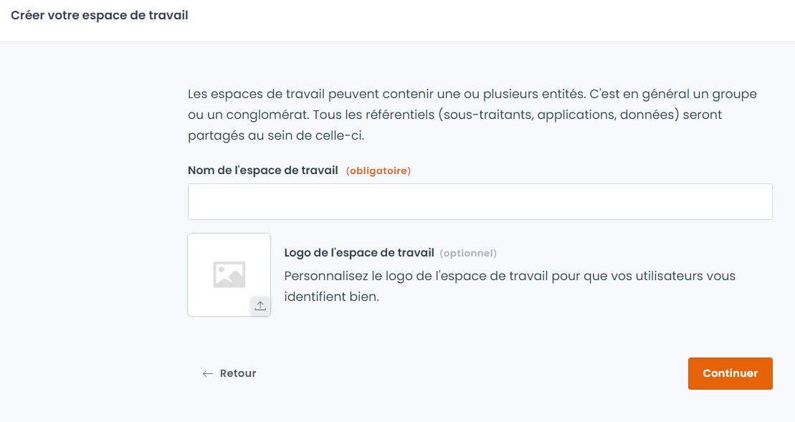

# Schnellstart in 5 Minuten

Diese Anleitung führt Sie von Ihrer ersten Anmeldung bis zu Ihrer ersten dokumentierten Verarbeitungstätigkeit im Dastra-Verzeichnis.

***

## Schritt 1: Zugang zu Dastra erhalten

Um Dastra zu nutzen, benötigt Ihre Organisation ein Abonnement.

* Nutzt Ihre Organisation Dastra bereits, bitten Sie einen Administrator, Sie einzuladen. Sie erhalten die Einladung per E-Mail.
* Andernfalls wenden Sie sich über das [Formular für Demo-Anfragen](https://www.dastra.eu/de/contacts/demo) an das Dastra-Team.

Melden Sie sich anschließend unter [https://app.dastra.eu](https://app.dastra.eu) an.

***

## Schritt 2: Ihren Mandanten erstellen

Ein **Mandant** ist die Umgebung, in der Sie Ihre Verarbeitungstätigkeiten dokumentieren. Ein Mandant entspricht in der Regel einer juristischen Person oder einem Compliance-Bereich.

Wenn Sie einem bestehenden Mandanten beitreten, gehen Sie zu Schritt 3. Nur Kontoinhaber können einen Mandanten erstellen.

1. Klicken Sie auf der Seite der Mandanten auf **Mandant erstellen**.
2. Geben Sie unter **Name des Mandanten** einen Namen ein (zum Beispiel den Namen der juristischen Person).
3. Klicken Sie auf **Weiter**.

Dastra öffnet dann die Nutzerseite des neuen Mandanten, auf der Sie seine Mitglieder hinzufügen können.

<figure><figcaption>
Geben Sie Ihrem Mandanten einen Namen
</figcaption></figure>


[Einen Mandanten erstellen und konfigurieren](setup/workspace.md)


***

## Schritt 3: Ihre erste Verarbeitungstätigkeit hinzufügen

Das **Verarbeitungsverzeichnis** ist das Herzstück von Dastra. Beginnen Sie mit einer einfachen Tätigkeit, etwa der Gehaltsabrechnung oder dem geschäftlichen E-Mail-Verkehr.

1. Klicken Sie im linken Menü auf **Verarbeitungstätigkeiten**.
2. Klicken Sie auf **Erstellen Sie eine Datenverarbeitung**.
3. Wählen Sie aus, wie Sie sie erstellen möchten:

<figure><figcaption>
Wählen Sie, wie Sie Ihre erste Verarbeitungstätigkeit erstellen
</figcaption></figure>

| Modus                              | Beschreibung                                                                                                                              |
| ---------------------------------- | ----------------------------------------------------------------------------------------------------------------------------------------- |
| **Erstellen mit KI-Assistent**     | Beschreiben Sie die Tätigkeit in wenigen Worten, und der KI-Assistent verfasst eine erste Version (sofern er in Ihrem Mandanten aktiviert ist) |
| **Basierend auf einer Vorlage**    | Beginnen Sie mit einer Dastra-Vorlage (Gehaltsabrechnung, Personalbeschaffung, Videoüberwachung usw.)                                      |
| **Ausgehend von einem Asset**      | Erstellen Sie die Verarbeitungstätigkeit aus einem Asset und den zugehörigen Daten                                                        |
| **Von Grund auf neu**              | Beginnen Sie mit einer leeren Verarbeitungstätigkeit                                                                                      |

Wählen Sie für eine erste Tätigkeit **Von Grund auf neu** oder **Basierend auf einer Vorlage**.

4. Füllen Sie bei **Von Grund auf neu** die beiden Pflichtfelder aus:

<figure><figcaption>
Name und Organisationseinheit sind bei der Erstellung die einzigen Pflichtfelder
</figcaption></figure>

* **Name der Datenverarbeitung** (zum Beispiel _Gehaltsabrechnung_)
* **Organisationseinheit**: die Entität oder Abteilung, zu der die Tätigkeit gehört


Der Verantwortliche, sein Datenschutzbeauftragter und sein Vertreter werden aus der Entität der gewählten Organisationseinheit übernommen.


5. Klicken Sie auf **Erstellen Sie eine Datenverarbeitung**.

Die Verarbeitungstätigkeit wird dem Verzeichnis hinzugefügt. Anschließend können Sie ihren Fragebogen ausfüllen: Zwecke, Datenkategorien, Empfänger, Sicherheitsmaßnahmen usw.


[Verarbeitungsverzeichnis](../features/ropa/README.md)


***

## Schritt 4: Einen Kollegen einladen

Laden Sie die Personen ein, die mit Ihnen im Mandanten arbeiten werden.

1. Öffnen Sie **Mandanteneinstellungen** > **Nutzer**.
2. Klicken Sie auf **Einen Nutzer einladen**.
3. Geben Sie die E-Mail-Adresse ein und wählen Sie die Rollen aus.
4. Klicken Sie auf **Eine Einladung senden**.

Die eingeladene Person erhält per E-Mail einen Zugangslink.


[Nutzer einladen](setup/users.md)


***

## Nächste Schritte

Um tiefer einzusteigen:


[Tutorial](tutorial/README.md)



[Einrichtung](setup/README.md)



[Verarbeitungsverzeichnis](../features/ropa/README.md)



[KI-Systeme](../features/ai-systems/README.md)

