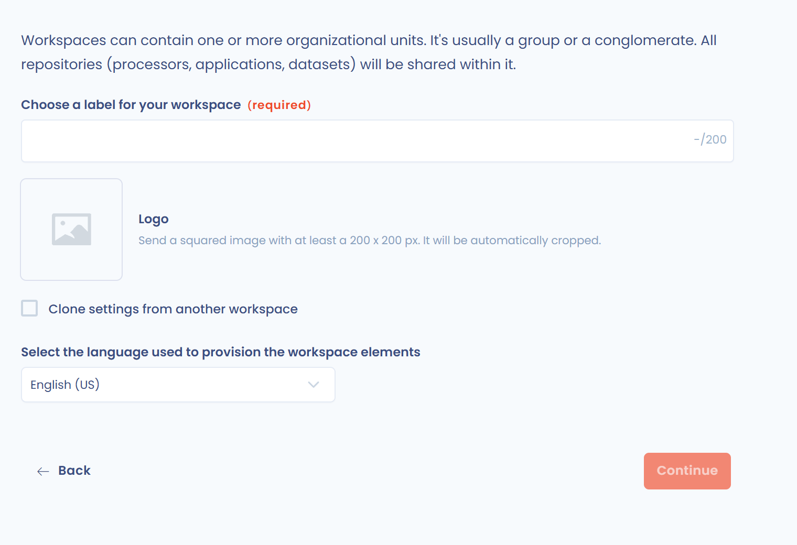

# Einrichtung

Dieser Abschnitt führt Sie durch die Erstellung Ihres ersten Mandanten, die Einladung von Nutzern und die Konfiguration von Rollen, Berechtigungen und Teams.

## Erste Schritte

<table data-view="cards"><thead><tr><th></th><th></th><th data-hidden data-card-target data-type="content-ref"></th></tr></thead><tbody><tr><td><strong>Wichtige Begriffe</strong></td><td>Definitionen der Begriffe, die Dastra strukturieren: Organisation, Mandant, Organisationseinheit, Entität, Abteilung und Inhaber.</td><td><a href="key-concepts.md">key-concepts.md</a></td></tr><tr><td><strong>Anmelden und Authentifizierung verwalten</strong></td><td>Melden Sie sich bei Dastra mit Passwort, Passkey, E-Mail-Link oder SSO an und sichern Sie Ihr Konto.</td><td><a href="login.md">login.md</a></td></tr><tr><td><strong>Ihr Nutzerprofil konfigurieren</strong></td><td>Bearbeiten Sie Ihre persönlichen Angaben, Sprache und Zeitzone und löschen Sie Ihr Nutzerkonto.</td><td><a href="profile.md">profile.md</a></td></tr></tbody></table>

## Den Mandanten strukturieren

Beginnen Sie mit der Erstellung Ihres Mandanten:

<figure><figcaption>
Das Formular zum Erstellen eines Mandanten
</figcaption></figure>

<table data-view="cards"><thead><tr><th></th><th></th><th data-hidden data-card-target data-type="content-ref"></th></tr></thead><tbody><tr><td><strong>Einen Mandanten erstellen und konfigurieren</strong></td><td>Erfahren Sie, wie Sie Ihren ersten Mandanten in Dastra erstellen.</td><td><a href="workspace.md">workspace.md</a></td></tr><tr><td><strong>Organisationseinheiten erstellen und konfigurieren</strong></td><td>Erfahren Sie, wie Sie Entitäten und Abteilungen in Dastra erstellen und einrichten.</td><td><a href="organizational-units.md">organizational-units.md</a></td></tr><tr><td><strong>Einen Datenschutzbeauftragten benennen</strong></td><td>Benennen Sie einen Datenschutzbeauftragten und fügen Sie ihn in Dastra der betreffenden Entität hinzu.</td><td><a href="dpo.md">dpo.md</a></td></tr><tr><td><strong>Eine federführende Aufsichtsbehörde hinzufügen</strong></td><td>Legen Sie die federführende Aufsichtsbehörde einer Entität in Dastra fest.</td><td><a href="lead-authority.md">lead-authority.md</a></td></tr></tbody></table>

## Nutzer verwalten

<table data-view="cards"><thead><tr><th></th><th></th><th data-hidden data-card-target data-type="content-ref"></th></tr></thead><tbody><tr><td><strong>Nutzer einladen</strong></td><td>Erfahren Sie, wie das Einladungssystem von Dastra funktioniert.</td><td><a href="users.md">users.md</a></td></tr><tr><td><strong>Rollen und Berechtigungen verwalten</strong></td><td>Erfahren Sie, wie Sie Rollen und Berechtigungen in Dastra verwalten.</td><td><a href="roles.md">roles.md</a></td></tr><tr><td><strong>Warum sieht ein Nutzer eine Verarbeitung nicht?</strong></td><td>Ein Nutzer sieht eine Verarbeitung oder einen Tab nicht oder erhält einen 403-Fehler? Verstehen Sie, wie Rollen, Teams und Organisationseinheiten bestimmen, was er sehen kann.</td><td><a href="visibility.md">visibility.md</a></td></tr><tr><td><strong>Teams erstellen und zuweisen</strong></td><td>Erfahren Sie, wie das Team-System von Dastra funktioniert.</td><td><a href="teams.md">teams.md</a></td></tr></tbody></table>

## Weiterführende Schritte

Sie sind bereit, Dastra zu nutzen.\
Sie können die Funktionen selbst erkunden oder einem konkreten Fall im Tutorial folgen:


[Tutorial](../tutorial/README.md)



[FAQ](faq.md)


Fragen zur Einrichtung? Die [FAQ](../../other/faq.md) listet die Fragen jedes Moduls auf.


Sie können Rollen, Teams und Organisationseinheiten in Ihrem Mandanten jederzeit ändern. Diese Einstellungen bleiben vollständig anpassbar, damit sie zu Ihrer Organisation passen.

