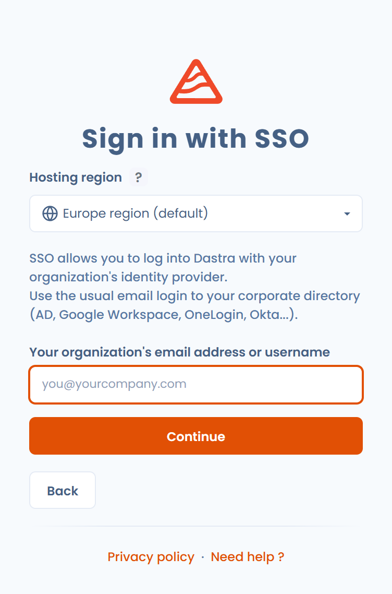

# Anmelden und Authentifizierung verwalten

Diese Seite erklärt, wie Sie sich bei Dastra anmelden, wie Sie Ihr Passwort zurücksetzen und wie Sie die Sicherheit Ihres Kontos erhöhen: starke Authentifizierung, Passkeys und aktive Sitzungen.

## Bei Dastra anmelden

Die Anmeldung erfolgt in zwei Schritten: Sie geben zuerst Ihre E-Mail-Adresse ein und wählen dann, wie Sie sich authentifizieren.

### Mit E-Mail-Adresse und Passwort

1. Rufen Sie [app.dastra.eu](https://app.dastra.eu) auf.
2. Geben Sie Ihre **Geschäftliche E-Mail-Adresse** ein und klicken Sie auf **Weiter**.
3. Geben Sie **Ihr Passwort** ein und klicken Sie auf **Anmelden**.

<figure><figcaption>
Erster Schritt: die E-Mail-Adresse
</figcaption></figure>

<figure><figcaption>
Zweiter Schritt: das Passwort und die weiteren Anmeldeoptionen
</figcaption></figure>


Setzen Sie ein Häkchen bei **Passwort speichern** nur auf einem persönlichen Gerät.


### Mit einem Google- oder Microsoft-Konto

Klicken Sie im ersten Schritt unter **Oder** auf die Schaltfläche für Google oder Microsoft und folgen Sie dann dem Verfahren des Anbieters. Ein externes Konto können Sie unter **Kontosicherheit** > **Externe Anmeldungen** mit Ihrem Dastra-Konto verknüpfen.

### Mit SSO

Hat Ihre Organisation [Single Sign-On (SSO)](../../features/settings/sso/README.md) eingerichtet, melden Sie sich mit Ihrem Identitätsanbieter an.

1. Klicken Sie im ersten Schritt auf **Mit SSO anmelden**.
2. Geben Sie **SSO-Anmeldeinformationen (E-Mail oder Nutzer)** ein und klicken Sie auf **Weiter**.
3. Folgen Sie dem Authentifizierungsverfahren Ihrer Organisation. Dastra leitet Sie anschließend zu Ihrem Mandanten weiter.

<figure><figcaption>
Anmeldung mit SSO
</figcaption></figure>

Bei SSO bleiben Ihre Zugangsdaten bei Ihrem Identitätsanbieter: Dastra erhält Ihr Passwort nicht.

### Mit einem Passkey

Ein Passkey ersetzt das Passwort durch Ihren Fingerabdruck, Ihr Gesicht oder die PIN Ihres Geräts. Klicken Sie im zweiten Schritt auf **Mit einem Passkey anmelden**.

Ihre Passkeys registrieren Sie unter **Kontosicherheit** > **Meine Passkeys verwalten**. Siehe [Passkeys](../../security/passkey.md).

### Mit einem Anmeldelink per E-Mail

Klicken Sie im zweiten Schritt auf **Bitte senden Sie den Zugangslink per E-Mail.** Dastra sendet einen Link an Ihre E-Mail-Adresse, mit dem Sie sich ohne Passwort anmelden.

### Die Hosting-Region wählen

Wenn Ihre Dastra-Umgebung mehrere Hosting-Regionen anbietet, zeigt die Anmeldeseite ein Feld **Hosting region** mit der aktuellen Region: **Europe region (default)** oder **Bleu cloud France**. Klicken Sie auf das Feld, um die andere Region zu öffnen, und melden Sie sich dort an.

Klicken Sie auf die Schaltfläche **?** neben dem Feld (**Learn more about hosting regions**), um die Regionen zu vergleichen. Ein Mandant wird in genau einer Region gehostet, und die beiden Regionen werden weder gespiegelt noch synchronisiert: Ein Konto der einen Region kann sich nicht in der anderen anmelden. Um einen bestehenden Mandanten in die andere Region zu verlegen, verwenden Sie **Contact our sales team** im selben Fenster. Siehe [Dastra auf Bleu](../../security/bleu.md) für die Adressen und die Hosting-Einzelheiten jeder Region.

## Ihr Passwort zurücksetzen

1. Klicken Sie im zweiten Anmeldeschritt auf **Haben Sie Ihr Passwort vergessen?**.
2. Geben Sie die mit Ihrem Konto verknüpfte E-Mail-Adresse ein.
3. Öffnen Sie die E-Mail, die Sie erhalten, und folgen Sie dem Link zum Zurücksetzen.
4. Wählen Sie ein neues Passwort.

<figure><figcaption>
Die Seite zum Zurücksetzen des Passworts
</figcaption></figure>

Funktioniert der Link nicht mehr, beginnen Sie von vorn. Nach der Anmeldung können Sie auch unter **Kontosicherheit** auf **Passwort ändern** klicken: Dastra sendet Ihnen eine E-Mail mit einem Link zum Zurücksetzen.

## Die Sicherheit Ihres Kontos verwalten

Öffnen Sie das Profilmenü oben rechts, klicken Sie auf **Nutzerprofil** und dann im linken Menü auf **Kontosicherheit**. Die Seite fasst zusammen:

* **Passwort**: die Schaltfläche **Passwort ändern**;
* die starke Authentifizierung, auch Zwei-Faktor-Authentifizierung genannt;
* Passkeys;
* **Externe Anmeldungen**;
* **Aktive Sitzungen**;
* Ihren **Aktivitätsverlauf**.

<figure><figcaption>
Die Seite Kontosicherheit
</figcaption></figure>

### Die starke Authentifizierung aktivieren

Die starke Authentifizierung fügt der Anmeldung einen Schritt hinzu: einen 6-stelligen Code, den eine Authentifizierungs-App auf Ihrem Telefon erzeugt.

1. Klicken Sie unter **Kontosicherheit** auf **Zwei-Faktor-Authentifizierung aktivieren**.
2. Scannen Sie den QR-Code mit einer Authentifizierungs-App (Microsoft Authenticator, Google Authenticator, 1Password usw.).
3. Geben Sie den erzeugten Code ein, um die Aktivierung zu bestätigen.
4. Bewahren Sie den Wiederherstellungscode auf, der bei der Aktivierung angezeigt wird.


Der Wiederherstellungscode verschafft Ihnen wieder Zugang zu Ihrem Konto, wenn Sie Ihre Authentifizierungs-App verlieren. Ohne ihn müssen Sie den Inhaber der Organisation bitten, die starke Authentifizierung Ihres Kontos zurückzusetzen.


Ist die starke Authentifizierung aktiviert, geben Sie Ihr Passwort und anschließend den 6-stelligen Code aus Ihrer App ein.

### Aktive Sitzungen verwalten

1. Suchen Sie unter **Kontosicherheit** den Bereich **Aktive Sitzungen**: Er listet die Geräte und Browser auf, die mit Ihrem Konto verbunden sind.
2. Klicken Sie neben der Sitzung, die Sie beenden möchten, auf **Abmelden**.

Beenden Sie jede Sitzung, die Sie nicht kennen, sofort.

## Bewährte Vorgehensweisen zur Sicherheit

* Verwenden Sie für Dastra ein langes, einmaliges Passwort.
* Geben Sie Ihre Zugangsdaten nie weiter, auch nicht intern.
* Aktivieren Sie die starke Authentifizierung oder registrieren Sie einen Passkey.
* Melden Sie sich auf gemeinsam genutzten oder öffentlichen Geräten ab.
* Prüfen Sie regelmäßig Ihre aktiven Sitzungen.

## Siehe auch

* [Ihr Nutzerprofil konfigurieren](profile.md)
* [Benachrichtigungen](../../features/settings/notifications.md)
* [Sicherheit bei Dastra](../../security/general.md)
