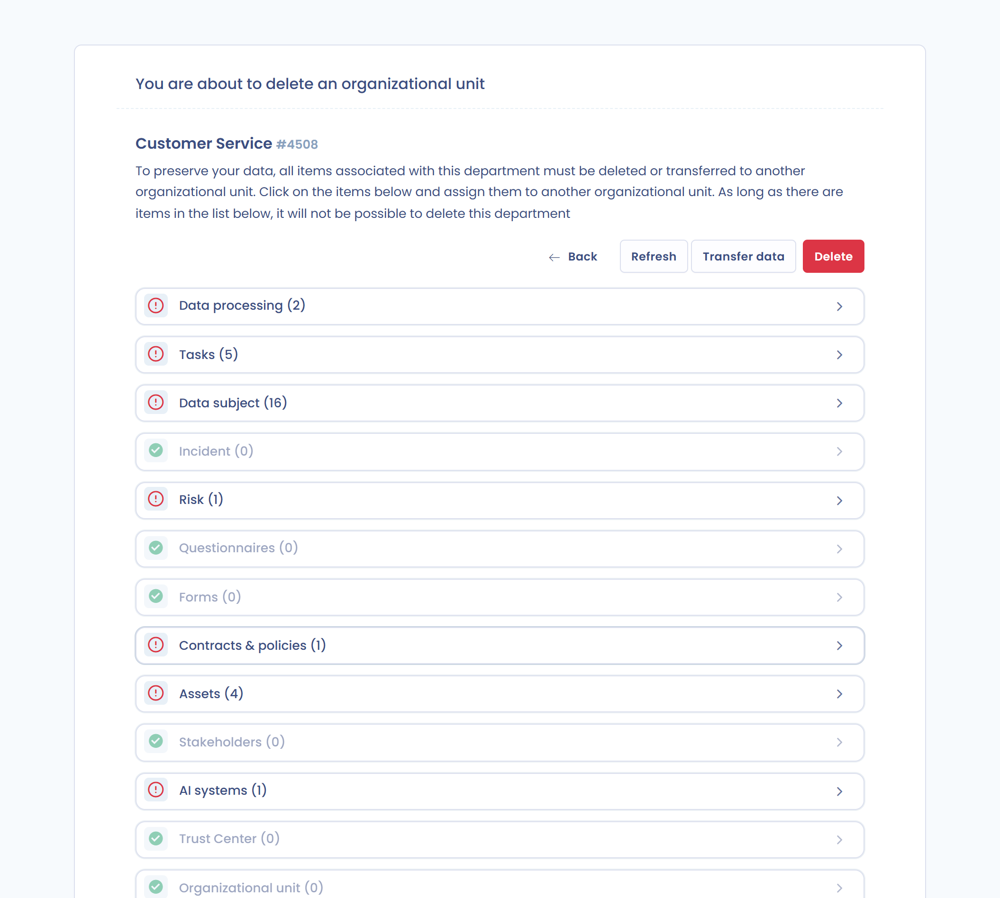
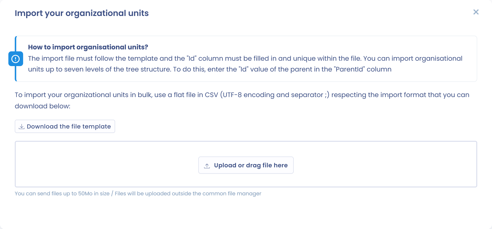

# Organisationseinheiten erstellen und konfigurieren

## Einführung

Organisationseinheiten strukturieren Ihren Mandanten. Es können zwei Arten von Organisationseinheiten erstellt werden:

* **Entitäten**, die juristischen Personen entsprechen und einen Verantwortlichen darstellen;
* **Abteilungen**, die die Entitäten untergliedern.

In Dastra ist ein Mandant keine juristische Person: **Ein Mandant kann sich auf mehrere verschiedene juristische Personen beziehen**, wie in einem Konzern. Pro juristischer Person kann es jedoch nur einen gesetzlichen Vertreter geben.


Jede Entität in Dastra gilt als Verantwortlicher.


## Die Organisationseinheiten aufrufen

Klicken Sie im linken Menü auf **Mandanteneinstellungen** und dann auf **Organisationseinheiten**.

<figure><figcaption>
Das Menü Mandanteneinstellungen
</figcaption></figure>

Es öffnet sich der Bildschirm zum **Erstellen und Konfigurieren** der Organisationseinheiten. Er hat zwei Tabs: **Organisationseinheiten** (die Liste) und **Organigramm**.

<figure><figcaption>
Die Liste der Organisationseinheiten
</figcaption></figure>

## Eine Entität erstellen oder bearbeiten

1. Klicken Sie auf **Eine Entität erstellen**.
2. Füllen Sie den **Namen der Entität** und das **Land** aus, die Pflichtfelder sind. Sie können außerdem die verantwortliche Person (den gesetzlichen Vertreter), den Datenschutzbeauftragten und gegebenenfalls den Vertreter in der Europäischen Union angeben.
3. Klicken Sie auf **Speichern**.

<figure><figcaption>
Das Formular zum Erstellen einer Entität
</figcaption></figure>


Anders als bei Abteilungen hängt die Anzahl der Entitäten (Verantwortlichen), die Sie erstellen können, von einem Kontingent Ihres Abonnements ab. Um es zu erhöhen, [wenden Sie sich an das Vertriebsteam](https://www.dastra.eu/de/contacts).


Um eine Entität zu bearbeiten, klicken Sie rechts neben der Entität auf die drei Punkte und dann auf **Bearbeiten**. Nehmen Sie Ihre Änderungen vor und klicken Sie auf **Speichern**.

<figure><figcaption>
Das Menü mit den drei Punkten einer Organisationseinheit
</figcaption></figure>

## Eine Abteilung erstellen oder bearbeiten

Um eine Abteilung zu erstellen, öffnen Sie das Menü der Schaltfläche **Eine Entität erstellen**, klicken Sie auf **Eine Abteilung erstellen** und füllen Sie die Felder aus.

Um sie zu bearbeiten, klicken Sie rechts neben der Abteilung auf die drei Punkte und dann auf **Bearbeiten**, nehmen Sie Ihre Änderungen vor und klicken Sie auf **Speichern**.

## Untergeordnete Einheiten hinzufügen

Das Menü mit den drei Punkten einer Einheit bietet außerdem:

* **Eine Unterabteilung hinzufügen**: erstellt eine Abteilung unterhalb der Einheit;
* **Eine untergeordnete Entität hinzufügen**: erstellt eine Entität unterhalb der Einheit, zum Beispiel um die Tochtergesellschaft einer Tochtergesellschaft abzubilden.

## Eine Organisationseinheit löschen und ihre Daten übertragen

Eine Organisationseinheit kann nicht gelöscht werden, solange ihr Elemente zugeordnet sind. Klicken Sie im Menü mit den drei Punkten auf **Löschen**, klicken Sie dann auf die aufgelisteten Elemente und weisen Sie sie einer anderen Einheit zu. Mit **Daten übertragen** können Sie auch die Objekttypen Ihrer Wahl in eine andere Einheit verschieben, ohne die Einheit zu löschen.

<figure><figcaption>
Eine Organisationseinheit löschen
</figcaption></figure>


Das Löschen einer Organisationseinheit ist endgültig. Die zugehörigen Daten werden in die Einheit übertragen, die Sie auswählen.


## Organisationseinheiten importieren und exportieren

Öffnen Sie das Menü der Schaltfläche **Eine Entität erstellen**: Es bietet **Importieren** und **Exportieren**.

Um zu importieren, klicken Sie auf **Importieren** und dann auf **Laden Sie die Dateivorlage herunter**. Füllen Sie die Datei aus und legen Sie sie im Ablagebereich ab. Die Datei kann im Format CSV (Kodierung UTF-8, Trennzeichen `;`), TXT oder XLSX vorliegen.

<figure><figcaption>
Das Importfenster
</figcaption></figure>

Zwei Spalten sind erforderlich:

* `Id`: die Kennung der Einheit, ein Text, der innerhalb der Datei eindeutig ist (höchstens 80 Zeichen);
* `Label`: der Name der Einheit (höchstens 80 Zeichen).

Die übrigen Spalten sind optional:

* `ParentId`: die `Id` der übergeordneten Einheit, falls es eine gibt;
* `CountryCode`: das Land als 2-stelliger Code ([ISO 3166](https://www.iso.org/iso-3166-country-codes.html)). Der Standardwert ist `FR`;
* `Type`: `Entity` für eine Entität oder `Area` für eine Abteilung. Der Standardwert ist `Entity`;
* `City`, `Address`, `ZipCode`, `MailAddress`, `PhoneNumber` und `ImmatriculationNumber`: die Kontaktdaten der Einheit;
* `RepresentativeName` und `RepresentativeType`, `DpoName` und `DpoType`, `ReferentName` und `ReferentType`: Name und Typ des Stakeholders, der als Vertreter, Datenschutzbeauftragter oder verantwortliche Person zugeordnet ist;
* `OwnerEmail`: die E-Mail-Adresse des Inhabers der Einheit.


Beschränken Sie die Hierarchie auf 7 Ebenen (Beziehungen zwischen übergeordneten und untergeordneten Einheiten), damit der Import korrekt verarbeitet wird.


Beispiel:

<table><thead><tr><th>Id</th><th>ParentId</th><th width="492">Label</th><th>CountryCode</th><th>Type</th></tr></thead><tbody><tr><td>20996</td><td></td><td>HOLDING</td><td>FR</td><td>Entity</td></tr><tr><td>21009</td><td>20996</td><td>IT</td><td>BE</td><td>Area</td></tr></tbody></table>

## Einheiten im Organigramm anzeigen und konfigurieren

Der Tab **Organigramm** zeigt Ihre Entitäten und Abteilungen grafisch. Die meisten Vorgänge der Liste können Sie auch dort ausführen.

<figure><figcaption>
Die Ansicht Organigramm
</figcaption></figure>

## Zugriff auf den Inhalt einer Organisationseinheit einschränken

Mit Teams von Nutzern können Sie den Zugriff auf die Inhalte einschränken, die einer Organisationseinheit zugeordnet sind. Ordnen Sie dazu der Einheit Teams zu: Klicken Sie im Menü mit den drei Punkten auf **Festlegen der Berechtigungen für** und fügen Sie die zugelassenen Nutzer oder Teams hinzu.

Standardmäßig erbt eine untergeordnete Einheit die Berechtigungen ihrer übergeordneten Einheit. Sobald Sie der untergeordneten Einheit Berechtigungen hinzufügen, ersetzen diese die geerbten.

### Eingeschränkter Zugriff nur auf eine untergeordnete Entität

Sie können einen Nutzer oder ein Team **nur zu einer untergeordneten Entität** hinzufügen, ohne ihm Zugriff auf die übergeordneten Entitäten zu geben. Er hat dann **ausschließlich Zugriff auf die Daten dieser Entität**, weder auf die der übergeordneten noch auf die der gleichrangigen Entitäten.

Dieser Modus ist nützlich, um die Verwaltung einer Tochtergesellschaft oder einer Abteilung an lokale Nutzer zu delegieren, ohne Konzerndaten offenzulegen. Um ihn einzurichten, öffnen Sie die Berechtigungen der Entität und fügen Sie den Nutzer oder das Team direkt zu dieser Entität hinzu, ohne ihn oder es der übergeordneten Entität zuzuordnen.


Anders als im Standardmodus gibt der eingeschränkte Zugriff auf eine untergeordnete Entität keinen Zugriff auf die Daten der übergeordneten Entitäten.


## Weiterführende Informationen


[teams.md](teams.md)

