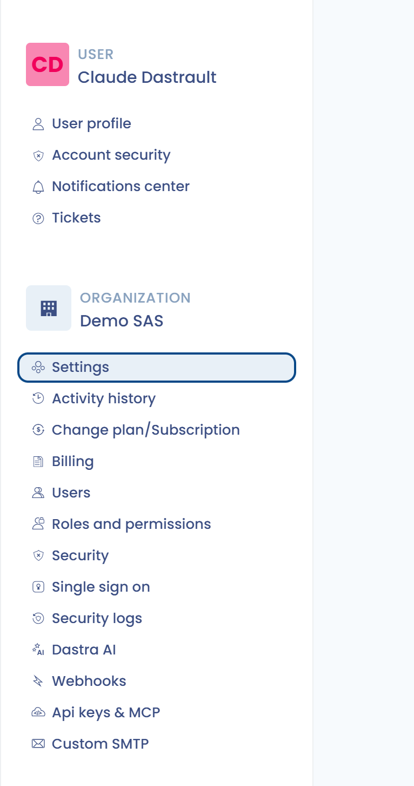

# Rollen und Berechtigungen verwalten

Beim Einladen eines Nutzers bietet Dastra standardmäßig **fünf Rollen** an:

* **Administrator**: Administratoren haben die Rechte der Beitragenden und können die Einstellungen des Mandanten verwalten. Nur Administratoren können eine Verarbeitungstätigkeit auf den Status „veröffentlicht“ setzen, Organisationseinheiten erstellen und neue Nutzer in den Mandanten einladen.
* **Beitragender**: Beitragende können den Inhalt des Mandanten lesen und bearbeiten. Sie können Elemente erstellen und noch nicht veröffentlichte Entwürfe ändern. Sie können die Einstellungen des Mandanten nicht ändern.
* **Leser**: Leser können den Inhalt des Mandanten nur einsehen. Sie können weder Inhalte bearbeiten noch die Einstellungen des Mandanten ändern.
* **Auditor**: Rolle des Compliance-Moduls. Sie gewährt Lesezugriff auf Dateien und Anhänge und ermöglicht es, die eigenen Audit-Elemente der Compliance zu bearbeiten.
* **Compliance-Tester**: Rolle des Compliance-Moduls. Sie gewährt Lese- und Schreibzugriff auf Dateien und Anhänge und ermöglicht es, die eigenen operativen Elemente der Compliance zu bearbeiten.


Nur **Inhaber** können die Einstellungen des Organisationskontos ändern und Mandanten erstellen.


## Einem Nutzer eine Rolle zuweisen

In Dastra kann ein Nutzer mehrere Rollen haben. Sie können sie an zwei Stellen zuweisen.

### Im aktuellen Mandanten

1. Klicken Sie im linken Menü auf **Mandanteneinstellungen** und dann auf **Nutzer**.
2. Öffnen Sie das Menü in der Zeile des Nutzers und klicken Sie dann auf **Rollen zuweisen**. Die Zahl in Klammern gibt an, wie viele Rollen der Nutzer bereits hat.
3. Wählen Sie die Rolle oder die Rollen aus, die Sie zuweisen möchten.

### In mehreren Mandanten gleichzeitig

Nur die Inhaber der Organisation können diese Methode verwenden.

1. Klicken Sie oben rechts auf dem Bildschirm auf Ihr Profilsymbol, dann auf **Konfiguration der Organisation** und anschließend auf **Nutzer**.
2. Öffnen Sie das Menü in der Zeile des Nutzers und klicken Sie dann auf **Rollen und Mandanten**.
3. Klicken Sie auf **Zuweisen**, wählen Sie die Rolle aus und legen Sie den Geltungsbereich fest: **Alle Mandanten der Organisation** oder **Spezifische Mandanten**.

<figure><figcaption>
Eine Rolle allen Mandanten oder einer Auswahl zuweisen
</figcaption></figure>

Sie können auch benutzerdefinierte Rollen erstellen, die möglicherweise besser zu Ihrer Organisation passen.

## Eine benutzerdefinierte Rolle erstellen

Um eine benutzerdefinierte Rolle zu erstellen, müssen Sie Inhaber der Organisation sein.

1. Klicken Sie oben rechts auf dem Bildschirm auf Ihr Profilsymbol und dann auf **Konfiguration der Organisation**.
2. Klicken Sie im Konfigurationspanel auf **Rollen und Berechtigungen**.

<figure><figcaption>
Das Profilmenü
</figcaption></figure>

<figure><figcaption>
Das Konfigurationspanel der Organisation
</figcaption></figure>

Die Liste der Rollen und Berechtigungen wird angezeigt.

<figure><figcaption>
Die Liste der Rollen mit Beispielen für benutzerdefinierte Rollen
</figcaption></figure>


Nur die Inhaber der Organisation haben Zugriff auf die Verwaltung der Rollen und Berechtigungen.


3. Klicken Sie auf **Eine Rolle hinzufügen** und geben Sie ihr einen Namen.
4. Aktivieren Sie die Berechtigungen, die mit den einzelnen Funktionen verknüpft sind (**Lesen**, **Schreiben**, **Erstellen**, **Importieren**, **Exportieren** usw.). In den Modulen, die sie anbieten, erlaubt die Berechtigung **Erstellen** das Erstellen neuer Elemente, unabhängig von der Berechtigung **Schreiben**, die deren Änderung erlaubt (siehe [Rollen und Berechtigungen](../../features/settings/roles.md)).
5. Klicken Sie unten auf dem Bildschirm auf **Speichern**.

Um von einer bestehenden Rolle auszugehen, klicken Sie daneben auf **Klonen**. **Berechtigungen anzeigen** zeigt die Berechtigungen einer Rolle an, ohne sie zu ändern.


Damit die neue Rolle wirksam wird, muss sie einem oder mehreren Nutzern zugewiesen werden, und zwar über die oben beschriebene Seite **Nutzer**.


Sie können jetzt das Tutorial durchgehen oder die Funktionen von Dastra auf eigene Faust erkunden.


[Tutorial](../tutorial/README.md)

