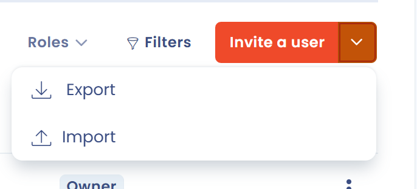
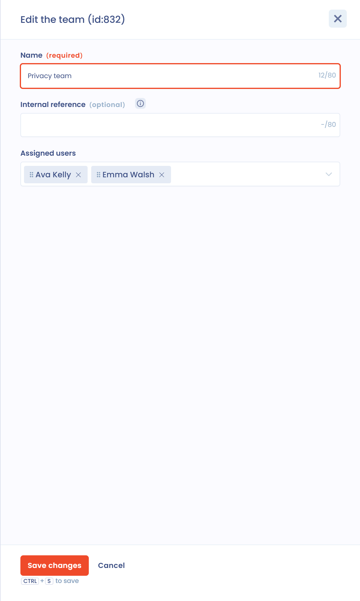

# Nutzer einladen

## Einen Nutzer einladen

Sie können jemanden zur Zusammenarbeit in Ihren Mandanten einladen, indem Sie ihn in die Organisation einladen, zu der der Mandant gehört.

1. Klicken Sie im linken Menü auf **Mandanteneinstellungen** und dann auf **Nutzer**.
2. Klicken Sie auf **Einen Nutzer einladen**.
3. Geben Sie die E-Mail-Adresse der Person ein. Ist diese Adresse der Organisation noch nicht zugeordnet, klicken Sie darauf, um fortzufahren.
4. Füllen Sie das Einladungsformular aus (siehe die folgende Tabelle) und klicken Sie dann auf **Eine Einladung per E-Mail senden**.

<figure><figcaption>
Die Seite Nutzer in den Mandanteneinstellungen
</figcaption></figure>

<figure><figcaption>
Das Einladungsformular
</figcaption></figure>

| Feld | Beschreibung |
| --- | --- |
| **Vorname** und **Name** | Identität der eingeladenen Person |
| **Sprache der Benutzeroberfläche** | Sprache, in der die Person Dastra sieht |
| **Einladen in alle Mandanten des Kontos** | Schalter: Ist er ausgeschaltet, wählen Sie den betreffenden Mandanten aus |
| **Bitte wählen Sie die Rolle(n) des Nutzers aus.** | Siehe [Rollen und Berechtigungen verwalten](roles.md) |
| **Bitte wählen Sie die Teams des Nutzers aus.** | Siehe [Teams erstellen und zuweisen](teams.md) |
| **Standardmäßige Verbindungsmethode** | Lokales Konto (Anmeldename und Passwort) oder SSO, sofern ein SSO konfiguriert ist |
| **Begrüßungsnachricht** | Text, der der Einladungs-E-Mail hinzugefügt wird |

Sie können auch unten in der linken Seitenleiste auf **Invite a member** klicken: Dadurch öffnet sich dasselbe Formular.

Die eingeladene Person erhält eine E-Mail mit einem Link, der Zugang zum Mandanten gibt. Sie erhalten eine Benachrichtigungs-E-Mail, sobald die Person auf den Link klickt. Der Einladungslink läuft nach 10 Tagen ab.

Statt die E-Mail zu versenden, können Sie auf **Einladungslink generieren** klicken: Dastra zeigt dann einen Link an, den Sie selbst an die Person weitergeben.

### Ausstehende Einladungen finden

Ausstehende Einladungen verwalten Sie im Tab **Einladungen** der Seite **Nutzer**.

<figure><figcaption>
Der Tab Einladungen
</figcaption></figure>


Ihr Abonnement begrenzt die Anzahl der Nutzer. Das Kontingent zählt die aktiven Nutzer und die Nutzer, die mit einer ausstehenden oder abgelaufenen Einladung verknüpft sind: Entfernen Sie den Nutzer einer Einladung, die Sie nicht mehr brauchen, um einen Platz freizugeben. Ist die Grenze erreicht, zeigt Dastra **You have reached the users limit**, und Sie können das Dastra-Team kontaktieren, um sie zu erhöhen.


### Einen Einladungslink erneut senden

Hat die eingeladene Person nicht auf den Link geklickt und ist dieser abgelaufen, klicken Sie neben der Einladung auf die Schaltfläche zum erneuten Senden und bestätigen Sie anschließend.

### Teams erstellen und zuweisen

In Dastra werden Nutzer in Teams gruppiert. Die Teams werden dann Entitäten oder Abteilungen zugewiesen, sodass sich Rollen und Verantwortlichkeiten genau verwalten lassen. Siehe [Teams erstellen und zuweisen](teams.md).

### Standardrollen

Dastra bietet fünf Basisrollen. Ihre detaillierten Berechtigungen sind unter [Rollen und Berechtigungen verwalten](roles.md) beschrieben.

| Rolle | Kennung |
| --- | --- |
| Administrator | 1 |
| Beitragender | 2 |
| Leser | 3 |
| Auditor | 11000 |
| Compliance-Tester | 11500 |


**Inhaber der Organisation und Datenschutzbeauftragter sind keine Rollen.** Wie Sie einem bereits eingeladenen Nutzer den Status **Inhaber** der Organisation geben, lesen Sie unter [Wie füge ich einen Inhaber der Organisation hinzu?](faq.md#wie-fuge-ich-einen-inhaber-der-organisation-hinzu). Wie Sie **den Datenschutzbeauftragten ändern**, lesen Sie unter [Wie ändere ich den Datenschutzbeauftragten?](faq.md#wie-andere-ich-den-datenschutzbeauftragten).


## Eine große Nutzerliste importieren

Um eine große Nutzerliste (ab 50 Nutzern) zu importieren, wenden Sie sich an das Dastra-Team. Sie können den Import einer Liste von bis zu 200 Nutzern beantragen, im Rahmen der verfügbaren Nutzer.

**Vorgehen:**

1. Öffnen Sie [https://app.dastra.eu/general-settings/users](https://app.dastra.eu/general-settings/users), klicken Sie auf den Pfeil rechts neben der Schaltfläche **Einen Nutzer einladen** und dann auf **Importieren**.

<figure><figcaption>
Das Importmenü in den Einstellungen der Organisation
</figcaption></figure>

2. Erstellen Sie pro Mandant eine Datei im CSV-Format mit den folgenden, durch Kommas getrennten Spalten.

Erforderlich:

* `Email`: die E-Mail-Adresse des Nutzers;
* `GivenName`: sein Vorname;
* `FamilyName`: sein Nachname;
* `Roles`: die Kennungen der Rollen in Dastra, getrennt durch `|`;
* `Teams`: die Kennungen der Teams in Dastra, getrennt durch `|`.

Optional:

* `SSOConfigurationId`: die Kennung der SSO-Anmeldung, falls zutreffend.

Hier eine Beispieldatei zum Herunterladen und Ausfüllen:


Vorlage der Importdatei


**Kennungen der Rollen**

Die Basisrollen haben die Kennungen aus der obigen Tabelle. Bei den benutzerdefinierten Rollen, die Sie erstellt haben, ist die Kennung in der Entwicklerkonsole Ihres Browsers sichtbar, im Tab Network. Die Rollen müssen vor dem Import erstellt werden.


So öffnen Sie die Konsole in Chrome: Cmd + Option + C (Mac) oder Strg + Umschalt + J (Windows).

So öffnen Sie die Konsole in Firefox: Cmd + Option + K (Mac) oder Strg + Umschalt + J (Windows).

So öffnen Sie die Konsole in Microsoft Edge: Strg + Umschalt + I.


**Kennungen der Teams**

Teams werden über ihre Kennungsnummer identifiziert. Um sie zu finden, öffnen Sie das Team in Dastra mit der Schaltfläche **Bearbeiten**: Die Nummer steht im Titel des Fensters.

<figure><figcaption>
In diesem Beispiel lautet die Kennung des Teams „Test“ 8019
</figcaption></figure>

Teams sind in Dastra nicht verpflichtend. Die Teams, die Sie in der Datei verwenden, müssen vorher im Mandanten erstellt worden sein.

**Kennung der SSO-Konfiguration**

Die Spalte `SSOConfigurationId` ist **optional**: Füllen Sie sie nur aus, wenn die importierten Nutzer einer bereits in Ihrer Organisation konfigurierten SSO-Anmeldung zugeordnet werden sollen. Lassen Sie sie für eine Standardanmeldung mit E-Mail-Adresse und Passwort leer.

Wie bei den benutzerdefinierten Rollen wird diese Kennung in der **Entwicklerkonsole** Ihres Browsers abgerufen, im Tab **Network**:

1. Öffnen Sie [die Konfigurationsseite der SSO-Anmeldungen](https://app.dastra.eu/general-settings/sso) (Sie müssen Inhaber der Organisation sein).
2. Öffnen Sie die Entwicklerkonsole (siehe die Tastenkombinationen oben) und wechseln Sie in den Tab **Network**.
3. Klicken Sie auf das Stiftsymbol der betreffenden SSO-Anmeldung, um das Fenster **SSO-Anmeldung bearbeiten** zu öffnen. Es handelt sich um ein modales Fenster: Die URL der Seite bleibt `https://app.dastra.eu/general-settings/sso`.
4. Öffnen Sie im Tab **Network** die Anfrage, die beim Öffnen des Fensters ausgelöst wird, und notieren Sie den Wert des Felds `scheme` (er steht auch am Ende der Anfrage-URL, nach `ssoConfiguration/`): Dies ist der Wert, der in die Spalte `SSOConfigurationId` einzutragen ist.


Die SSO-Anmeldung muss vorher konfiguriert sein. Siehe [Single Sign On (SSO)](../../features/settings/sso/README.md).


3. Speichern Sie Ihre Datei im Format CSV UTF-8. Wählen Sie in Excel den Dateityp **CSV UTF-8 (durch Trennzeichen getrennt)**.
4. Teilen Sie uns mit, in welchen Mandanten Sie die Nutzer importieren möchten, und legen Sie die Datei in der Upload-Oberfläche ab.

<figure><figcaption>
Die Upload-Oberfläche für die Datei
</figcaption></figure>

Das Dastra-Team erhält Ihre Anfrage und meldet sich bei Ihnen.
