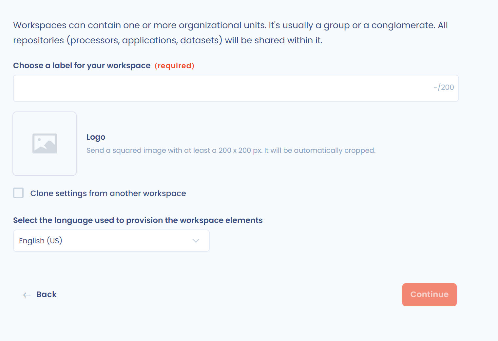
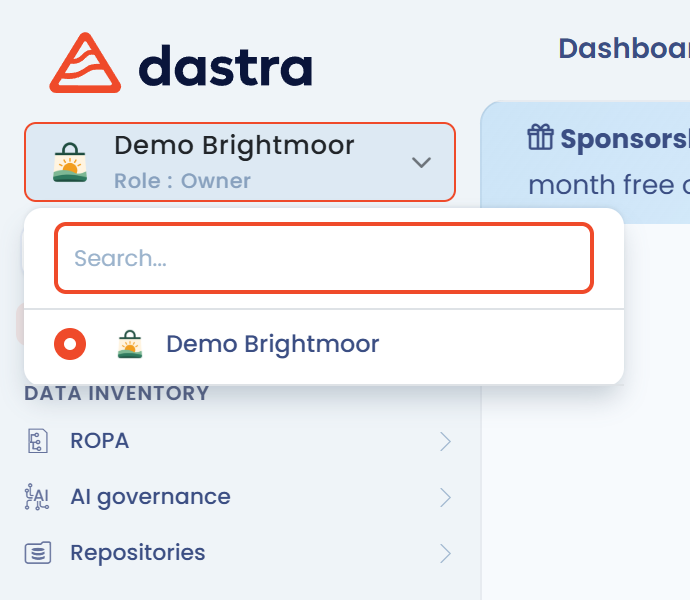

# Einen Mandanten erstellen und konfigurieren

Diese Seite erklärt, wie Sie einen Mandanten erstellen, seine ersten Nutzer einladen, Ihre erste Entität erfassen und zwischen Ihren Mandanten wechseln.

## Bei Dastra anmelden

Melden Sie sich zunächst unter [app.dastra.eu](https://app.dastra.eu) an. Wenn Sie noch kein Konto haben, bitten Sie einen Administrator Ihrer Organisation, Sie einzuladen. Wenn Ihre Organisation Dastra noch nicht nutzt, [fordern Sie eine Demo an](https://www.dastra.eu/de/contacts/demo).

## Mandant

Ein Mandant ist **eine Organisation, die ein oder mehrere Verarbeitungsverzeichnisse enthält**. Sie können je nach Wunsch einen Mandanten pro Verzeichnis, pro juristischer Entität oder pro Niederlassung erstellen. Die Definitionen der übrigen Begriffe (Organisation, Organisationseinheit, Entität, Abteilung) finden Sie unter [Wichtige Begriffe](key-concepts.md).


Ein Mandant ist eine Umgebung, deren **Daten vollständig voneinander getrennt sind**: Die Datensätze eines Mandanten (Verarbeitungstätigkeiten, Assets, Anfragen usw.) sind aus dem Kontext eines anderen Mandanten niemals zugänglich. Sie können jedoch im mandantenübergreifenden Dashboard **konsolidierte Statistiken** über alle Ihre Mandanten hinweg ansehen (siehe [Mandantenübergreifende Statistiken](workspace.md#mandantenubergreifende-statistiken)) und Elemente (Verarbeitungstätigkeiten, Assets usw.) von einem Mandanten in einen anderen duplizieren.


## Einen Mandanten erstellen

Nur Inhaber der Organisation können einen Mandanten erstellen.

1. Klicken Sie auf der Seite, die Ihre Mandanten auflistet, auf **Mandant erstellen**.
2. Füllen Sie das Pflichtfeld **Name des Mandanten** aus.
3. Fügen Sie optional das **Logo des Mandanten** hinzu: ein quadratisches Bild von mindestens 200 x 200 px, das automatisch zugeschnitten wird.
4. Wählen Sie die Sprache in der Liste **Bitte wählen Sie die Sprache aus, die in diesem Mandant verwendet werden soll.** aus.
5. Klicken Sie auf **Weiter**.

<figure><figcaption>
Das Formular zum Erstellen eines Mandanten
</figcaption></figure>

Um von der Konfiguration eines bestehenden Mandanten auszugehen, aktivieren Sie **Die Einstellungen eines anderen Mandanten kopieren**, wählen Sie im Feld **Quell-Mandant** den gewünschten Mandanten aus und aktivieren Sie bei Bedarf **Nutzer und Teams einbeziehen**. Die Sprachauswahl entfällt: Der neue Mandant verwendet die Sprache des Quell-Mandanten.


Sobald der Mandant erstellt ist, können Sie seine Organisationseinheiten einrichten und Nutzer einladen.


### Die ersten Nutzer einladen

Nach der Erstellung öffnet Dastra die Nutzerseite des neuen Mandanten. Sie können bestehende Nutzer der Organisation hinzufügen oder mit **Einen Nutzer einladen** neue Nutzer einladen.

<figure><figcaption>
Der Schritt zum Einladen von Nutzern
</figcaption></figure>

Weisen Sie jedem Nutzer die gewünschte Rolle zu und klicken Sie dann auf **Weiter**. Die Details der Einladungsfelder finden Sie unter [Nutzer einladen](users.md).

### Die erste Entität erstellen

In Dastra ist ein Mandant keine juristische Entität: Er kann mehrere davon zusammenfassen, wie in einem Konzern. Jede Entität entspricht einem Verantwortlichen, und eine Entität hat nur einen gesetzlichen Vertreter.

Um die erste Entität zu erstellen, füllen Sie den **Namen der Entität** und das **Land** aus: Das sind die beiden Pflichtfelder. Sie können auch ihre Vertreter angeben (die verantwortliche Person und den gesetzlichen Vertreter) sowie, falls einer benannt wurde, ihren Datenschutzbeauftragten.

<figure><figcaption>
Das Formular zum Erstellen der ersten Entität
</figcaption></figure>

Klicken Sie auf **Weiter**, um in Ihren Mandanten zu gelangen. Sie können auch auf **Überspringen** klicken und Ihre Entitäten später erstellen.

### Weitere Entitäten und Abteilungen erstellen

Sobald Ihr Mandant geöffnet ist, erfassen Sie möglichst bald die übrigen juristischen Entitäten und die Abteilungen. Das vereinfacht später die Verwaltung der Verarbeitungstätigkeiten und die Vergabe von Nutzerrechten.

1. Klicken Sie im linken Menü auf **Mandanteneinstellungen** und dann auf **Organisationseinheiten**.
2. Klicken Sie auf **Eine Entität erstellen**, um eine juristische Entität hinzuzufügen, oder öffnen Sie das Menü der Schaltfläche und wählen Sie **Eine Abteilung erstellen**.
3. Wiederholen Sie dies, bis das Organigramm Ihrer Struktur in Dastra abgebildet ist.

<figure><figcaption>
Die Ansicht Organigramm
</figcaption></figure>

Informationen zu untergeordneten Abteilungen, untergeordneten Entitäten, Import und Löschung finden Sie unter [Organisationseinheiten erstellen und konfigurieren](organizational-units.md).

## Auf einen Mandanten zugreifen

1. Melden Sie sich mit Ihrem Nutzerkonto bei der Anwendung an.
2. Klicken Sie in der angezeigten Liste auf die Kachel Ihres Mandanten.

<figure><figcaption>
Die Liste der Mandanten
</figcaption></figure>

Sie befinden sich jetzt in Ihrem Mandanten. Um jederzeit den Mandanten zu wechseln, klicken Sie oben in der linken Seitenleiste auf die Mandantenauswahl.

<figure><figcaption>
Die Mandantenauswahl
</figcaption></figure>

## Mandantenübergreifende Statistiken

Das mandantenübergreifende Dashboard bündelt die Kennzahlen aller Ihrer Mandanten in einer einzigen Ansicht. Inhaber rufen es über die Schaltfläche **Statistiken** in der Liste der Mandanten auf.

<figure><figcaption>
Die Schaltfläche Statistiken öffnet das mandantenübergreifende Dashboard aus der Liste der Mandanten
</figcaption></figure>

Es konsolidiert die Kennzahlen der wichtigsten Module: Verarbeitungsverzeichnis, Betroffenenanfragen, Datenschutzvorfälle, Fragebögen, KI-Systeme und Aufgaben. Die Daten werden als Widgets und Diagramme dargestellt.

<figure><figcaption>
Konsolidierte Kennzahlen des Verarbeitungsverzeichnisses und der Betroffenenanfragen über alle Mandanten hinweg
</figcaption></figure>

Mit dynamischen Filtern können Sie die Analyse nach Mandant, nach Organisationseinheit und nach Typ eingrenzen. Die Schaltfläche **Bitte wählen Sie einen Zeitraum aus** beschränkt die Kennzahlen auf einen Zeitraum: Wählen Sie einen vordefinierten Zeitraum (Heute, Aktuelle Woche, Aktueller Monat, Laufendes Jahr usw.) oder ein Start- und ein Enddatum im Kalender und klicken Sie dann auf **Anwenden**. Ist kein Zeitraum ausgewählt, umfassen die Kennzahlen alle Daten. Die Schaltfläche **Zurücksetzen** entfernt den ausgewählten Zeitraum. Das Dashboard kann gedruckt und exportiert werden.

## Weiterführende Informationen

Folgen Sie dem nachstehenden Tutorial oder erkunden Sie Dastra auf eigene Faust.


[Tutorial](../tutorial/README.md)

