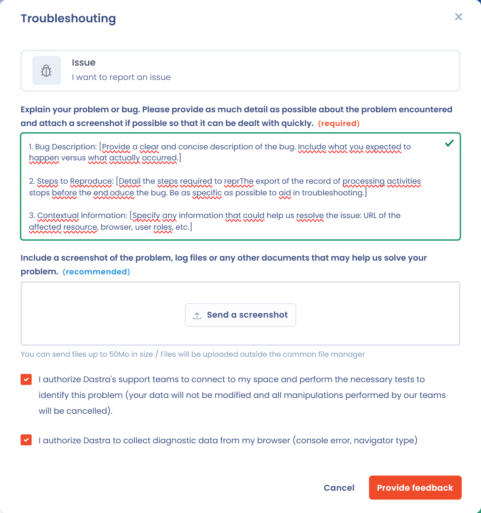

# Supportanfrage

Manchmal lässt sich das Problem, mit dem Sie konfrontiert sind, weder mit dieser Dokumentation noch mit dem Chat oder der Online-Hilfe lösen.

In diesem Fall bietet Dastra Ihnen die Möglichkeit, uns direkt aus der Anwendung heraus zu kontaktieren: über **den Chat** unten rechts auf dem Bildschirm, um **funktionale Fragen an Ihren dedizierten Privacy Success Manager** zu stellen, oder über das Formular für **Support-Anfragen** oben rechts auf dem Bildschirm, **für technische Probleme**.

<figure><figcaption>
Die Chat-Schaltfläche unten rechts auf dem Bildschirm
</figcaption></figure>

<figure><figcaption>
Die Schaltfläche für Nutzerfeedback oben rechts auf dem Bildschirm
</figcaption></figure>


Um auf das Formular für Support-Anfragen oder den Chat zuzugreifen, müssen Sie ein Konto haben und in der Anwendung angemeldet sein.


## Der Chat

Im Chat sprechen Sie mit Ihrem **dedizierten Privacy Success Manager** darüber, wie Sie die Plattform nutzen, oder erhalten Hilfe beim Verständnis der Funktionen.

## Das Formular für Support-Anfragen

Damit können Sie Fehler melden, Ideen für neue Funktionen vorschlagen oder dem Supportteam technische Fragen stellen.

1. Klicken Sie oben rechts auf die Schaltfläche **Bitte wenden Sie sich an den Support** (Megafon-Symbol). Es öffnet sich ein Fenster.
2. Wählen Sie einen der sechs Anfragetypen aus:

   | Typ | Wann Sie ihn wählen |
   | --- | --- |
   | **Problemlösung** | Sie haben ein Problem oder eine Frage zur Nutzung einer Funktion. Zuerst wird eine Suche in der Dokumentation angeboten: Beantwortet sie Ihre Frage nicht, klicken Sie auf **Ticket erstellen**. |
   | **Fehlerbericht** | Sie möchten eine Fehlfunktion der Anwendung melden. |
   | **Aktualisierung des Abonnements** | Sie möchten Ihr Abonnement ändern oder Informationen zu Ihrer Rechnungsstellung erhalten. |
   | **Funktionsidee** | Sie möchten eine neue Funktion vorschlagen. |
   | **Hinweis** | Sie möchten Ihre Meinung zur Anwendung äußern. |
   | **Weitere Anfrage** | Für alle weiteren Anfragen. |

3. Beschreiben Sie Ihre Anfrage detailliert und klicken Sie dann auf **Anfrage senden**.

<figure><figcaption>
Den Anfragetyp auswählen
</figcaption></figure>

Bei einem Fehlerbericht und bei einer Problemlösung bietet das Fenster zwei Kontrollkästchen an:

* **Ich ermächtige die Support-Teams von Dastra, sich in meinen Bereich einzuloggen und die zur Identifizierung dieses Problems erforderlichen Tests durchzuführen**: Ihre Daten werden nicht verändert, und alle Manipulationen der Teams werden rückgängig gemacht;
* **Ich erlaube Dastra, Diagnosedaten meines Browsers zu erfassen**: Konsolenfehler und Browsertyp. Dieses Kontrollkästchen ist standardmäßig aktiviert.

<figure><figcaption>
Die Kontrollkästchen zur Erlaubnis bei einem Fehlerbericht
</figcaption></figure>

Wenn Sie diese Kontrollkästchen aktiviert lassen, kann das Team schneller und effizienter auf Ihre Anfrage reagieren.

Sobald die Anfrage gesendet ist, antwortet das Team so schnell wie möglich. Das Formular steht jederzeit zur Verfügung und bewahrt einen Verlauf Ihrer Anfragen auf.

## Telefon

Bei Problemen mit dem Zugriff auf die Anwendung oder bei dringenden Notfällen:\
[+33 1 76 31 05 47](tel:+33176310547) (erreichbar von 9:00 bis 18:00 Uhr, GMT+2)

## Weitere Anfragen

Wenn Sie eine andere Art von Anfrage stellen möchten oder noch kein Dastra-Konto haben, schreiben Sie an [support@dastra.eu](mailto:support@dastra.eu). So werden alle Anfragen zentral erfasst und im offiziellen Support-Prozess bearbeitet.
