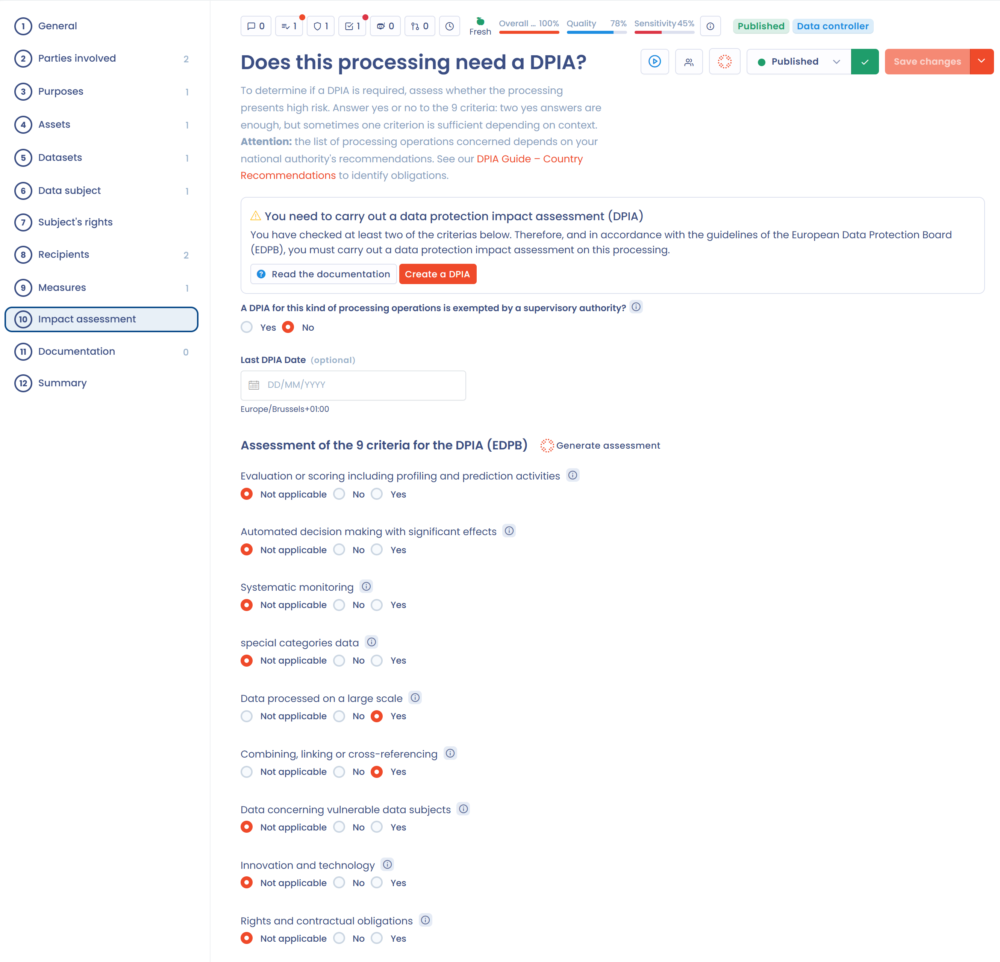

# Schritt 3: Risiken verwalten

Das Risikomanagement in Dastra kann verschiedene Formen annehmen:

* die Datenschutz-Folgenabschätzung (DSFA),
* die Identifizierung und Bewertung von Risiken (mit dem Modul Risiken),
* Audits.

## Die Datenschutz-Folgenabschätzung

Wenn Sie Verarbeitungstätigkeiten identifiziert haben, die voraussichtlich ein hohes Risiko für die Rechte und Freiheiten der betroffenen Personen mit sich bringen, müssen Sie für jede davon eine [Datenschutz-Folgenabschätzung](https://dsgvo-gesetz.de/themen/datenschutz-folgenabschaetzung/) (DSFA) durchführen.


Die Durchführung einer DSFA ist für jede Verarbeitung verpflichtend, die voraussichtlich ein hohes Risiko für die Rechte und Freiheiten der betroffenen Personen mit sich bringt (Artikel 35 der DSGVO).


Um Ihnen bei der Beurteilung zu helfen, ob Ihre Verarbeitung voraussichtlich ein hohes Risiko mit sich bringt, definieren die Leitlinien der Artikel-29-Datenschutzgruppe die folgenden 9 Kriterien:

1. Bewertung oder Scoring;
2. automatisierte Entscheidungsfindung mit Rechtswirkung oder ähnlich erheblicher Wirkung;
3. systematische Überwachung;
4. sensible Daten oder Daten höchstpersönlicher Natur;
5. Verarbeitung personenbezogener Daten in großem Umfang;
6. Abgleichen oder Kombinieren von Datensätzen;
7. Daten zu schutzbedürftigen betroffenen Personen;
8. innovative Nutzung oder Anwendung neuer technologischer oder organisatorischer Lösungen;
9. Ausschluss von einem Recht, einer Dienstleistung oder einem Vertrag.

Diese Kriterien sind in den Workflow zur Erstellung einer Verarbeitungstätigkeit integriert: Für jedes Kriterium geben Sie an, ob eine DSFA durchgeführt werden muss.

<figure><figcaption>
Beispiel einer Verarbeitungstätigkeit, die potenziell eine DSFA erfordert
</figcaption></figure>

## Identifizierung und Bewertung von Risiken

Mit dem Modul Risiken von Dastra verwalten Sie Risiken auf der Ebene Ihrer Verarbeitungstätigkeiten, Ihrer Stakeholder (zum Beispiel Auftragsverarbeiter) und Ihrer Assets.

Die Methodik des Risikomanagements entspricht den Standardanforderungen an das Risikomanagement von Informationssystemen. Sie umfasst vier Schritte:

1. Risikoidentifizierung;
2. Risikobewertung;
3. Risikobehandlung;
4. Risikoüberwachung.

Allgemein wird das Risiko wie folgt gemessen:

$$
Risiko = Wahrscheinlichkeit * Auswirkung
$$


[Risikomanagement](../../features/risks/README.md)


## Audits

Um beim Risikomanagement weiterzugehen, können Sie in Dastra außerdem Audits entwerfen, Kampagnen durchführen und die Ergebnisse als exportierbaren Auditbericht erfassen.


[Fragebögen](../../features/questionnaires/README.md)


Ihre Risiken sind identifiziert und bewertet. Weiter geht es mit Schritt 4, der Priorisierung der Aufgaben:


[Schritt 4: Maßnahmen priorisieren](step-4.md)

