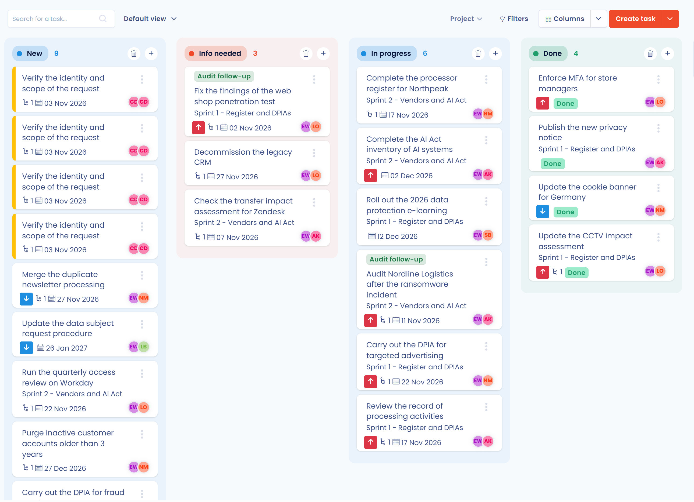

# Schritt 4: Maßnahmen priorisieren

Sobald das Verzeichnis erstellt ist, listen Sie alle Aufgaben auf, die zu erledigen sind, um den aktuellen und künftigen Verpflichtungen der Datenschutz-Grundverordnung (DSGVO) nachzukommen. Anschließend priorisieren Sie diese Maßnahmen anhand der Risiken, die Ihre Verarbeitungstätigkeiten für die Rechte und Freiheiten der betroffenen Personen darstellen.


Sie wissen nicht, wo Sie anfangen sollen? Der [DSGVO-Leitfaden der CNIL für Entwickler](https://www.cnil.fr/en/gdpr-developers-guide) (auf Englisch) ist ein guter Ausgangspunkt.


Sobald Sie die für Ihr Compliance-Projekt erforderlichen Maßnahmen identifiziert haben, erstellen Sie die zugehörigen Aufgaben und weisen sie den zuständigen Kollegen im Menü **Aufgaben** von Dastra zu:

<figure><figcaption>
Beispiel eines Maßnahmenplans
</figcaption></figure>

Weitere Informationen zur Aufgabenverwaltung in Dastra:


[Planung](../../features/tasks/README.md)

