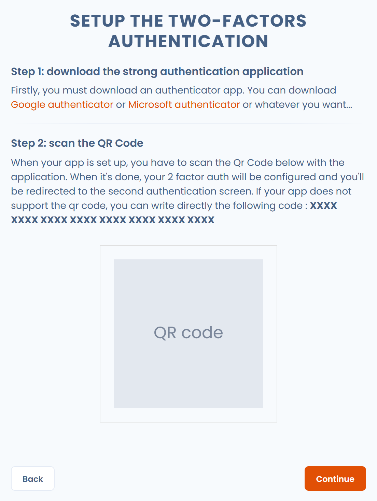

# Zwei-Faktor-Authentifizierung

Dastra verwendet die [TOTP](https://de.wikipedia.org/wiki/Time-based_one-time_password)-Technologie zur Verwaltung der [Multi-Faktor-Authentifizierung](https://de.wikipedia.org/wiki/Multi-Faktor-Authentisierung) der Nutzer. Die Nutzer melden sich mit ihrem üblichen Passwort und einem 6-stelligen Code an, den eine Authentifizierungs-App wie Microsoft Authenticator oder Google Authenticator bereitstellt.

Diese Seite erklärt, wie Sie die starke Authentifizierung für Ihr Konto aktivieren und wie Sie sie anschließend für die Nutzer Ihrer Organisation verpflichtend machen.

## Die starke Authentifizierung für Ihr Konto aktivieren

1. Öffnen Sie oben rechts das Profilmenü, klicken Sie auf **Nutzerprofil** und anschließend im linken Menü auf **Kontosicherheit**. Sie können auch direkt [https://app.dastra.eu/general-settings/account-security](https://app.dastra.eu/general-settings/account-security) aufrufen.
2. Klicken Sie in der Karte **Schützen Sie Ihr Konto mit einer Zwei-Faktor-Authentifizierung** auf **Zwei-Faktor-Authentifizierung aktivieren**.

<figure><figcaption>
Die Karte zur Zwei-Faktor-Authentifizierung unter Kontosicherheit
</figcaption></figure>

3. Installieren Sie auf dem Bildschirm **Einrichtung einer Zwei-Faktor-Authentifizierung** eine Authentifizierungs-App auf Ihrem Telefon, falls Sie noch keine haben.
4. Scannen Sie den QR-Code mit der App. Wenn die App ihn nicht scannen kann, geben Sie den Code ein, der unter dem Text angezeigt wird.

<figure><figcaption>
Der Einrichtungsbildschirm: der QR-Code, den Sie mit Ihrer App scannen
</figcaption></figure>

5. Klicken Sie auf **Weiter**. Dastra zeigt Ihnen anschließend Ihren Wiederherstellungscode an: Bewahren Sie ihn sicher auf.
6. Bei jeder Anmeldung geben Sie Ihr Passwort ein und danach den **6-stelligen Code**, den Ihre App bereitstellt.

<figure><figcaption>
Beispiel einer Authentifizierungs-App
</figcaption></figure>


Bewahren Sie den Wiederherstellungscode sicher auf. Wenn Sie Ihre Authentifizierungs-App verlieren, können Sie damit die starke Authentifizierung zurücksetzen: Klicken Sie auf dem Bildschirm zur Codeeingabe auf **Haben Sie Schwierigkeiten beim Einloggen?**. Ohne diesen Code bleibt Ihr Konto gesperrt: Wenden Sie sich an den Inhaber Ihrer Organisation, damit er die starke Authentifizierung Ihres Kontos zurücksetzt.


## Die starke Authentifizierung verpflichtend machen

Die Inhaber der Organisation können alle internen Nutzer, also die von der Organisation verwalteten Nutzer, zur Verwendung der starken Authentifizierung verpflichten. Diese Option gehört zu den Sicherheitseinstellungen der Organisation, die dem Enterprise-Plan vorbehalten sind.

1. Öffnen Sie das Profilmenü, klicken Sie auf **Konfiguration der Organisation** und anschließend im linken Menü auf **Sicherheit**. Sie können auch direkt [https://app.dastra.eu/general-settings/security](https://app.dastra.eu/general-settings/security) aufrufen.
2. Aktivieren Sie in der Karte **Nutzer zur Verwendung einer Zwei-Faktor-Authentifizierung (zweistufige Authentifizierung) verpflichten** den Schalter: Er wechselt auf aktiviert.

<figure><figcaption>
Die Karte, mit der die starke Authentifizierung verpflichtend wird
</figcaption></figure>


Bei ihrer nächsten Anmeldung können die betroffenen Nutzer erst auf die Anwendung zugreifen, wenn sie die starke Authentifizierung eingerichtet haben. Informieren Sie Ihr Team und erinnern Sie es daran, den Wiederherstellungscode sicher aufzubewahren. Eine Anmeldung mit einem [Passkey](passkey.md) und Nutzerverifizierung zählt bereits als zwei Faktoren: Dabei wird kein 6-stelliger Code abgefragt.

