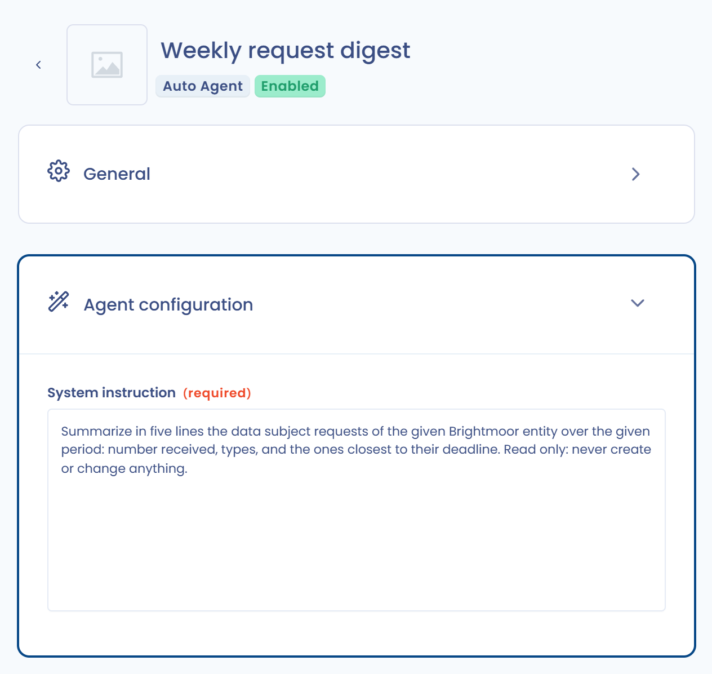
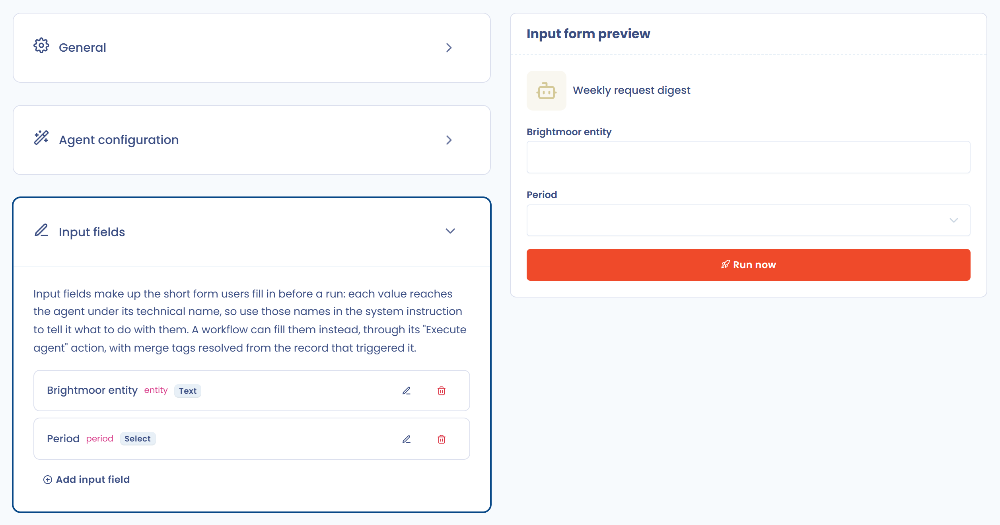
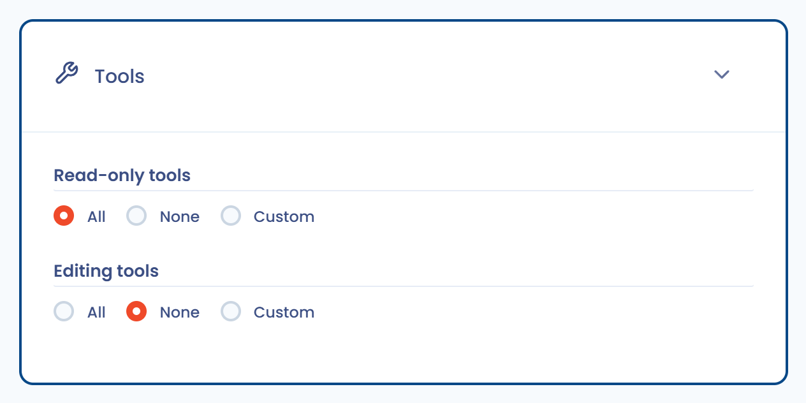
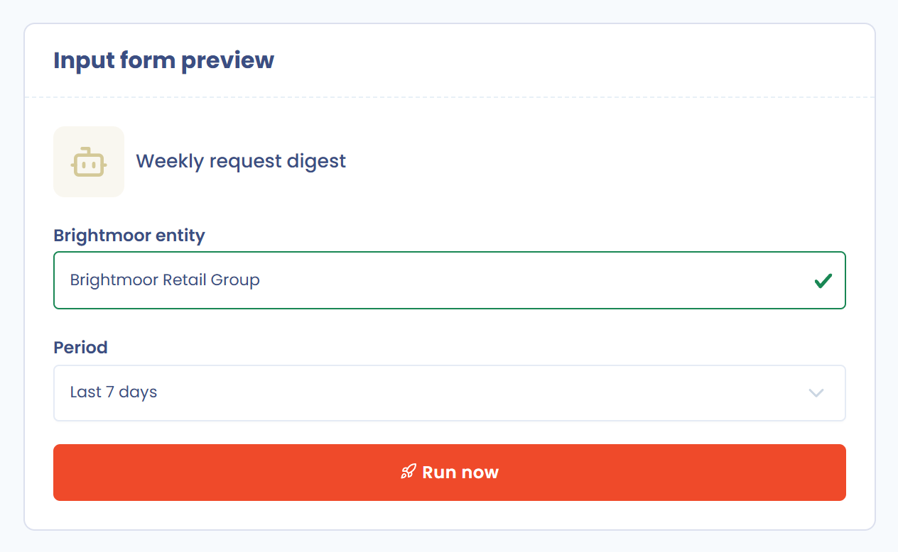
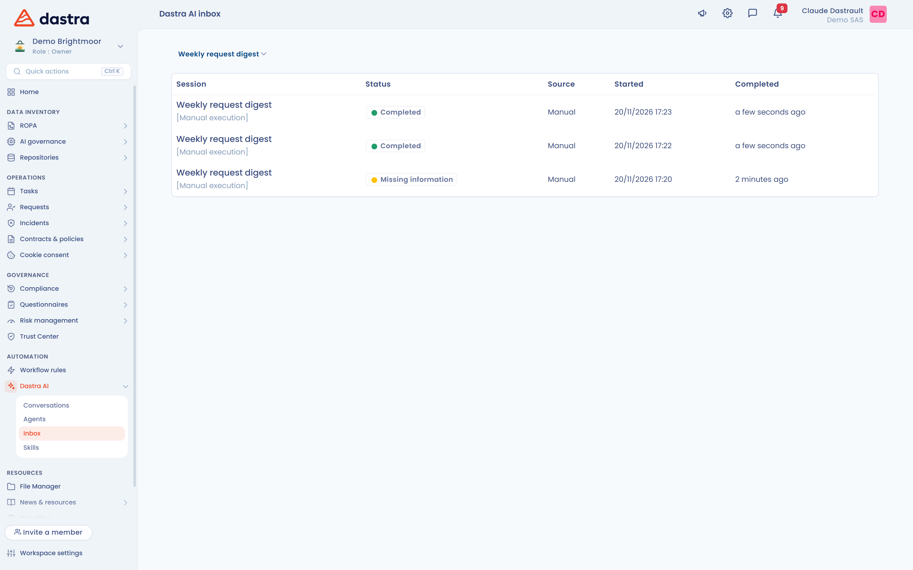
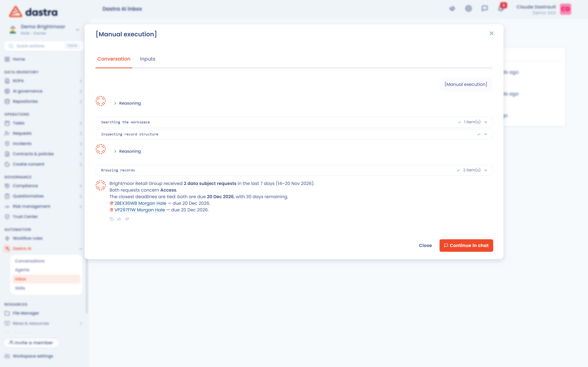
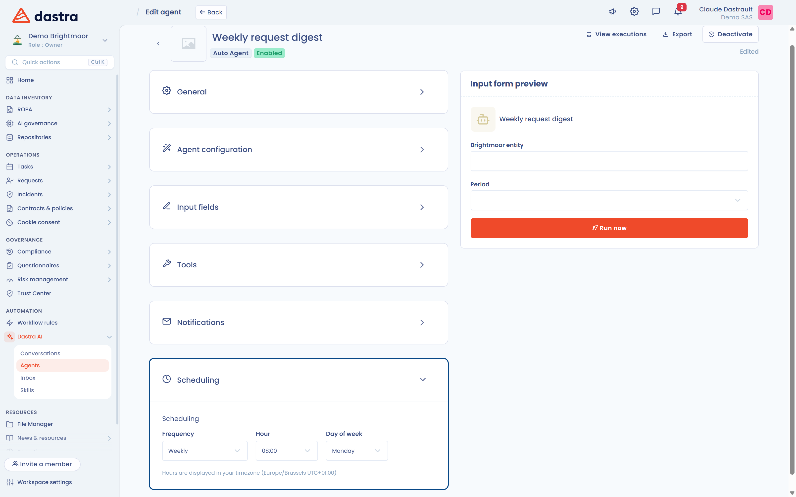

# Build an autonomous agent

This example builds an agent for Brightmoor Retail Group that summarizes the data subject requests of the week: how many arrived, which rights they concern and which ones are closest to their deadline. It is the case an [autonomous agent](../features/general/ai-assistant/agents/autonomous.md) fits best: a recurring task that only reads data and reports, with nobody watching it.

## What the agent does

The agent takes two values, a Brightmoor entity and a period, reads the requests of the workspace and writes a five-line digest. It changes nothing. The result is kept in the **Inbox** of Dastra AI, where you read it after each run.

Use this pattern when the task comes back on a regular basis, always has the same shape, and needs no answer from a person along the way. If the task must ask questions or let a person confirm each step, a [conversational agent](../features/general/ai-assistant/agents/conversational.md) is the better fit.

## Create the agent

1. Open **Automation** > **Dastra AI** > **Agents** and click **Create agent**.
2. Choose **Auto Agent**.
3. Enter the **Name**, here `Weekly request digest`, and an optional **Description**, for example `Five-line digest of the data subject requests of an entity`.
4. Click **Create agent**. The button stays disabled until a name is typed.

The editor opens on the new agent.

## Write the system instruction

Open the **Agent configuration** block and fill in **System instruction**, which is required:

```
Summarize in five lines the data subject requests of the given Brightmoor entity over the given period: number received, types, and the ones closest to their deadline. Read only: never create or change anything.
```

<figure><figcaption><p>The editor, with the system instruction</p></figcaption></figure>

Three choices make this short instruction work.

* The output shape is fixed: "in five lines", then the three things each digest must contain: the number received, the types and the closest deadlines. Every run answers in the same form, so the digests can be compared from one week to the next.
* The scope comes from the inputs. "The given Brightmoor entity" and "the given period" refer to the two input fields of the next step. The instruction holds no entity name and no date, so one agent serves every entity and every period. The help text of the **Input fields** block adds that a value can also be referred to by its technical name, here `entity` and `period`.
* The read-only rule closes the instruction. The last sentence states the intent. It is not a technical guard: the next step provides that.

## Add the input fields

Open the **Input fields** block, click **Add input field** and create the two fields:

| Label | Name | Type | Options |
| --- | --- | --- | --- |
| Brightmoor entity | `entity` | **Text** | none |
| Period | `period` | **Select** | `Last 7 days, Last 30 days, Current quarter` |

The **Name** follows the label (`brightmoor_entity`) until you type another one: replace it with `entity`. For a **Select** field, **Options** takes comma-separated values. Leave **Required** off: this example runs fine with a field left empty.

<figure><figcaption><p>The two fields, and the form they produce on the right</p></figcaption></figure>

The **Input form preview** on the right is the form a person fills in before a run.

## Choose the tools



Open the **Tools** block and set the two groups:

* **Read-only tools**: **All**. The agent needs to search the workspace and browse the requests to count them.
* **Editing tools**: **None**. The digest never creates or changes a record.


**Editing tools** are set to **All** when an agent is created. The sentence "never create or change anything" in the instruction does not stop the agent from doing it, and nobody reviews an autonomous agent while it works. Set the group to **None**.




<figure><figcaption><p>Read-only tools on All, Editing tools on None</p></figcaption></figure>



## Run the agent



1. In the **Input form preview**, enter `Brightmoor Retail Group` in **Brightmoor entity** and choose `Last 7 days` in **Period**.
2. Click **Run now**. A message confirms that the run started.
3. Open **Dastra AI** > **Inbox**. The run appears with its status, then reaches **Completed** after about twenty seconds.
4. Click the row to open the run. The **Conversation** tab shows the steps of the agent and its answer, and the **Inputs** tab shows the values it received.



<figure><figcaption><p>The form, ready to run</p></figcaption></figure>



<figure><figcaption><p>The runs in the Inbox</p></figcaption></figure>

Here is the answer of a real run:

```
Brightmoor Retail Group received 2 data subject requests in the last 7 days (14–20 Nov 2026).
Both requests concern Access.
The closest deadlines are tied: both are due 20 Dec 2026, with 30 days remaining.
2BEX36WB Morgan Hale — due 20 Dec 2026.
VP297F1W Morgan Hale — due 20 Dec 2026.
```

The five lines follow the shape of the instruction: the number received, the type, then the closest deadlines. Morgan Hale is the fictitious requester of the demo requests. The steps listed above the answer show that the agent only searched and browsed records.

<figure><figcaption><p>The detail of a run</p></figcaption></figure>

See [Tracking runs](../features/general/ai-assistant/agents/inbox.md) for every status and for what a run records.

## Schedule the agent

This step is optional. To get the digest every Monday, open the **Scheduling** block, choose **Weekly** in **Frequency**, then the **Hour** and the **Day of week**. The change is saved at once.

<figure><figcaption><p>A weekly schedule, Monday at 08:00</p></figcaption></figure>

A scheduled run receives no value for its input fields. The agent of this example would then have no entity and no period to read: for a scheduled digest, write the entity and the period in the instruction itself. In the **Notifications** block, choose the **Notified users** who should hear when a run completes. See [Creating an autonomous agent](../features/general/ai-assistant/agents/autonomous.md#scheduling) for the hour and time zone rules.

## Good to know

* The editor saves by itself. There is no Save button: each change is saved a moment later, and the time of the last save appears at the top right.
* The agent is enabled from the start. A schedule or a workflow rule can start it as soon as it exists. Click **Deactivate** in the header while you are still tuning it: **Run now** keeps working.
* The form preview starts a real run. **Run now** there is the same button as for any user, and the run counts in your monthly AI credits.
* An autonomous agent does not run with the rights of the person who launched it. Read the [warning of the reference page](../features/general/ai-assistant/agents/autonomous.md) and the [rights of agents](../features/general/ai-assistant/agents/README.md#who-can-do-what) before you give it editing tools.
