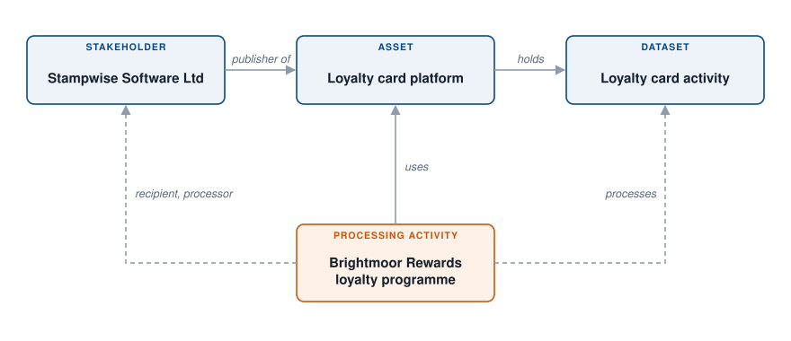
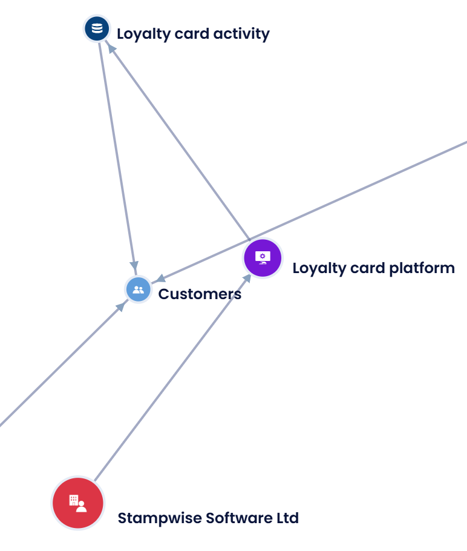

# Map a data flow

Brightmoor Retail Group runs a loyalty programme. Its members' data lives in a loyalty card platform published by an external vendor. This example maps that flow once in the **Repositories**, then reuses it in the processing activity, so the record and the mapping stay consistent. See [Data Mapping](../features/mapping/README.md) for the method.

<figure><figcaption>
The four objects and their links
</figcaption></figure>

The links are the following:

* the **stakeholder** publishes the **asset**;
* the **asset** holds the **dataset**;
* the **processing activity** uses the asset, lists the stakeholder as a processor and processes the dataset.

## 1. Create the vendor

In **Data inventory** > **Repositories** > **Stakeholders**, create the stakeholder "Stampwise Software Ltd", the company that publishes the platform. It will be referenced as a processor in the processing activity. See [Stakeholders](../features/mapping/repositories/stakeholders.md).

## 2. Create the asset

In **Repositories** > **Assets**, create the asset "Loyalty card platform". In **Publisher**, select "Stampwise Software Ltd". See [Assets](../features/mapping/repositories/assets.md).

## 3. Create the dataset

In **Repositories** > **Datasets**, create the dataset "Loyalty card activity", with its data fields: card number, points balance, purchase history. In **Linked asset**, select "Loyalty card platform". A dataset without an asset is an orphan: the link is what lets you find everything an asset holds. See [Datasets](../features/mapping/repositories/datasets.md).

## 4. Build the processing activity from the mapping

Open the processing activity "Brightmoor Rewards loyalty programme", or create it.

1. In the **Assets** section, click **Attach asset** and select "Loyalty card platform".
2. On the row of the asset, click **Sync data**. The **Sync asset data with data processing** window lists what Dastra can copy from the mapping: the **Asset's editor to add as a processor**, the **Dataset related to this asset** and the security measures.
3. Check **Select all** and click **Add**.

Dastra adds "Stampwise Software Ltd" to the **Recipients** section, in the **Processors** category, and "Loyalty card activity" to the **Datasets** section. Nothing is typed twice. The asset row now shows **Synced**. See [Assets](../features/ropa/activity/assets.md) and [Recipients](../features/ropa/activity/recipients/README.md).

## 5. Read the result

* In the processing activity, **Recipients** shows the vendor as a processor. From its **...** menu, **Edit vendor** opens the stakeholder.
* In **Repositories** > **Graphs**, the **Node mapping** chart shows the asset, its publisher and its dataset as linked nodes. See [Repositories](../features/mapping/repositories/README.md).

If the vendor changes, you edit the stakeholder once. If a second dataset is added to the asset, the row of the asset shows that it changed since the last sync: run **Sync data** again in each processing activity that uses it.

<figure><figcaption>
The flow on the Node mapping chart
</figcaption></figure>
