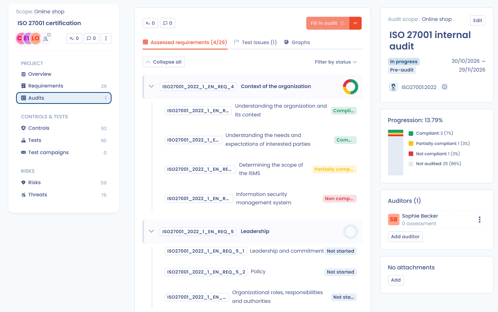

# ISO 27001 project

Brightmoor Retail Group wants ISO/IEC 27001 certification for its online shop. Emma Walsh, the data protection officer, leads the project and Liam O'Connor follows it. This example walks through the six phases of a compliance project with the real screens and labels of the application.

Dastra prepares and tracks the work. The certificate itself is issued by an accredited certification body, outside Dastra.

## The path at a glance

| Phase | What Brightmoor does | Reference |
| --- | --- | --- |
| **Scope** | Defines a scope and creates the project | [Scopes](../features/compliance/scopes.md), [Projects](../features/compliance/projects/README.md) |
| **Design** | Adds the ISO 27001 framework and imports its controls and risks | [Project design](../features/compliance/projects/design.md) |
| **Implementation** | Excludes controls that do not apply, assigns owners, configures tests | [Project implementation](../features/compliance/projects/implement.md) |
| **Monitoring** | Runs a test campaign and collects evidence | [Compliance monitoring](../features/compliance/projects/monitoring.md) |
| **Internal audit** | Audits the framework and reports gaps | [Audits](../features/compliance/projects/audits.md) |
| **Final audit** | Records the state of compliance before certification | [Audits](../features/compliance/projects/audits.md) |

## 1. Prepare the framework

A framework holds the requirements, controls, tests, risks and threats of a standard. Brightmoor starts from the Dastra template.

1. In the menu, open **Compliance** > **Library** > **Frameworks**.
2. Click **Create a framework**, then choose **Built-in template**.
3. Search for ISO 27001 and select the template. Check the number of requirements, controls, risks and threats shown in the details.
4. Confirm the import.

The framework is now in the library and is editable. Creating it uses one framework credit of the account (see [Dastra import and templates](../features/compliance/library/frameworks/import.md)).

## 2. Define the scope

The scope answers one question: which organizational units does the project cover? Brightmoor certifies the online shop only.

1. Open **Compliance** > **Scopes** and create a scope named "Online shop".
2. Select the organizational units "Group IT" and "E-commerce". A scope needs at least one unit.

## 3. Create the project

1. Open **Compliance** > **Projects**, then **All projects**, and click **Create a project**.
2. Enter "ISO 27001 certification" in **Title** and choose the **Scope** "Online shop". Click **Next**.
3. In **Assign users to project**, add Emma Walsh with the **Accountable** role and Liam O'Connor with the **Informed** role. Click **Add**.

The project opens on its overview, in the **Scope** phase. The assistant at the top shows the **Checklist** of the phase, and the **Move to phase** button appears when every step is done.

## 4. Design phase: import the controls

Move the project to **Design** and follow the checklist.

1. Add the ISO 27001 framework to the project. Keep the version preselected in **Version to install**.
2. Import all the controls of the framework. The controls are marked as implemented by default, and their tests are attached with the status **Missing evidence**.
3. Add the risks of the framework to the project. They are the base of the initial risk assessment.

If Brightmoor later adds another framework, such as GDPR, Dastra detects the common controls and imports them only once (see [Project design](../features/compliance/projects/design.md#4.-sharing-controls-across-frameworks)).

<figure><figcaption>
The project in the Design phase
</figcaption></figure>

## 5. Implementation phase: make the controls real

1. Exclude the controls that do not apply. Brightmoor hosts everything in the cloud, so controls about its own data center are out of scope. In the **Controls** tab, set **Control status** to **Excluded** and fill in **Explain why this control should be excluded**. The justification reaches the statement of applicability and the audits.
2. Assign owners. In the **Requirements** tab, click the users button of a requirement. In **Assign owner to all controls and tests**, select the owner and click **Validate**. Sophie Becker takes the access control requirements, Noah Martin the operations requirements.
3. Configure the tests. For each test, set the procedure, the frequency and the owner. A test is manual, or automated through a connector (see [Tests](../features/compliance/library/tests.md)).
4. Assess the risks. In the **Risks** tab, set the initial and the residual assessment of each risk, and choose its treatment. The **Cartography** view shows the initial, current and residual matrices side by side.

The checklist of the phase reads **Configure at least one control**, **Configure automated tests**, **Assess your risks** and **Assign owners to tests**.

## 6. Monitoring phase: collect the evidence

Move the project to **Monitoring**. Evidence added in another phase triggers a warning.

1. Open the **Test campaigns** tab and click **Create tests campaign**.
2. Enter the **Campaign label**, "First evidence collection", and select all the tests awaiting evidence.
3. Check that every test has an owner. If some do not, Dastra warns you: use **View tests without owners**.
4. Launch the campaign and click **Send invitations** to notify the owners, with a message if needed.

Each owner opens **My tests**, reads the **Test procedure**, adds the evidence with **Add evidence** and clicks **Validate test**. The same file can serve as evidence for several tests.

Brightmoor follows the **Tests status** and **Tests freshness** indicators on the overview. The checklist asks for at least 80% of passing tests before the next phase.

ISO/IEC 27001 requires a statement of applicability. On the framework card, open the **⋯** menu and click **Export statement of applicability**. The XLSX file lists every control with its applicability, its justification and its implementation status.

## 7. Internal audit

Move the project to **Internal audit**. ISO/IEC 27001 requires internal audits at planned intervals.

1. In the **Audits** tab, click **Create a new audit** and select the ISO 27001 framework.
2. Enter the **Name**, "ISO 27001 internal audit", choose Sophie Becker in **Auditors**, set **Audit phase** to **Pre-audit** and fill in **Start date** and **Deadline**.
3. Keep **Define as current audit** on, then click **Validate**.
4. Click **Fill in audit** and assess each requirement as **Compliant**, **Partially compliant**, **Not compliant** or **Not applicable**, with a **Comment**.
5. When the evidence of a test is weak, click **Report issue**, choose the **Severity** and describe the problem. In the **Test issues** tab, tick the reported tests and click **Invalidate tests**, then **Re launch a test campaign** so the owners update their evidence.
6. When every requirement is assessed, click **Complete audit** and write the **Final Audit Assessment**.

<figure><figcaption>
The internal audit dashboard
</figcaption></figure>

## 8. Final audit

Move the project to **Final audit** and create a new audit with the audit phase **Final audit**. Assess the requirements again on the improved evidence, then complete the audit.

The compliance percentage per framework appears on the project overview and in **Compliance** > **Statistics**. Brightmoor exports the audit to hand the evidence to the certification body, and can display the project in its Trust center (see [Configure your Trust center](../features/trust-center/configuration/README.md)).
