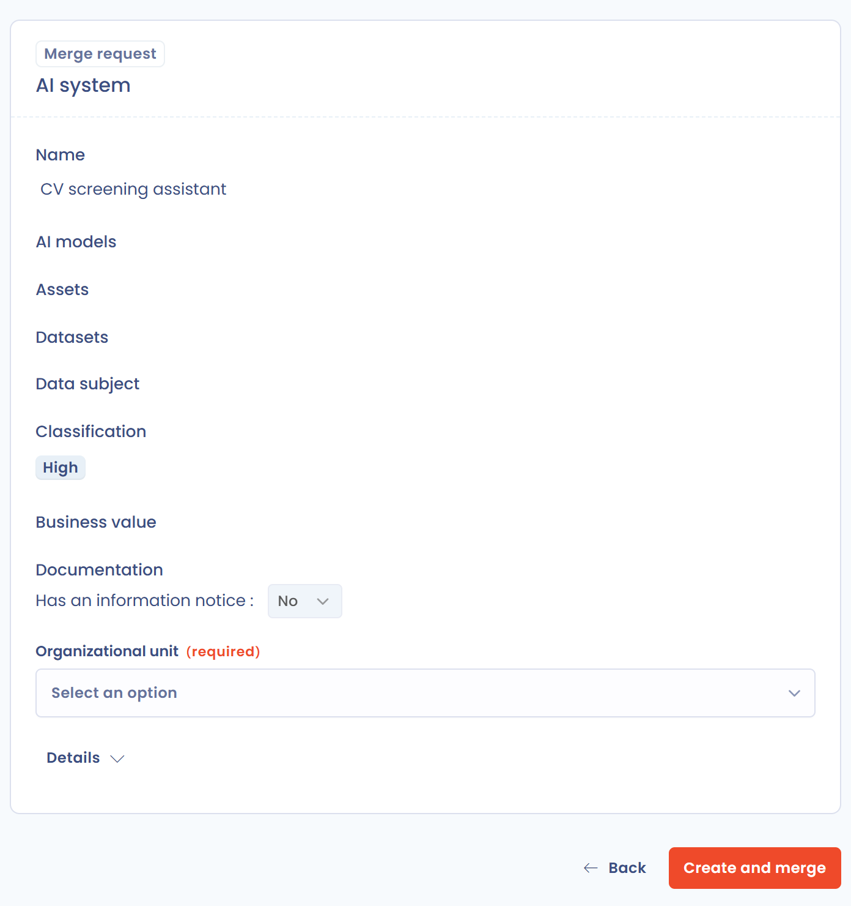

# Questionnaire answers in a record

Brightmoor Retail Group already lists its AI system "CV screening assistant" in the register, but the entry is incomplete. Emma Walsh, the data protection officer, wants the person who owns the tool to answer an AI Act questionnaire, and she wants the answers to complete the AI system. This example builds that questionnaire. The reference is [Fill a record from the answers](../features/questionnaires/templates/record-mapping.md).

The questionnaire fills four fields: the name, the risk level, the roles of Brightmoor under the AI Act, and a custom field with the business owner.

## 1. Create the custom field

In **Workspace settings** > **Custom fields**, choose the module of the AI systems and create a text field with the label "Business owner". Open the field and read its **Variable name (slug)**: `business_owner`. It is read-only after the creation. See [Custom fields](../features/general/custom-fields.md).

## 2. Create the template

1. In **Questionnaires**, create a customized template named "AI Act intake".
2. Set **Questionnaire type** to **AI System creation**. The type carries the data model of an AI system.
3. Set **Related to** to AI systems, so that each response can be linked to an AI system.

## 3. Add the questions

For each question below, open the question properties, check **Would you like to customize the variable name (for experts users only)?** and set the variable name.

| Question | Question type | Variable name | How it is set |
| --- | --- | --- | --- |
| Name of the AI system | Short text | `label` | **Select a variable to map**, then the row `label` |
| What is the risk level of this AI system? | Unique choice list | `riskLevel` | **Select a variable to map**, then the row `riskLevel` |
| What is the role of Brightmoor? | List with multiple fields | `responsibilities` | **Select a variable to map**, then the row `responsibilities` |
| Role (sub-question of the list) | Unique choice list | `responsibilityType` | Typed by hand |
| Who owns this AI system in the business? | Short text | `custom_business_owner` | Typed by hand: `custom_` and the technical name |

Three points to know:

* For `riskLevel`, choosing the field creates one answer per value: Low, Medium, High and Unacceptable, with these exact variable names. Rename the labels as you wish, for example Minimal, Limited, High and Unacceptable, and keep the variable names.
* For the roles, the six values of the AI Act are Provider, Deployer, Distributor, Importer, AuthorizedRepresentative and Manufacturer. Add one answer per role to the sub-question, with the value as the variable name of the answer.
* The custom field is not in the list of variables, which is why its name is typed in full.

Save the template.

<figure><figcaption>
The variables offered for an AI system
</figcaption></figure>

## 4. Link the response to the AI system and collect the answers

1. Schedule the questionnaire. In **Subject linked to the response**, select the AI system "CV screening assistant". See [Schedule a questionnaire](../features/questionnaires/schedule.md).
2. Liam O'Connor answers: name "CV screening assistant", risk level **High** (a recruitment tool is a high-risk use under Annex III of the AI Act), role **Deployer**, business owner "Sophie Becker, HR".
3. The response is validated and published.

## 5. Merge the answers into the AI system

Because the response is linked to an existing AI system, its owner sees the button **Merge request (AI System)**.

1. Click **Merge request**. The preview shows the AI system built from the answers. Choose the **Organizational unit** and click **Create and merge**.
2. In the merge window, compare the existing AI system with the temporary one, labeled "CV screening assistant (From Questionnaire)". Keep the values of the questionnaire for `riskLevel`, the roles and the custom field, and keep the existing values for the rest.
3. Confirm the merge.

| Field | Before | After |
| --- | --- | --- |
| Risk level | Empty | High |
| Roles | None | Deployer |
| Business owner (custom field) | Empty | Sophie Becker, HR |

The AI system now carries the answers. Nothing was changed before step 3: the answers never update a record by themselves.

If the AI system did not exist, the response would have no linked record. The button would read **Creation request** and **Create** would add the AI system to the register.

<figure><figcaption>
The merge request of a response
</figcaption></figure>
