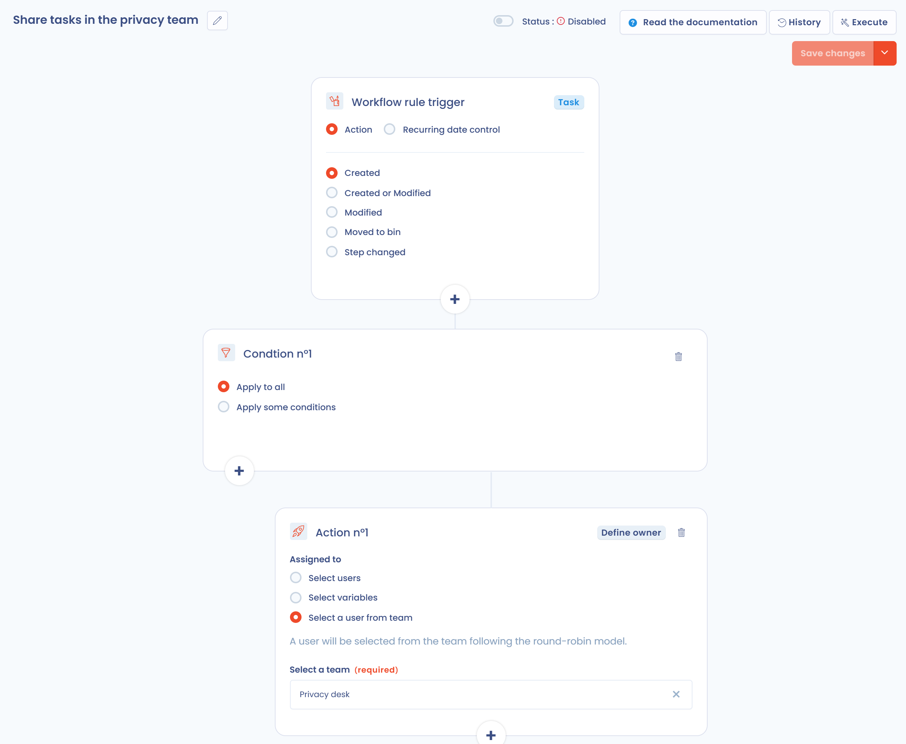
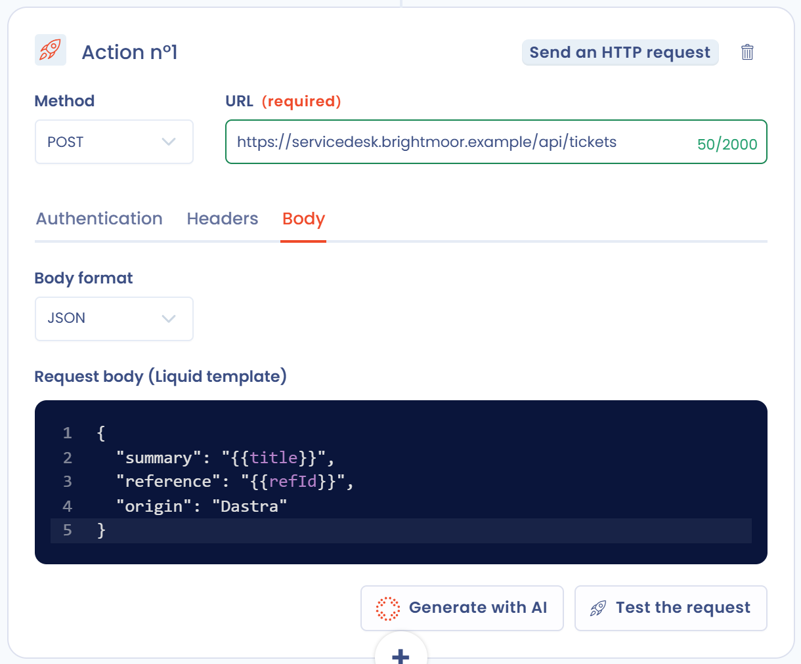

# Workflow recipes

Each recipe is a [workflow rule](../features/settings/workflow-rules.md) of Brightmoor Retail Group: a trigger, conditions and actions on one object type. To create any of them, open **Automations** > **Workflow rules**, click **Create a workflow rule**, choose **From scratch**, then enter the **Rule name** and the **Object type**. Switch the rule on with the **Status** switch once it is saved.

Keep **Execute the workflow only once per item (recommended)** on for the recipes that react to a creation or a change, so that an item is never processed twice.

## Recipe 1: assign new requests

Goal: Every new data subject request has an operator from the first minute, depending on the subsidiary that received it.

### Trigger

Object type: **Request**. Trigger: **Action**, event **Created**.

### Conditions

A rule has up to five conditions, and each one carries its own actions. Choose **Apply some conditions** for each:

| Condition | Field | Value |
| --- | --- | --- |
| 1 | **Organizational unit** | Brightmoor Germany |
| 2 | **Organizational unit** | Brightmoor UK |
| 3 | **Organizational unit** | Brightmoor Retail Group |

A request has no country field. The organizational unit of the request is the usual stand-in for the country of a subsidiary. To route by language, use the **Language** field instead, and to route by right exercised, use **Rights of the data subject** (for example Erasure).

### Actions

In each condition, click **+** and choose **Define owner**, then select a user: Sophie Becker for condition 1, Liam O'Connor for condition 2 and Emma Walsh for condition 3. On a request, this action fills in the **Operator**.

### Result

A request received by the German subsidiary is assigned to Sophie Becker as soon as it is created. In the rule, **History** lists each processed request with its status, and **Execute** applies the rule by hand to a request created before the rule.

## Recipe 2: share tasks in a team

Goal: Spread the new tasks evenly between the members of the privacy desk.

### Trigger

Object type: **Task**. Trigger: **Action**, event **Created**.

### Conditions

**Apply to all**: every new task is concerned. To limit the rule, choose **Apply some conditions** and filter on a field such as a tag.

### Actions

Add **Define owner**, choose **Select a user from team** and pick the team in **Select a team**. A user is selected from the team following the round-robin model: each time the rule fires, the next member is chosen, and the first member follows the last.

<figure><figcaption><p>The round-robin assignment</p></figcaption></figure>

### Result

The first task goes to the first member of the team, the second task to the next one, and so on. The member chosen is the one in **Assigned to**. See [Create and assign teams](../getting-started/setup/teams.md) to create the team. If the team has no member, the execution fails and appears in error in the history.

## Recipe 3: alert a Microsoft Teams channel on a high-risk breach

Goal: Warn the privacy channel at once when a data breach reaches the High risk level, because the supervisory authority and the data subjects must then be informed.

Prerequisite: The [Microsoft Teams integration](../features/integrations/microsoft-teams.md) is installed and enabled on the workspace. Without it, the action is not offered.

### Trigger

Object type: **Data breach**. Trigger: **Action**, event **Created or Modified**: the risk level only exists once the risk assessment is filled in, after the creation.

### Conditions

Choose **Apply some conditions** and set the field **Points** to a value greater than or equal to 6. **Points** is the score of the breach, the sum of the two scores of the risk assessment, and 6 is the threshold of the High risk level (see [Risk scoring](risk-scoring.md)). The **Risk** field itself is not offered in conditions.


A breach whose level was set by hand in **Risk assessment conclusion** keeps its score, so the rule follows the score and not the level you chose.


### Actions

Add **Send a Teams notification** and fill in:

* **Card title**: `High risk data breach: {{label}}`;
* **Message**: `Score {{score}}. Check the notification deadline to the supervisory authority.`;
* **Include a link to the object in the card**: on, which is the default.

Type `{{` in a field to list the variables of the data breach.

### Result

A card appears in the Teams channel linked to the webhook, with a link to the breach. There is no recipient to pick: the channel is the one configured in the integration. This action cannot be tried without a Teams channel, which is why this recipe has no screenshot.

## Recipe 4: send an HTTP request

Goal: Create a ticket in the service desk of Brightmoor each time a request arrives.

Prerequisite: The [HTTP / Custom API](../features/integrations/custom-http.md) integration is enabled in **Workspace settings** > **Integrations**, with a connection to the service desk (API key, Basic credentials or OAuth 2.0). Adding this action requires the **Integrations** permission.

### Trigger

Object type: **Request**. Trigger: **Action**, event **Created**.

### Conditions

**Apply to all**.

### Actions

Add **Send an HTTP request** and fill in:

* **Method**: POST. **URL**: `https://servicedesk.brightmoor.example/api/tickets`.
* **Authentication** tab: the connection of the service desk. The credentials stay on the connection, never in the rule.
* **Body** tab: the **JSON** format, with this template:

```
{
  "summary": "{{title}}",
  "reference": "{{refId}}",
  "origin": "Dastra"
}
```

Click **Test the request**. **Preview** renders the URL, the headers and the body against a real request of the workspace without sending anything. **Send the request** makes the real call and shows the response of the service desk. **Generate with AI** drafts the request from an instruction and the payload the service desk expects.

<figure><figcaption><p>The HTTP request action</p></figcaption></figure>

### Result

The service desk receives a ticket for each new request. The rendered body must be valid JSON: otherwise nothing is sent and the execution is logged as an error. Each call is traced in the integration logs. Disabling the integration or deleting the connection disables the rule.
