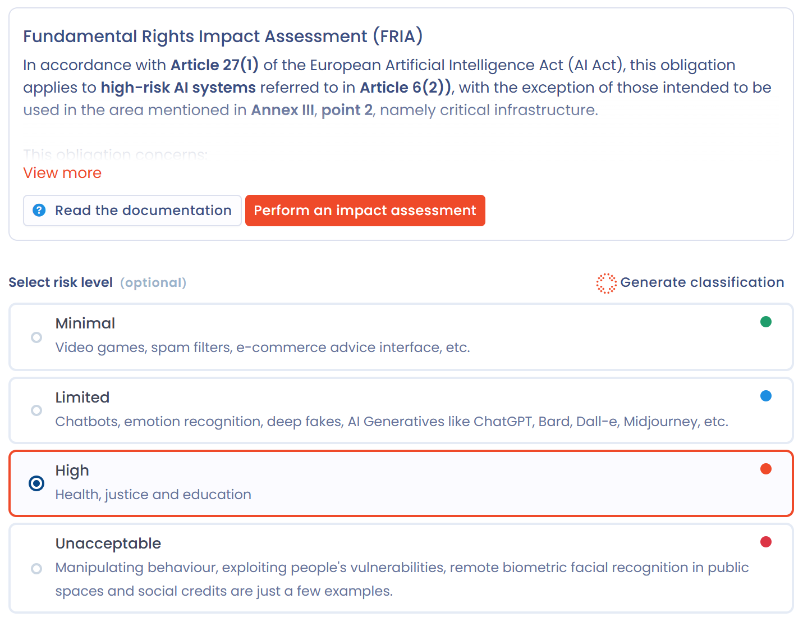

# Fundamental rights impact assessment (FRIA)

This page explains who must carry out a fundamental rights impact assessment (FRIA) and how to do it in Dastra. It is for deployers of high-risk AI systems.

## Regulatory context

Article 27 of the European Artificial Intelligence Act (**AI Act**) requires a fundamental rights impact assessment before the first use of certain high-risk AI systems. The obligation does not cover every high-risk system.

It applies to the high-risk systems referred to in Article 6(2), except those of Annex III, point 2 (critical infrastructure). It concerns:

* deployers governed by public law;
* private entities providing public services;
* deployers of the high-risk systems of Annex III, points 5(b) and 5(c): the evaluation of the creditworthiness of people, and risk assessment and pricing for life and health insurance.

The deployer carries out the assessment before putting the system into service. In similar cases, the deployer may rely on an assessment already carried out, or on the impact assessments the provider supplies. Once the assessment is done, the deployer notifies its results to the market surveillance authority (Article 27(3)).

The assessment is distinct from a GDPR DPIA, but it complements it: when a DPIA already covers some of the obligations, the fundamental rights impact assessment comes in addition (Article 27(4)).

## Purpose of the assessment

The assessment describes, for the system concerned:

* the deployer's processes in which the system is used;
* the intended period and frequency of use;
* the categories of people likely to be affected;
* the specific risks of harm to their rights, for example to privacy, non-discrimination, freedom of expression, the presumption of innocence, dignity or workers' rights;
* the human oversight measures;
* the measures to take if those risks materialize, including internal governance and complaint mechanisms.

## When Dastra offers the assessment

The **Fundamental Rights Impact Assessment (FRIA)** box appears on the **Classification** step of the record when:

* the **Responsibility** step declares the deployer role;
* the risk level is **High**;
* your plan includes the **Questionnaires** module and you have write access to questionnaires.

If the risk level is **Unacceptable**, the box warns that Article 5 of the AI Act prohibits deployment.

<figure><figcaption>
The box shown to a deployer of a high-risk system
</figcaption></figure>

## Carry out the assessment

1. In the box, click **Perform an impact assessment**.
2. The **Choosing a questionnaire template** window lists the templates of type **AI system impact assessment** installed in your workspace. Click a template to schedule it.
3. In the **Plan a questionnaire** window, choose how respondents answer. See [Schedule a questionnaire](../questionnaires/schedule.md).

<figure><figcaption>
The AI system impact assessment templates
</figcaption></figure>

If the window shows no template, install one:

1. In the window, click **Create a template**. The Questionnaires module opens in a new tab.
2. Choose **Automated questionnaires**.
3. In the library, filter **Types** on **AI system impact assessment**, then click the template to install. See [Automated questionnaire templates](../questionnaires/templates/README.md#automated-questionnaire-templates).
4. Go back to the record and click **Perform an impact assessment** again.


The window only offers templates of type **AI system impact assessment**. A template of type **Privacy impact assessment (DPIA)**, even one designed for AI, does not appear there.


## Find the completed assessments

Click **AI governance** in the sidebar, then **Impact analysis**. This page shows the Questionnaires module limited to the **AI system impact assessment** type. It appears if your plan includes the Questionnaires module and you have access to questionnaires.

<figure><figcaption>
The Impact analysis page
</figcaption></figure>
