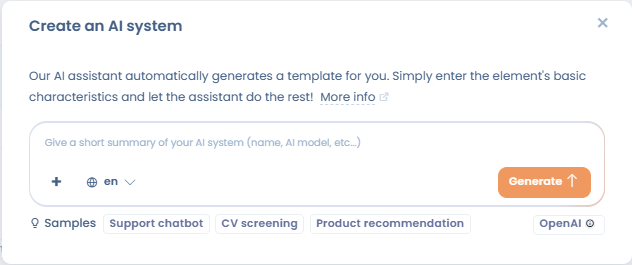
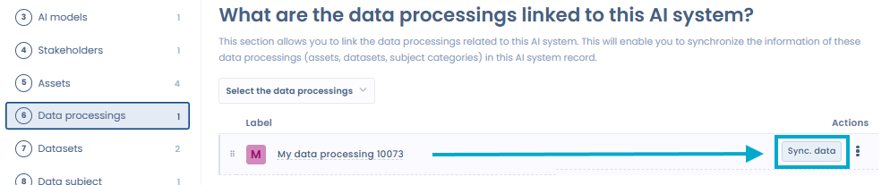
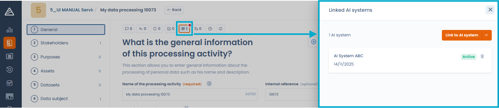
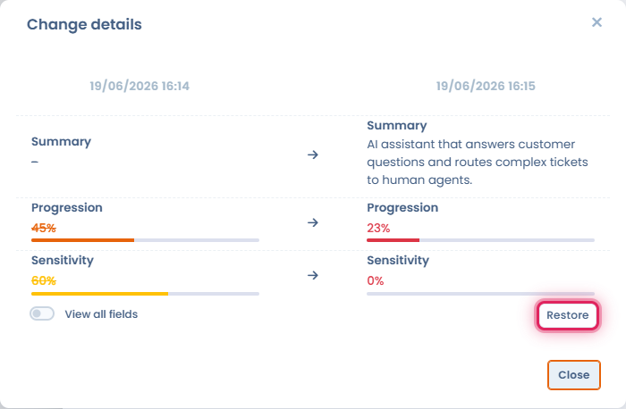

# Establishing a record of AI systems

To set up a record of your AI systems, you have two options:

* You already have a record: import it directly into Dastra. See [Import your AI systems](import.md).
* You do not have one: create the AI systems one by one, as described below.

## Create an AI system

Click **AI governance** in the sidebar, then **Record of AI systems**. Then click **Create an AI system**. A window offers three creation modes:

<figure><figcaption>
Three creation modes: AI assistant, template, or blank form
</figcaption></figure>

* **Generate with AI**: the AI assistant generates a record from a short description of the system (name, publisher, URL...). It uses web browsing to enrich the information.
* **Built-in template**: choose a system from the Dastra AI system library or from another workspace.
* **Personalized**: create a blank record and fill in each field yourself. Enter the name of the system and its organizational unit.

The button with the AI icon, to the left of the **Create an AI system** button, opens the generation by the AI assistant directly.

### Generate an AI system with the AI assistant

Select **Generate with AI**, then describe the system to document (name, publisher...). You can attach a file or provide a URL to help the generation.

<figure><figcaption>
Describe the AI system to generate (name, AI model used...)
</figcaption></figure>

The assistant produces a pre-filled record which you can review and validate before saving.

<figure><figcaption>
The generated record should be reviewed before validation: AI can make mistakes
</figcaption></figure>


Data generated automatically by AI may contain errors. Review and correct the proposed record before saving it to your registry.


Once the required information is saved, Dastra opens the record of the system, a form with 12 steps. It lets you give as much detail as possible about the AI system.

<figure><figcaption>
The 12 steps of the record of an AI system
</figcaption></figure>

## The 12 steps of the form

The steps are listed on the left of the record, with the number of items entered or a check mark when the step is filled in: **General**, **Responsibility**, **AI models**, **Stakeholders**, **Assets**, **Data processings**, **Datasets**, **Data subject**, **Classification**, **Business value**, **Documentation** and **Summary**. Save the record at any time with **Save changes**.

### 1. General

Enter the basic information about the AI system:

* the name of the system;
* an internal reference, if you have one;
* the organizational unit;
* the tags;
* the description of the purpose of the system and how it works;
* the deployment date.

### 2. Responsibility

Define your role under the AI Act. An organization can hold several roles depending on its activities:

* **Provider**: develops an AI system, or has it developed, and places it on the market or puts it into service under its own name or trademark, for payment or free of charge.
* **Deployer**: uses an AI system under its own authority in the course of professional activities.
* **Importer**: places on the Union market an AI system that bears the name or trademark of a person established in a third country.
* **Distributor**: makes an AI system available on the Union market without being its provider or importer.
* **Authorized Representative**: a person established in the Union who received a written mandate from a provider established outside the Union.
* **Manufacturer**: if an AI system is integrated into a product subject to sector-specific legislation, for example a medical device, the manufacturer of the product is treated as the provider of that system.

For each responsibility, you can add a justification. Identify your roles precisely: they determine your obligations under the AI Act.


If no responsibility is defined, Dastra offers a self-assessment questionnaire on roles and responsibilities in AI, with the **Self-Assessment of Roles and Responsibilities in the AI Act** button. Once the responsibilities are identified, the AI assistant can generate a justification: click **Generate a description of the responsibility with AI**.


### 3. AI models

Specify the AI model or models used in this system, with their usage description. See [AI models repository](models.md).

### 4. Stakeholders

Add the users in charge of this AI system and assign a role to each one.

### 5. Assets

Add the assets that support this AI system, for example infrastructure components, software tools or APIs. This information is optional: it lets you map the application chain that links the data together.

### 6. Data processings

Link the processing activities of your GDPR record to this AI system, then synchronize their information with the record. See [Linked processing activities and data synchronization](#linked-processing-activities-and-data-synchronization).

### 7. Datasets

List the datasets associated with this AI system: click **Add a dataset** to create one, or **Existing datasets** to choose from your repository. For each dataset:

* describe the relationship between the dataset and the AI system in the field provided;
* indicate, with **Yes** or **No**, how the system uses it in the three columns **Training**, **Request** and **Validation**.

Each of the three columns has a help text:

* **Training**: the data is used to train an AI model, that is, to let it learn patterns, relationships or classifications from historical data.
* **Request**: the data is used to query the AI model, for example the data the system processes during actual operation.
* **Validation**: the data is used for AI model validation, that is, to assess its performance and tune its parameters to prevent overfitting.

The **Display data fields** switch shows the data fields of each dataset. For each dataset, document its purpose, its composition and its link with the AI system.

<figure><figcaption>
The Datasets step of an AI system
</figcaption></figure>

### 8. Data subject

Add the categories of data subjects whose personal data the AI system processes, for example customers, employees or users. Indicate whether vulnerable persons are concerned.

### 9. Classification

Assign a risk level to the system under the AI Act. This step can also display alerts tied to your role:

* **Unacceptable risk**: if you are the deployer of a system classified **Unacceptable**, an alert reminds you that Article 5 of the AI Act prohibits deploying it.
* **High risk**: if you are the deployer of a system classified **High**, an alert presents the scope of Article 27 of the AI Act and offers to carry out the [fundamental rights impact assessment (FRIA)](fria.md).

For the details of this step, see [Risk analysis and business value](risk-analysis.md).

### 10. Business value

Assess the business value of the system for your organization. This assessment helps you prioritize high-value AI projects. See [Risk analysis and business value](risk-analysis.md).

### 11. Documentation

Say whether an information notice exists, write it or generate it, and attach the documents of the system: notices, technical guides, compliance assessments. See [Transparency notice](transparency-notice.md).

### 12. Summary

Review the summary of all the information entered for this AI system before finalizing its record.

## Linked processing activities and data synchronization

The **Data processings** step of an AI system's record links one or more processing activities of your GDPR record to that system. This link keeps your record of processing activities and your record of AI systems consistent.

<figure><figcaption>
The "Data processings" step lists the GDPR processing activities linked to this AI system
</figcaption></figure>

### Synchronize data from a processing activity

For each linked processing activity, the **Sync. data** button imports the elements of the processing activity into the AI system's record: assets, datasets and data subject categories.

<figure><figcaption>
The data synchronization button imports the data of the processing activity into the AI system's record
</figcaption></figure>

A window lists the elements to import. You can select exactly the ones to add.

<figure><figcaption>
Selecting the elements to synchronize from the processing activity to the AI system
</figcaption></figure>

### View linked AI systems from a processing activity

Conversely, from the record of a processing activity, the **Linked AI systems** panel lists all the AI systems associated with it.

<figure><figcaption>
The "Linked AI systems" panel is available from the record of any processing activity
</figcaption></figure>

This two-way link makes audits and documentation of AI Act compliance easier from the GDPR record.

## Invite users to complete the record

In a record, click the button with the users icon, **Invite users to complete this AI system**. In the window:

1. Choose the **Section** of the record to complete.
2. Select the **Users to invite**. They need at least the Modification right, or the right to read and write their own items if they are stakeholders of the system.
3. Write the **Invitation message**, or select a message template.
4. Click **Send invitation**.

## Other actions on an AI system

In the record of AI systems, the menu of each row offers **Edit**, **Create a copy** and **Move to recycle bin**. In a record, the menu of the **Save changes** button offers in particular:

* **Review**: marks the record as reviewed. The action appears for a system in the **Active** state if regular review is enabled for AI systems. See [Regular review (freshness)](../regular-review.md);
* **Export**: exports the record as CSV, Excel, JSON, HTML, Word, PDF or Markdown;
* **Generate information notice** and **Export information notice**: see [Transparency notice](transparency-notice.md);
* **Move to recycle bin**.

The menu of the **Create an AI system** button in the record of AI systems also offers **Create from library...**, **Import**, **Export** and **Set up regular review**, which opens the regular review settings for AI systems.

## Restore a previous version

The **Activity history** panel on an AI system's record keeps every creation and modification. You can restore a past version directly from this panel.

<figure><figcaption>
Each version in the Activity history offers a restore button
</figcaption></figure>

Each history entry shows a restore button, visible to users with write permission. After confirmation, Dastra creates a **new AI system** from the data of the chosen version. Its name receives the suffix "- restored version - [date]" and you are redirected to this new record. The original AI system remains unchanged.

<figure><figcaption>
The restored version appears as a new AI system suffixed "- restored version - [date]"
</figcaption></figure>
