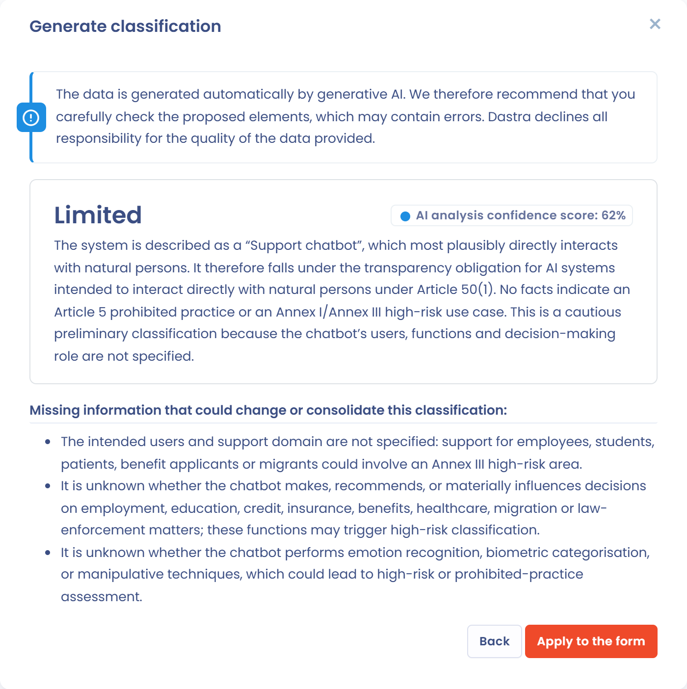

# Risk analysis and business value

Two steps of an AI system's record assess the system: **Classification** for its risk level and **Business value** for its worth to your organization. This page describes both steps and the help the AI assistant gives to fill them in.

## Classification of the risk level

On the **Classification** step, you assign one of four risk levels to each system: **Minimal**, **Limited**, **High** or **Unacceptable**. These levels come from the AI Act, from minimal to unacceptable risk. Under each level, Dastra shows examples of the systems concerned.

Justify the level you chose in the **Justification of risk level** field. It becomes available once a level is selected.

<figure><figcaption>
The Classification step of an AI system
</figcaption></figure>

### Risk levels under the AI Act

The AI Act sorts AI systems into four categories. Each one brings different obligations.

#### Minimal risk

AI systems whose risk to fundamental rights or people's safety is negligible or nil.

Examples: spam filters, content recommendation engines with no significant impact, AI used in video games.

Obligations: the AI Act sets no specific one, but the general rules still apply, such as the GDPR and the obligation to ensure AI literacy among staff (Article 4).

#### Limited risk

AI systems subject to transparency obligations toward users, without significant impact on their rights.

Examples: conversational chatbots, deepfakes generated for entertainment.

Obligations:

* inform the user that they are interacting with an AI system;
* disclose that content was generated or modified by AI.

#### High risk

AI systems that present a significant risk to health, safety or fundamental rights. They fall under a strict framework of compliance and assessment.

Examples:

* credit scoring;
* automated recruitment, for example sorting job applications;
* biometric identification, outside prohibited practices;
* AI used in medical devices or critical infrastructure.

Obligations:

* conformity assessment before the system is placed on the market;
* risk management;
* governance of the data used;
* transparency and detailed technical documentation;
* human oversight and traceability.


Article 27 of the AI Act requires a fundamental rights impact assessment from some deployers of high-risk systems: deployers governed by public law, private entities providing public services and deployers of certain financial-sector systems. See [Fundamental rights impact assessment (FRIA)](fria.md).


#### Unacceptable risk

AI systems that are prohibited because they go against the values of the European Union or infringe fundamental rights.

Examples:

* social scoring of people;
* real-time remote biometric identification in public spaces for law enforcement, outside strict exceptions;
* subliminal manipulation of people.

Obligations: placing on the market and use in the European Union are prohibited.

Assigning the right risk level helps you determine the applicable obligations, prioritize compliance actions and communicate clearly with your business and legal teams.

### Generate the classification with AI

If your plan includes the matching AI features, the **Generate classification** button appears above the level selector. It suggests a risk level from the information already entered in the record.

1. Click **Generate classification**. The window lists the data sent to the AI model: system name, description, models, role under the AI Act, assets, linked processing activities, datasets and data subject categories.
2. Click **Generate**.
3. Read the suggestion: the risk level, a justification that cites the applicable provisions of the AI Act, the confidence score of the analysis and the missing information that could change or consolidate the classification.
4. Click **Apply to the form** to copy the level and the justification into the step, or **Back** to run the generation again.
5. Review the result, correct it if needed, then save the record.

<figure><figcaption>
A classification suggested by the AI assistant
</figcaption></figure>


The AI assistant's suggestion helps you classify the system. It does not replace your legal analysis. Review it before applying it.


### Classification questionnaire

As long as no risk level is set, a **Not sure about the risk level?** box offers to run an AI risk assessment questionnaire. It helps you determine the classification of the system under the AI Act: prohibited practices, high-risk areas and transparency obligations.

Click **Start classification questionnaire** and choose a template of type **AI system risk assessment**. The questionnaire is scheduled like any other: see [Schedule a questionnaire](../questionnaires/schedule.md). If the window shows no template, install one from the library, as for the [impact assessment](fria.md). The box appears if your plan includes the **Questionnaires** module and you can create questionnaires.

## Business value of an AI system

The **Business value** step assesses the worth of the system to your organization. Select one of the three levels, **Low**, **Moderate** or **High**, then explain in the **Benefit justification** field what the system concretely brings, for example:

* an operational performance gain;
* an improvement in service quality;
* a reduction in risks or costs.

<figure><figcaption>
The Business value step of an AI system
</figcaption></figure>

### Generate the evaluation with AI

The **Generate evaluation** button works like **Generate classification**. The AI assistant reviews the context of the record (purpose, models, assets, linked processing activities) and suggests a business value level with a justification. Click **Generate**, review the suggestion, then click **Apply to the form**. Correct the text if needed and save the record.

## Why fill in both steps

Entering the risk level and the business value lets you see whether an AI system is rather a strategic opportunity for your organization or a disproportionate risk given its low usefulness. A high-risk system with low business value may not justify staying in production.

This combined analysis supports your trade-offs and the alignment of your AI portfolio with your strategic and regulatory priorities.
