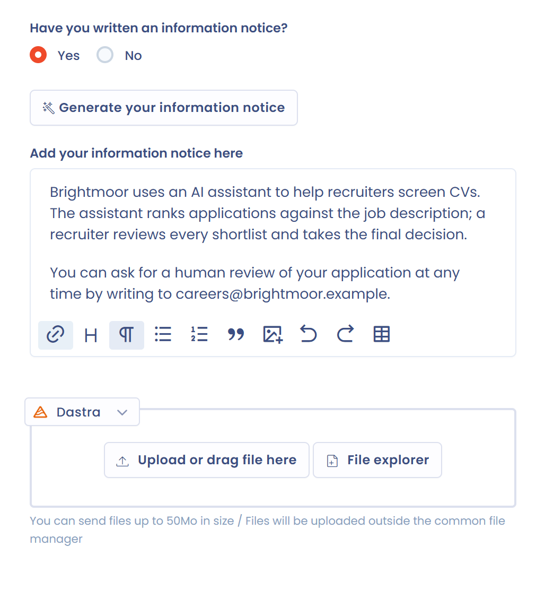

# Transparency notice

A transparency notice (or information notice) explains to data subjects and users how an AI system works and how it is used. The AI Act sets transparency obligations according to the risk level of the system: see [Risk analysis and business value](risk-analysis.md).

In Dastra, you enter the notice on the **Documentation** step of the AI system's record.

## Enter the notice

On the **Documentation** step:

1. Answer **Yes** or **No** to the question **Have you written an information notice?**
2. Write the notice in the editor, below the **Generate your information notice** button. You can type it directly or paste it from another document.
3. Add the documents linked to the system in the attachments area: the notice as a PDF or Word file, technical guides, compliance assessments.
4. Save the record.

<figure><figcaption>
The Documentation step of an AI system
</figcaption></figure>

## Generate the notice with the AI assistant

The AI assistant drafts a notice from the information in the record. The feature is available if your plan includes the matching AI features and you have the right to edit the system.

1. Click **Generate your information notice** on the **Documentation** step. You can also open the menu of the **Save changes** button and click **Generate information notice**.
2. In the **Select a quick instruction** list, choose the form of the notice: **Standard**, **Long version**, **Compact**, **Simple** or **Custom**. With **Custom**, enter your instructions in the **Give custom instructions to the model** field (300 characters at most).
3. Choose the **Notice language**.
4. Click **Generate**, then review the suggested notice.

<figure><figcaption>
The notice generation window
</figcaption></figure>

The generated notice is not saved in the record. It stays in the window until you close it: export it to keep it. The generated content is a suggestion, so review and complete it before you use it.

## Export the notice

In the generation window, click **Export** and choose the format: PDF, HTML, Word or Markdown. The **Add this file to the attachments of this AI system** option, enabled by default, adds the exported file to the attachments of the **Documentation** step. Each export creates a new attachment. The option does not appear if you do not have the right to edit the AI system.

<figure><figcaption>
Adding the exported notice to the attachments of the AI system
</figcaption></figure>

To export the notice you typed in the editor of the **Documentation** step, open the menu of the **Save changes** button and click **Export information notice**. This action appears when the record contains a saved notice. The file is downloaded without being added to the attachments.
