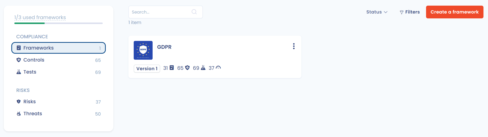

# Frameworks

The **Frameworks** page of the Library is the entry point to the compliance approach in Dastra.\
A framework represents a **structured compliance framework** (e.g. GDPR, E-Privacy, AI Act), bringing together requirements, controls, risks and threats.\
These frameworks serve as a **common foundation** for building your compliance projects, harmonizing your practices and ensuring full traceability between regulatory obligations, operational controls and risk management.

***

## 1. Side navigation of the compliance library

<figure><figcaption></figcaption></figure>

The side menu groups the objects of the library in two groups, with the number of items of each entry:

* **Compliance** group:
  * **Frameworks**: compliance frameworks (central library). The chapters and requirements that structure a framework are viewed in the framework page
  * **Controls**: the central element linking requirements, tests and risks
  * **Tests**: verifications that demonstrate the effectiveness of a control
* **Risks** group:
  * **Risks**: supports for risk assessment and monitoring
  * **Threats**: events or scenarios that may materialize a risk

At the bottom of the menu, the **used frameworks** gauge shows your consumption of framework credits.

***

## 2. List of frameworks

The central area displays the list of frameworks available in your environment:

* Frameworks created by your organization
* Frameworks imported from the Dastra library
* Number of frameworks in your quota (note that the quota is shared at the account level, not the workspace level)
* Filters by status (draft, published, etc.)

* Number of the current version of each framework and, for a framework created from a template, the **Update available** badge when a newer version of the source referential exists (see [Framework versions](versions.md))

When no framework is present, Dastra directly offers:

* [**Import a framework**](import.md)
* [**Create a framework**](custom.md)


Remember that the quota is shared across the entire organization, not per workspace. Keep an eye on your usage to avoid hitting the limits. The versions of a framework are not counted separately: creating or importing a version does not consume a framework credit.

