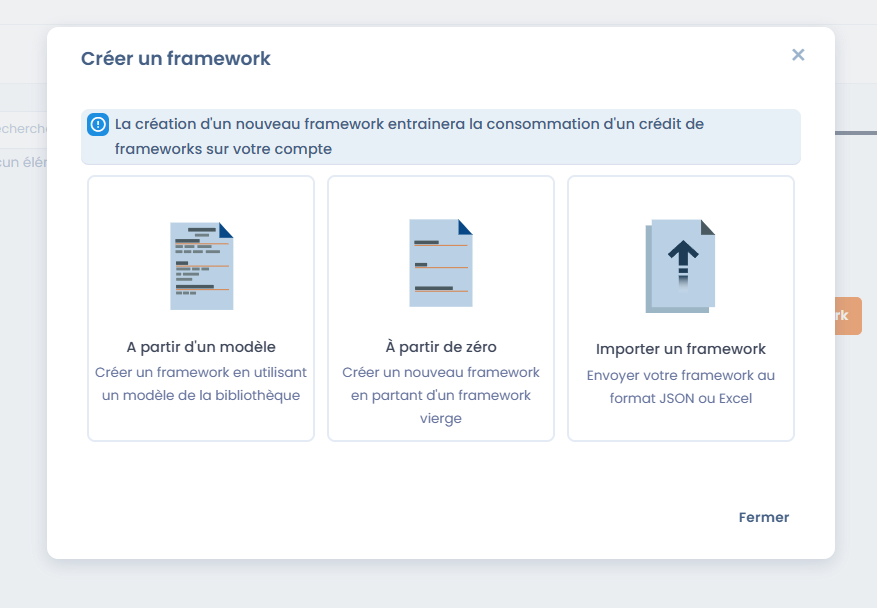

# Dastra import and templates

In **Compliance** > **Library** > **Frameworks**, click **Create a framework**. The dialog offers three methods:



* **Built-in template**: start from a template of the Dastra library (see below)
* **Personalized**: create a blank framework (see [Create a custom framework](custom.md)). This method depends on your plan
* **Import a framework**: send a JSON or Excel file (see below)

From the same page, you can also view the **details of an existing framework**.







***

## Create a framework from a template

### Benefits of starting from a template

Importing a framework from a template makes it possible to **save time** and to rely on a framework that is already structured and compliant with regulatory or sector-specific best practices.

The templates offered by Dastra include:

* The structure of the chapters
* The associated requirements
* The controls
* The related risks and threats

They can then be **customized** to fit your context.

***

### Steps to import a template



* Click on **Create a framework**
* Select **Built-in template**
* Access the Dastra template library
* Search a template by name, then set:
  * the **Choose the library source** filter (**Dastra default library** by default)
  * the language
  * the display mode of the results
* Select the desired template
* View the **framework details**:
  * Number of requirements
  * Controls
  * Risks
  * Threats
  * Functional description
* Confirm the import\
  → The framework is added to your Library and becomes **editable**.



<figure><figcaption></figcaption></figure>

<figure><figcaption></figcaption></figure>




Creating a new framework consumes a **framework credit** on your account. When the quota is reached, you can still view the details of a template, but you cannot import it until you free up space or increase your quota.


Later versions of the framework (created, imported or generated by an update from the source referential) do not consume an additional credit.

***

## Import a framework from a file

You can import a framework that you prepared or exported from Dastra. This method requires the import right on the library and an available framework credit.

1. Click **Create a framework**, then **Import a framework**. If the library is empty, the **Import a framework** button is also offered directly.
2. Choose the format:
   * **JSON**: import your framework in .json;
   * **Complex excel workbook**: import your framework using an excel workbook composed of several sheets.
3. For the Excel workbook, click **Download the file template** to get the model workbook, which the import uses to recognize the data. Turn on **Use native column names or reports (recommended for importing data)** if your file uses the native column names.
4. Send your file (one at a time).
5. Dastra first shows a simulation: no data is modified. The table indicates, for each item, whether it will be **Created**, **Updated**, **Ignored** or **Simulated**, with the totals. Check it, then click **Validate** to run the final import.

The import creates the framework and all the items it contains in your library.

<figure><figcaption></figcaption></figure>

***

## Result after import



<figure><figcaption></figcaption></figure>



You will then be able to check the elements before creation.

All the objects contained in your framework will be created in your library.



Once imported, the framework:

* Is available in the library
* Can be enriched or adapted
* Serves as a basis for:
  * **Compliance projects**
  * The assessment of controls
  * Risk management

***

## Updating from the source referential

When a newer version of the original template is available, the framework card displays the **Update available** badge and the framework page displays the banner _A newer version of the source referential is available_ with the **update** link.

This link opens a preview of the changes (controls, tests, risk scenarios and threats). Once you validate, a published version of the framework is created from the source and becomes the current version; earlier versions and the projects that use them are not changed. See [Framework versions](versions.md).

