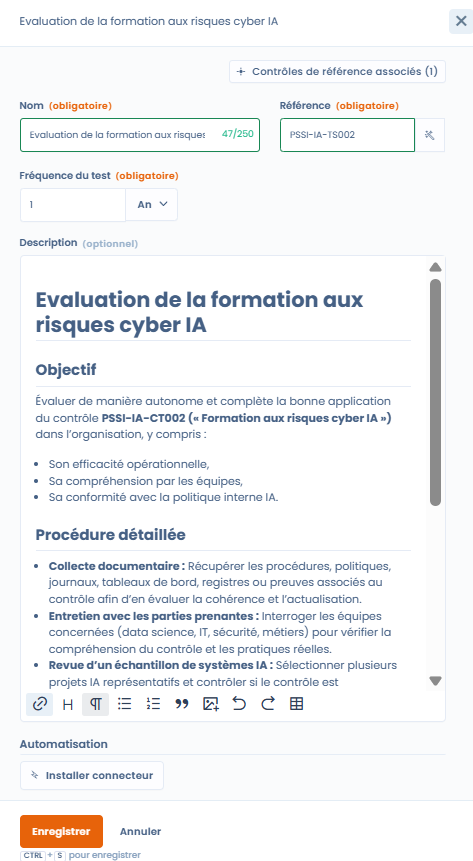

# Tests

A test defines **how** and **how often** a control is evaluated, and which evidence that evaluation relies on.

Tests are the operational link between:

* the **controls** (measures implemented),
* the **evidence** collected,
* and the **compliance results** observed over time.

***

## The role of tests in Dastra

A test answers one question:

> _Is the control actually applied and effective?_

Each test is:

* associated with a **reference control**
* run according to a **defined frequency**
* used in **compliance projects** to produce usable evidence and results

***

## Test library view

<figure><figcaption></figcaption></figure>

The test library offers a cross-cutting view of all available tests, including in particular:

* their type (manual or automated),
* the creation date,
* the associated controls,
* advanced filters (framework, type, requirements, orphaned tests).

This view makes it possible:

* to identify tests reused in several contexts,
* to detect unattached tests,
* to industrialize verification methods.

***

## Manual tests (default)

By default, a test is **manual**.

A manual test relies on a **human action**, for example:

* documentary review,
* interview with teams,
* verification of a register,
* one-off audit of a process.

### How it works within a compliance project

When a manual test is added to a project:

* it requires a **regular update of the evidence**
* according to the **frequency defined** in the test (monthly, quarterly, annual, etc.)

This ensures **living** compliance that is kept up to date over time.

***

## Configuring a test



When creating or editing a test, the user defines:

* **the name and reference of the test** (with reference generator)
* **the frequency of the test**
* **the detailed description**, including:
  * the objective of the test
  * the procedure to follow
  * the expected evidence



<figure><figcaption></figcaption></figure>



This information serves as an operational guide when running the test within a project.

### Test window in a project

In a project, a test opens in a window with tabs:

* **Test details**: label, **Test owner**, status, **Test procedure**, **Test frequency** and evidence;
* **Related controls**: the controls verified by the test;
* **Test issues**: the issues reported by auditors on this test (see [Audits](../projects/audits.md));
* **Context**: the project, frameworks and scope the test belongs to.

***

## Automated tests with Dastra connectors

Dastra offers ready-to-use connectors (questionnaires, registers, policies, etc.), as well as a generic HTTP request connector. These connectors, also called automatic evidence collectors, are used directly in the **automated tests** of the Compliance module.

<figure><figcaption></figcaption></figure>

In addition to manual tests, Dastra makes it possible to configure **automated tests** using **connectors**.

An automated test relies on a Dastra connector to:

* directly query elements of the workspace
* automatically collect evidence
* verify compliance according to defined criteria

### Install a connector on a test

1. Open a manual test and click **Add connector**.
2. In **Choose an automatic evidence collector to install**, select the connector.
3. Set the **Test frequency** (in days, months or years) and configure the default values of the connector.
4. Click **Validate**. The collection of evidence starts immediately with this configuration.

Then click **Execute** to run the collection again on demand. Each execution is saved as evidence of the test. If the configuration of a connector is invalid, automatic collection stays disabled until you fix it.

### Available connectors

| Connector | Collects |
| --- | --- |
| **Collect audits** | The questionnaires of the workspace, according to criteria. |
| **Collect a contract or policy** | A contract or policy, for example to verify its presence and update. |
| **Collect the register of actors** | The stakeholders (third parties) of the workspace. |
| **Collect the AI systems registry** | The register of AI systems, for example to verify their documentation. |
| **Collect the asset register** | The assets of the workspace. |
| **Collect data breach** | The incidents of the workspace. |
| **Collects data processing** | The processing activities of the register. |
| **HTTP Request** | The result of a request to any API or endpoint (see below). |

Example: an automated test can verify that each AI system has compliant and up-to-date documentation, without any manual intervention.

## Adding a custom connector

In addition to the standard connectors, Dastra makes it possible to create **custom connectors** in order to automate the collection of evidence in compliance tests.

A custom connector makes it possible:

* to run a technical query (e.g. an HTTP request),
* to query an internal or external source,
* to automatically collect factual elements,
* to produce evidence that can be used in audits.

The connector thus becomes a **recurring and traceable source of evidence**.

### HTTP request

The **HTTP Request** connector makes it possible to query any exposed API or endpoint.

It is particularly suited to:

* querying third-party tools,
* verifying the existence or state of a resource,
* automating technical or documentary controls.

## Configuring the HTTP connector

<figure><figcaption>
The HTTP connector configuration interface with its Auth, Headers, Query parameters and Body tabs
</figcaption></figure>

The HTTP connector configuration interface makes it possible to build a request without knowing the JSON syntax.

| Field | Description |
| --- | --- |
| **URL** | Endpoint to query. Required, in `http://` or `https://` format. |
| **HTTP Method** | `GET` or `POST`. |
| **Auth** tab | Choose the **Authentication**: **None**, **API Key**, **Authorization Token (Bearer)** or **Basic Authentication**. The matching header is added automatically to each request, without entering any JSON. |
| **Headers** tab | Custom headers as key/value pairs, sent in addition to the authentication. |
| **Query parameters** tab | Query parameters as key/value pairs, added to the URL. |
| **Body** tab | **Request body** in JSON format. |

Sensitive fields (API key, token, password) are masked by default; an eye-shaped icon lets you reveal them temporarily. Read-only previews show what will actually be sent: **Headers that will be sent**, **URL that will be called** and **Request body that will be sent**, with sensitive values remaining masked.

### Result of the request

The test passes when the endpoint answers with HTTP code 200. Each execution is saved as evidence in the compliance project, and the test runs again according to the **Test frequency** chosen when the connector was installed. The success criteria cannot be configured.

## Benefits of automated tests

Automated tests make it possible:

* to **continuously collect evidence**
* to reduce the operational workload
* to improve the reliability of controls
* to detect gaps more quickly

They are particularly suited to recurring or structured controls.

***

## Attaching evidence from the file manager

When adding evidence to a test, it is possible to select a file directly from the Dastra **file manager**, without having to re-import it. Click on **File explorer** in the add evidence window.

<figure><figcaption>
The **File explorer** button makes it possible to select evidence already present in the Dastra file manager
</figcaption></figure>

***

## AI analysis of evidence

Dastra can automatically analyze the evidence attached to a test and indicate whether it matches what the procedure expected. This feature is a **decision aid for the auditor**: it never replaces human judgment and neither accepts nor rejects evidence on your behalf.

### How it works

When evidence is added to a test, the AI compares the content of the evidence with the label and the description of the test procedure. The result is shown in the **AI Appreciation** column of the evidence table, as a **colored badge**:

| Appreciation | Meaning |
| --- | --- |
| **Correct** | The evidence matches the procedure. |
| **Likely Correct** | The evidence seems to match, a human check is recommended. |
| **Not Correct** | The evidence does not match the procedure. |
| **Unknown** | The AI cannot conclude. |

Hover over the badge to display the **Document** (summary of the analyzed document), the **Analysis confidence** (from 0 to 100%) and the **Details** that justify the appreciation.

### Supported evidence types

The analysis adapts to the type of evidence provided:

| Evidence type | Analysis method |
| --- | --- |
| Image (screenshot, JPEG, PNG, etc.) | Visual analysis of the content by a vision model |
| Document (PDF, Word) | Text extraction, then analysis of the text |

The tooltip of the **AI Appreciation** column header recalls this method.

### Activation and settings

The feature is optional and disabled by default. To enable it, go to **Settings** > **Compliance** and turn on the **AI evidence auto-scan** option.


As long as the feature is not enabled, **no evidence data is sent to the AI model**.


To disable the analysis, click **I want to disable this analysis** in the tooltip of a result: the link leads to the compliance settings. The AI model used can be configured according to your organization's choice, through the AI assistant settings (model family or Custom AI provider).

### What the analysis does not do

* It **neither accepts nor rejects** evidence automatically: the final decision always belongs to the auditor.
* It does not change the status of the test.
* It is non-binding: an **Unknown** or **Likely Correct** appreciation signals that a human check is recommended.

***

## Merging tests

Just as with controls, the test library can accumulate redundant tests, particularly after importing several frameworks. The **test merge** feature makes it possible to consolidate these duplicates into a single reference test.

### How the merge works

From the test library, select the tests to merge, then click **Merge**. Choose the **reference version**, that is, the test to keep: the associations of the other tests (linked controls, execution results, frequency) are carried over to it, and then the other tests are deleted. In the comparison table, tick the fields to carry over in the **Keep selected fields** columns.


The merge is irreversible. Check the associations of each source test before confirming.


### Typical use cases

* **Deduplication**: two framework imports have created a duplicate "Privacy policy verification" test: the merge consolidates them.
* **Rationalization**: several very similar manual tests can be grouped into a single, more complete test.
* **Cleanup before an audit**: reducing the number of orphaned tests improves the readability of the dashboard.

***

## Linking a test to a document

A compliance test can be associated with one or more **documents from the Dastra file manager** (contracts, policies, documentary evidence, subprocessing agreements). This link lets you find the tests associated with each document, and vice versa.

### From a document view

When a test is linked to a document, a **Tests** panel appears in the editing view of the document or contract concerned, displaying the reference, name and status of each associated test.

<figure><figcaption>
A linked test appears in the Tests panel to the right of the document (here: G-T2 Lawful Basis Spot Check, Done / Pass)
</figcaption></figure>

### From the file manager

In the file manager, the detail sheet of a document displays, in the side column, all the Dastra entities to which it is attached: processing activities, contracts, and compliance tests.

<figure><figcaption>
The file manager displays the tests associated with each document in the detail column
</figcaption></figure>

This two-way traceability lets you audit which tests rely on which document, and to find all documentary evidence from the file manager.

***

## Complementarity of the approaches

Dastra makes it possible to combine:

* **manual tests** for controls that require analysis or human judgment
* **automated tests** for objective and repetitive verifications

This complementarity offers a balance between rigor, efficiency and pragmatism.
